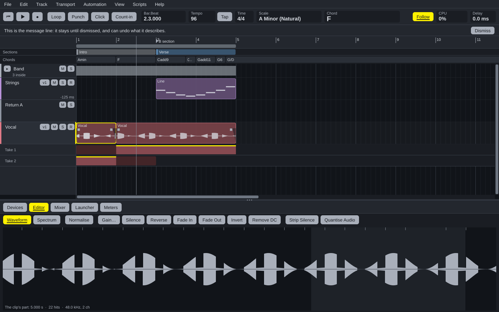
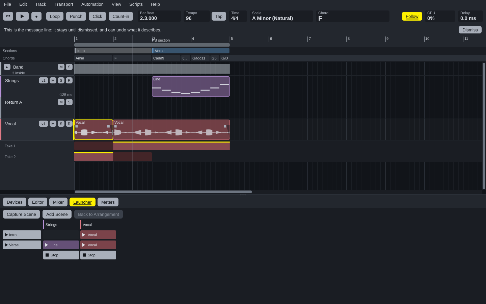

# Kalibre

A DAW for Apple silicon Macs, made to be exactly right for one musician, and
so maybe for others. Everything happens in one window: the plug-ins you use
sit side by side under your tracks, their own windows inside Kalibre's, and
grow and shrink with it.


## What's in it

- **AU, VST3 and CLAP** plug-ins, hosted side by side, with **plug-in delay
  compensation** so they stay in time; switch one **off** and it's unloaded
  from memory with its settings kept.
- **Audio and MIDI on the same track.** Folders inside folders that sum their
  tracks and take plug-ins of their own. Returns and sends.
- **Track versions**: right-click a track, New Version; every version keeps
  its own clips.
- **MIDI effects** (Scaler, arpeggiators, sequencers) always run before the
  instrument.
- **The scale and the chord** at the top of the window; the scale shaded in
  the piano roll, a chord lane along the timeline.
- **Five ways to write notes**: the piano roll (click to add, right-click to
  remove, drag to move or stretch, right-drag to clear an area, Shift-drag to
  choose), a drum grid, a step sequencer, a Euclidean sequencer, notation.
- **Tempo and time signature** that change and ramp along the song.
- **Modulators**: LFO, ADSR and ADR, envelope follower, and wavetables drawn
  or read from a sample.
- **Automation that picks up the last thing you touched.**
- **The X/Y morph**: four plug-ins or four samples, one in each corner.
- **Track delay** (-125 ms to pull slow strings into time) and **articulation
  maps** with a delay for each articulation.
- **Capture**: it's always listening, so the idea you played before pressing
  Record can still be kept, MIDI or audio.
- **Warping**: repitch, granular or spectral, from the loop's tempo or warp
  markers. **Offline effects** on single clips.
- **ARA** plug-ins like Melodyne read the track's audio clips directly.
- **Takes and comping**: every pass of a loop is a take; drag across a take
  to use it there. **Crossfades** wherever audio overlaps.
- **Sidechains** from any track into a plug-in. **MIDI learn** for any knob.
- **Loudness meters** (LUFS, true peak, range) and export at -14 LUFS.
- **Sync**: MIDI clock and timecode out, clock and timecode in, Machine
  Control, Ableton Link, the Mac's network MIDI.
- **Control surfaces**: Mackie Control (X-Touch, FaderPort...), HUI and OSC.
- **Audio tools**: normalise, strip silence, quantise audio to the grid, a
  sample editor with a spectrogram.
- **Sections** you move and duplicate whole, ripple editing, linked clips,
  track groups, and a **clip launcher** for playing ideas in loops.
- **Kalibre Synth and Sampler**, **presets** and **A/B** for every plug-in,
  hardware inserts, instruments' extra outputs on their own tracks,
  **surround** up to 7.1, **MPE**.
- **Meters**: peak and RMS, spectrum, oscilloscope, phase scope, a tuner;
  CPU for each track.
- **Files**: templates, collect and save, relink, archives, MP3 with the
  song's details, several exports at once, Final Cut XML; a **video** track.
- **Every key changeable**, and saved **workspaces**.
- **Lua scripts**, as in REAPER.
- Menus in the Mac's menu bar; the house colours; Apple's guidelines.






What's done and what isn't, feature by feature: **[docs/FEATURES.md](docs/FEATURES.md)**.
**ARA** (Melodyne) is built in; it, the plug-in windows and the menus still need trying on a Mac.

## Get it

Every push is built for Apple silicon by GitHub Actions: open the latest
**Build** run under the repository's **Actions** tab and download
**Kalibre-macOS**. Open the `.dmg`, drag Kalibre into Applications, and the
first time right-click it and choose **Open**. Then **Kalibre > Scan for
Plug-ins**.

Or build it on your Mac: double-click `build-mac.command` (needs Xcode's
Command Line Tools and CMake).

## For developers

```sh
cmake -B build-core -G Ninja -DKALIBRE_BUILD_APP=OFF && cmake --build build-core && ./build-core/KalibreTests
cmake -B build -G Ninja -DCMAKE_BUILD_TYPE=Debug && cmake --build build
```

[docs/ARCHITECTURE.md](docs/ARCHITECTURE.md) is the map;
[docs/decisions/](docs/decisions/README.md) the reasons;
[docs/SCRIPTING.md](docs/SCRIPTING.md) the script API.

Licence: AGPLv3, as JUCE's open-source licence is.
