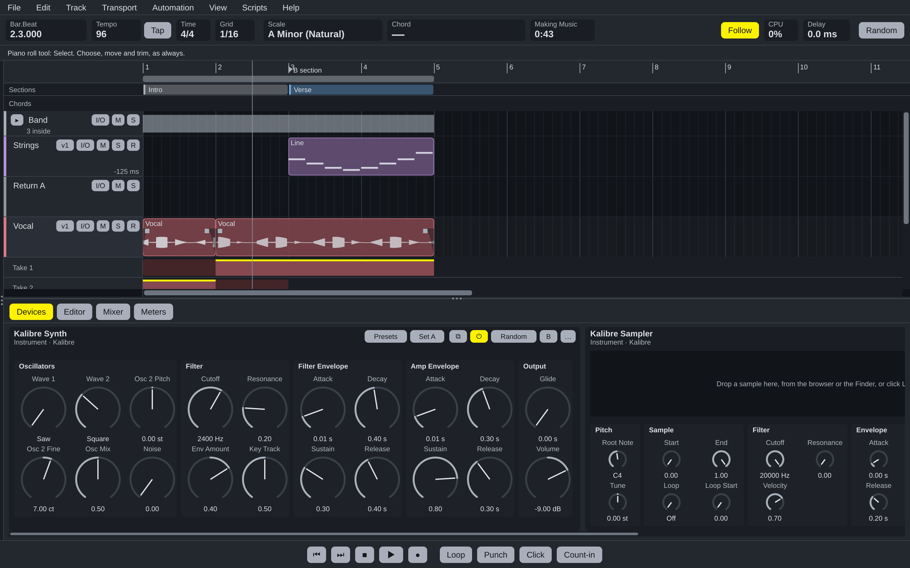
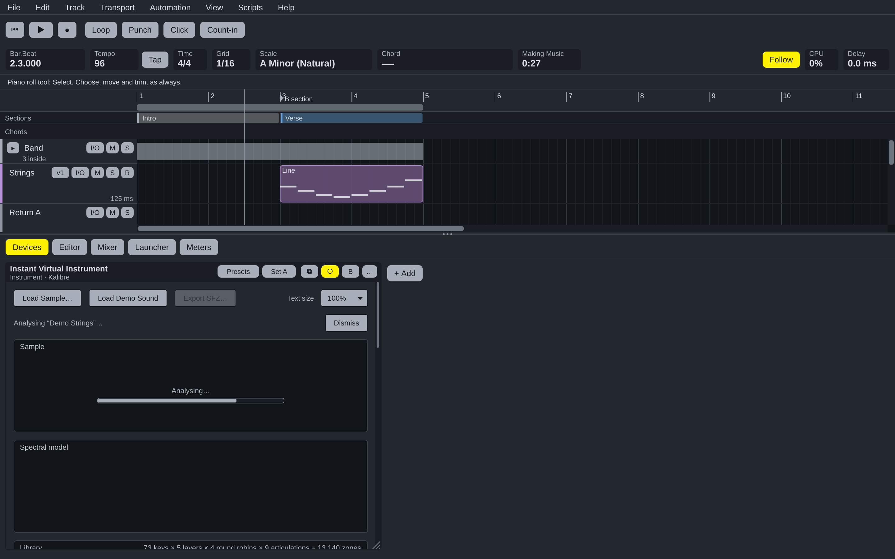
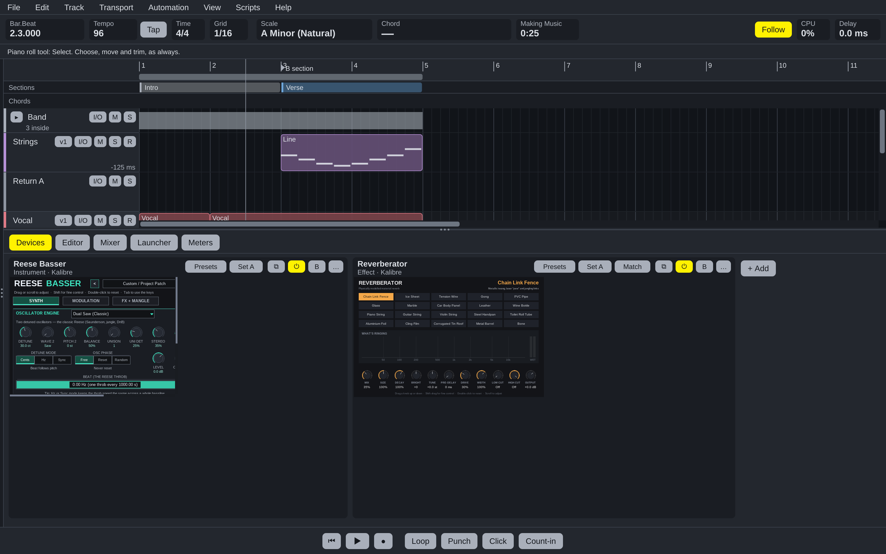
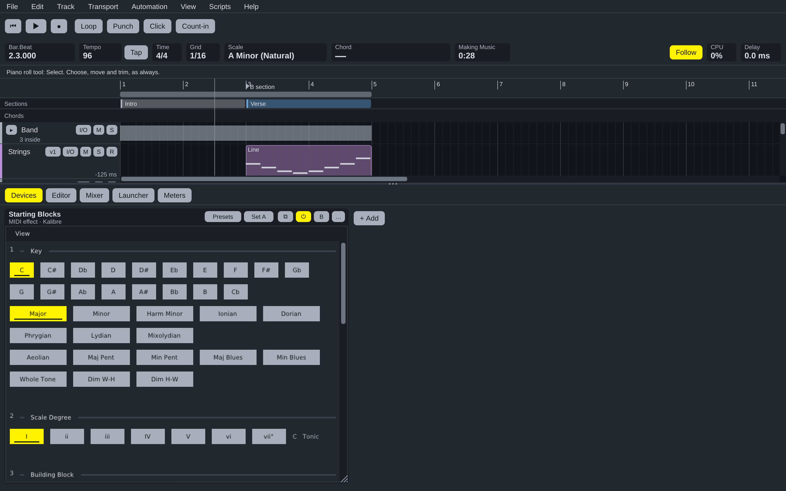
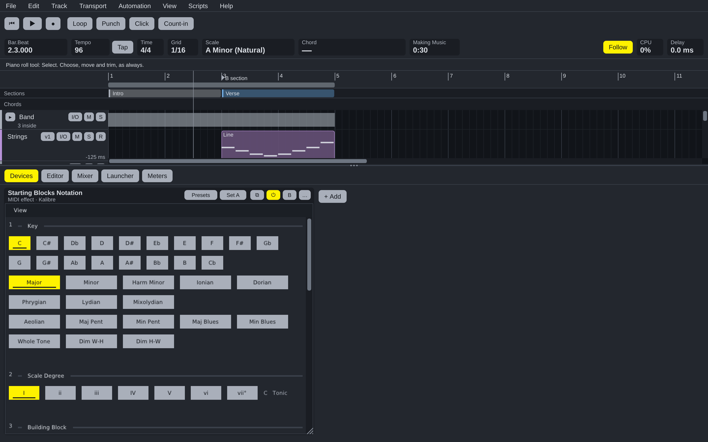
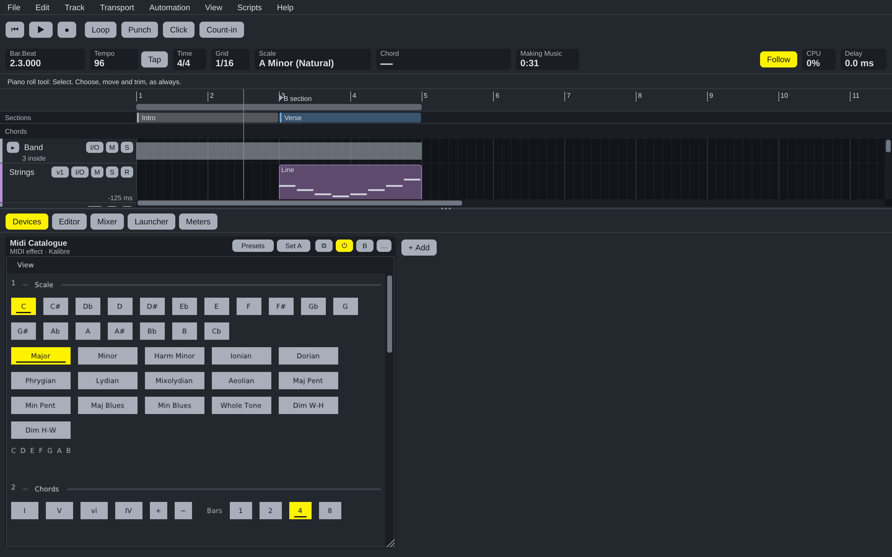
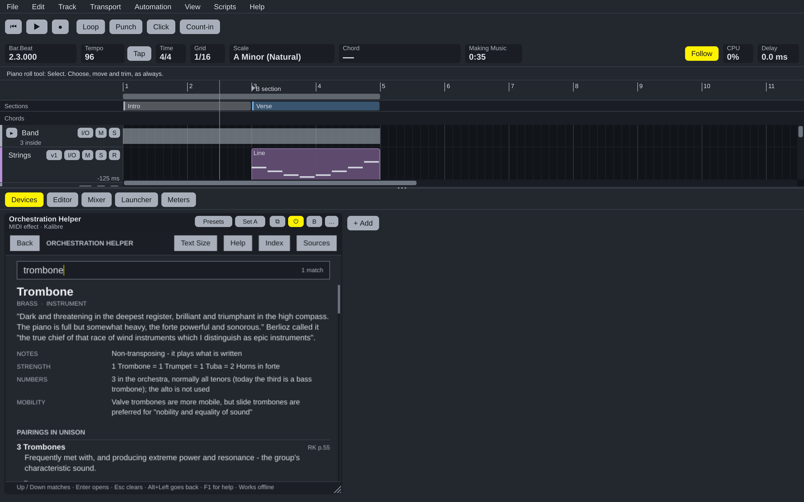

# Kalibre's Own Devices

Every device under **+ Add > Kalibre**, in detail: what it is, where it goes
in a track, every control, and how what it makes gets into your song.

Most of these come from the family's own projects (KallumS on GitHub), built
into Kalibre unchanged: the same code, the same sound, the same window. Where
a device was made for REAPER, this manual says what's different in Kalibre.
Each section ends with what has been tried and what hasn't.

> **Where a device goes.** Kalibre plays a track's devices in this order: MIDI
> effects, then the instrument, then audio effects. A MIDI effect (Midi
> Evolver, Midular, Good Idea, ScaleView…) changes or makes notes for the
> instrument after it, so the track needs an instrument too.

**Contents**

| Instruments | Audio effects | MIDI effects | Ideas and reference |
| --- | --- | --- | --- |
| [Kalibre Synth](#kalibre-synth) | [Reverberator](#reverberator) | [Midi Evolver](#midi-evolver) | [Good Idea](#good-idea) |
| [Kalibre Sampler](#kalibre-sampler) | [Transient Shuffler](#transient-shuffler) | [Midular](#midular) | [Starting Blocks](#starting-blocks) |
| [Trombolese](#trombolese) | [Container](#container) | [MIDI Production Center](#midi-production-center) | [Starting Blocks Notation](#starting-blocks-notation) |
| [Reese Basser](#reese-basser) | [Hardware Insert](#hardware-insert) | [Note Splitter](#note-splitter) | [Midi Catalogue](#midi-catalogue) |
| [Instrument Creator](#instrument-creator) | [X/Y Morph (effect)](#xy-morph) | [ScaleView](#scaleview) | [Orchestration Helper](#orchestration-helper) |
| [Instant Virtual Instrument](#instant-virtual-instrument) | | | |
| [X/Y Morph (instrument)](#xy-morph) | | | |

**Every device** has the rack's own buttons (⏻ off, B bypass, Set A/B,
Presets, ⧉ its own window, … its menu: [User Guide, Section 8](USER-GUIDE.md#8-plug-ins-and-devices)),
and **every one of its controls is a parameter**: it can be automated,
modulated, MIDI-learned, and becomes the last touched control when you move
it. Its settings are saved with the song.

---

## Instruments

### Kalibre Synth

A plain, dependable subtractive synth: two oscillators and noise through a
resonant low-pass filter. Up to 16 notes at once.

| Section | Control | Does |
| --- | --- | --- |
| Oscillators | **Wave 1**, **Wave 2** | Saw, Square, Triangle or Sine. |
| | **Osc 2 Pitch** | Oscillator 2 up or down, -24 to +24 semitones. |
| | **Osc 2 Fine** | ±50 cents (7 to start, for a little width). |
| | **Osc Mix** | Between oscillator 1 and 2. |
| | **Noise** | White noise mixed in. |
| Filter | **Cutoff** | 30 Hz to 18 kHz. |
| | **Resonance** | The peak at the cutoff. |
| | **Env Amount** | How far the filter envelope moves the cutoff (negative closes it). |
| | **Key Track** | Higher notes open the filter more. |
| Filter Envelope | **Attack, Decay, Sustain, Release** | The cutoff's movement for each note. |
| Amp Envelope | **Attack, Decay, Sustain, Release** | The volume of each note. |
| Output | **Glide** | Notes slide into each other. |
| | **Volume** | -48 to +6 dB. |

The mod wheel adds vibrato.

### Kalibre Sampler

One sample played across the keyboard. **Drop an audio file onto its panel**
to load it. Up to 32 notes at once.

| Section | Control | Does |
| --- | --- | --- |
| Pitch | **Root Note** | The key the sample plays at its own pitch (60 is middle C). |
| | **Tune** | ±24 semitones, in hundredths. |
| Sample | **Start**, **End** | Which part of the file plays. |
| | **Loop**, **Loop Start** | Loops from Loop Start to End while the key is held. |
| Filter | **Cutoff**, **Resonance** | A low-pass filter. |
| | **Velocity** | How much harder playing is louder. |
| Envelope | **Attack, Decay, Sustain, Release** | |
| | **Volume** | |

*Tried: both play a track's notes in the tests.*

### Trombolese

A physical model of an instrument that doesn't exist: a trombone crossed with
an oboe. Its body (the bore) can change shape **while it plays**, from a
cylinder to a cone, which changes not only its tone but which notes it can
sound: a cylinder rings on the odd harmonics (1, 3, 5, 7: clarinet-like,
hollow), a cone on all of them (1, 2, 3, 4: oboe- and sax-like, full).
Nothing made of brass can do that. Kalibre's Trombolese is a port of the
Trombolese project's Python model, checked against it sample for sample.

It plays **one note at a time**. A note played while another is held
**slides** to it, as a trombone's slide does. Notes 34 to 84 (B♭1 to C6) are
in tune to within 32 cents; notes the bore can't sound play an octave up.

| Control | Does |
| --- | --- |
| **Bore (Cylinder to Cone)** | The body's shape. 0: a cylinder, odd harmonics, darker and hollow. 1: a cone, every harmonic, fuller and brighter. The pitch stays put as it moves. The **mod wheel** adds to it, so you can sweep it as you play. |
| **Reed (Lips to Double Reed)** | What sets the air moving: 0, a brass player's lips; 1, an oboe's double reed. |
| **Breath** | How hard it's blown, 2500 to 6000 Pa. More is louder and brassier. |
| **Attack**, **Release** | How quickly a note speaks and stops. |
| **Slide Time** | How long the slide takes from one note to the next. |
| **Volume** | |

**Pitch bend** moves the slide two semitones either way.

*Tried: its notes, its slides and that it stays finite, in the tests. Its
sound hasn't been heard on your Mac yet.*

### Reese Basser

An instrument that only makes **Reese basses**: two or more slightly detuned,
harmonically rich oscillators whose phases drift in and out, so the sound
throbs. It's one note at a time (the last note held wins; let go and the one
before returns). Its own window has three pages, chosen with the tabs under
its title: **Synth**, **Modulation** and **FX + Mangle**.

**The beat.** The throb is the main control. **Detune mode**:

| Mode | What Detune means | Use it for |
| --- | --- | --- |
| **Cents** | Classic detune: higher notes throb faster. | The traditional sound. |
| **Hz** | The two oscillators an exact number of Hz apart: every note throbs at the same rate. | Even movement across a bassline. |
| **Sync** | The throb is a note value (1/4, 1/8T, 2 bars…), locked to the song. | Throb that grooves with the drums. |

The **Beat** meter shows the throb's rate, and **Beat Phase** can move
anything in time with it.

**Engines** (eight ways to make a Reese, each with three controls A, B, C;
choosing one sets them to good starting values, and double-clicking A, B or C
resets it):

| Engine | Method | A / B / C |
| --- | --- | --- |
| **Dual Saw (Classic)** | Two detuned oscillators, the jungle/drum-and-bass standard. | Wave 2 / Pitch 2 / Balance |
| **Supersaw Unison** | 3 to 16 stacked saws. | Voices / Curve / Side mix |
| **PWM** | Pulse width swept at the beat rate. | PWM depth / Width / Osc 2 |
| **Phase Distortion (CZ)** | Casio CZ-style, where the original 1988 bass came from. | DCW / Wave / Line 1′ |
| **FM Cross-Mod** | Detuned carriers modulated by a sine. | Index / Ratio / Feedback |
| **Hard Sync** | Two detuned master/slave pairs: aggressive, vocal. | Sync ratio / Slave wave / Master mix |
| **Phaser (Filter Reese)** | One saw through a phaser swept at the beat rate. | Depth / Feedback / Stages |
| **Cross-Fold** | A sine through a wavefolder moved by its detuned twin. | Fold / X-mod / Symmetry |

Shared: **Unison** (1-8 copies) and **Uni Det**, **Stereo**, **Drift** (slow
analogue wander), **Level**, **Octave**, **Osc Phase** (Free, Reset, Random).

**The sound's path**: engine (oversampled 1x, 2x or 4x) → noise → filter
(LP 24 ladder, LP 12, band-pass, high-pass, notch; Drive, Key, Env) →
distortion (Tape, Tube, Hard Clip, Wavefold, Rectify, Pedal OD; before or
after the filter) → **Mangle** (Formant vowels, Ring Mod, Freq Shift, Crush) →
**Movement** (tempo-synced Notch Sweep, Phaser or Flanger) → **Squash**
(three-band compression) → chorus, **Width**, **Mono <** (everything below it
in mono, 120 Hz to start) → a clean **Sub** oscillator underneath (with **Low
Cut** on the Reese above it) → output.

**Modulation page**: amp and mod envelopes, two LFOs (7 shapes, free or
synced), and a 6-slot matrix from LFO 1 and 2, the envelopes, velocity, mod
wheel, aftertouch, key, note random or Beat Phase, to 24 destinations.

**Playing**: **Legato** (envelopes don't restart on overlapping notes) or
**Retrig**; **Glide**; pitch bend range; velocity sensitivity; sustain pedal.

**Presets**: 20 in the box at the top (◀ ▶ step through them): Init, Saunderson
'88 (CZ), Terrorist Jungle, Mutant Techstep, Neuro Double Notch, Liquid
Roller, Garage PWM, FM Growl, Sync Scream, Filter-Method Reese, Cross-Fold
Mod, Yoi Talker, Tempo-Locked Throb, Barberpole Shift, Bitcrushed Sampler,
Burial Rumble, Wide Unison Wall, Hoover Reese, Ring-Mod Metal, Talking
Flanger. **Mutate** randomises a section (or everything) within musical
ranges; **Nudge** makes small changes.

**In its window**: drag a knob up or down, Shift-drag for fine, double-click
to reset, scroll to step. Tab moves between controls, arrows turn them,
Delete resets. **Options**: Interface Size, Fit Interface to Window, Reduce
Motion.

**Recipes**: *classic*: Dual Saw, 20-50 cents, LP 24 at 200-700 Hz, glide
~100 ms, legato. *Mono-safe rumble*: Sub at -1 octave, Low Cut 100-150 Hz,
Mono < 120 Hz, then add Width freely. *Neuro*: Supersaw or Sync → distortion
→ Notch Sweep → Squash, automate Move Freq.

### Instrument Creator

Build instruments that don't exist from parts, and play them: a glass
trumpet, a violin of ice, a marimba of marble, a jelly gong. Every
instrument is described the way real ones are:

> **energy source → exciter → vibrating element → coupler → resonator → radiator**,
> plus four controls: frequency control, tuning, damping and modulation.

The window draws your instrument whole. **Click a part** (or its label) to
see every choice for it, drawn on your instrument; click one to use it (the
panel stays open so you can play and compare); **Done** closes it. Scroll
over a part to step through choices. Hover over anything for what it does.

| Part | Choices |
| --- | --- |
| **Energy source** | Breath, Bow, Finger, Plectrum, Hammer, Electricity. Steady ones sustain; single pushes swell and fade into sustaining exciters. |
| **Exciter** | Reed, Lips, Hammer, Bow, Plectrum, Mallet. |
| **Vibrating element** | String, Membrane, Bar, Plate, Reed (a tine), Air Column. |
| **Resonator** | Bore, Soundbox, Pipe, Cavity, Body. |
| **Coupler** | Bridge, Soundpost, Mouthpiece, Windway (a flute's air jet). |
| **Radiator** | Bell, Soundboard, Drumhead, Cone (a loudspeaker). |
| **Frequency control** | Fret, Tone Hole, Valve, Slide (glides; pitch bend 7 semitones), Key. |
| **Tuning** | Peg (drifts), Tuning Pin (stretched octaves), Machine Head (exact), Slide (settles into tune). |
| **Damping** | Damper, Mute, Palm, Felt, Hand. |
| **Modulation** | Keywork, Pedals, Valves, Levers, Electronics: what the mod wheel does. |

**Materials** (31, for the element and for the resonator, coupler and
radiator, which share one): metals (Steel, Brass, Bronze, Aluminium, Gold,
Tin, Car Panel, Chain Link, Handpan Steel, Foil), glass and stone (Glass,
Crystal, Ice, Marble, Clay), woods (Wood, Spruce, Rosewood, Bamboo),
plastics (Plastic, PVC, Nylon, Carbon Fibre, Cling Film), soft and natural
(Bone, Gut, Leather, Rubber, Paper, Cardboard, Jelly). Some misbehave when
played hard, as the real things do: tin and chain link rattle, a car panel
clanks, cling film buzzes, foil crackles.

| Control | Does |
| --- | --- |
| **Force / Pressure** | How hard it's blown, bowed or struck. |
| **Size** | The resonator, coupler and radiator: bigger is lower and boomier. |
| **Brightness**, **Decay** | How long the highs, and everything, ring. |
| **Excite Position** | Near the end (thin) or the middle (round). |
| **Resonator Amount** | How much body against the bare element. |
| **Age / Rust** | From new to found in a skip: duller, uneven, out of tune, rattly, leaky. The drawing rusts too. |
| **More**: Play Mode, Glide Time, Fine Tune, Output | Poly, or Mono (legato, so frets, holes, valves and slides act as on the real thing). |

**Presets** (19): Bamboo Saxophone, Ice Violin, Marble Marimba, Glass
Trumpet, Crystal Music Box, Rubber Tuba, Electric Bone Harp, Clay Drum, Jelly
Gong, Steel Flute, Bowed Ice Bar, Golden Piano, Paper Accordion, Carbon
Trombone, Buzzing Glockenspiel, Bronze Bell Plate, Plastic Recorder, Cling
Film Kazoo, Tin Roof Banjo. **Surprise Me** picks every part at random;
**Play C4** plays a note.

MIDI: velocity, pitch bend, mod wheel, breath (CC2), expression (CC11),
aftertouch, sustain (CC64) and soft pedal (CC67). Up to 8 notes.

### Instant Virtual Instrument

**One sample in, a whole instrument out.** Give it a single recorded note (a
cello, a flute, a voice, a synth) and it becomes a playable sampled
instrument: every key in the range you choose, dynamic layers from pp to ff,
round robins so repeated notes differ, and nine articulations, all made from
that one note.

1. **Load Sample…** (or drop a file on its window): one note, ideally 1 to 5
   seconds. **Load Demo Sound** tries it with a built-in tone.
2. It finds the note; if it's the wrong octave, set **Root note**.
3. **Source dynamic**: how loud your recording was played.
4. **Lowest key**, **Highest key**, **Dynamic layers** (1-8), **Round
   robins** (1-8), then play.

| Control | Does |
| --- | --- |
| **Formant** | How much of the body stays put as the pitch moves (75% natural; 0% the sped-up-tape sound). |
| **Layer blend** | Moves smoothly between neighbouring layers. Velocity chooses the layer, or the mod wheel for long notes. |
| **Variation** | How loose the round robins are. **New Takes** plays a fresh set. |

**Articulations**, on keyswitches or its buttons:

| Key | Articulation |
| --- | --- |
| C1 | Sustain |
| C♯1 | Legato |
| D1 | Staccato |
| D♯1 | Spiccato |
| E1 | Marcato |
| F1 | Pizzicato |
| F♯1 | Tremolo |
| G1 | Swell |
| G♯1 | Fortepiano |

The library grid lights up as you play; click a cell to hear it. **Export
SFZ…** writes the whole library out for any SFZ sampler. The sample is kept in
the song. Made for pitched sounds; far from the original note it sounds more
synthetic.

### X/Y Morph

Four corners, **A**, **B**, **C** and **D**, each a plug-in or a sample, mixed
by where the dot sits on the pad. Add it as an instrument (sample or
instrument corners) or as an effect. Click **A…** to **D…** under the pad to
choose each corner. Sample corners play the track's notes, pitched from
middle C. Plug-in corners all run, lined up with the slowest. **X** and **Y**
are parameters: automate them or give them a modulator for movement.

---

## Audio Effects

### Reverberator

A reverb that sends your sound **through odd materials** instead of a room,
the way a plate reverb sends it through steel. Click a material's tile.

| # | Material | What you hear |
| --- | --- | --- |
| 1 | Chain Link Fence | Metallic twang, laser-ish "pew", jangling |
| 2 | Ice Sheet | Falling "pew pew" echoes |
| 3 | Tension Wire | Long droning sci-fi "blaster" chirps |
| 4 | Gong | A huge, dark, shimmering wash |
| 5 | PVC Pipe | Hollow, tubey flutter |
| 6 | Glass | Bright, glassy, long ring |
| 7 | Marble | Short stony "clink", pitched |
| 8 | Car Body Panel | Clanky metallic "bonk" |
| 9 | Leather | Dead, thumpy drum-skin thud |
| 10 | Wine Bottle | Hooty boom at ~110 Hz plus a glass clink |
| 11 | Piano String | A shimmering halo of strings ringing along |
| 12 | Guitar String | Six open strings humming along |
| 13 | Violin String | Nasal, woody sympathetic ring |
| 14 | Steel Handpan | Sweet, tuned, bell-like bloom in D minor |
| 15 | Toilet Roll Tube | Honky, boxy, talking through a tube |
| 16 | Aluminium Foil | Sizzly, crinkly, papery splash |
| 17 | Cling Film | Soft, rubbery, kazoo-like buzz |
| 18 | Corrugated Tin Roof | Rumbling, rattly, tinny |
| 19 | Metal Barrel | Boomy inside-an-oil-drum resonance |
| 20 | Bone | Dry, woody knock with a hollow core |

| Control | Does |
| --- | --- |
| **Mix** | Dry against wet; both full at 50%. |
| **Size** | Bigger is lower and rings longer. |
| **Decay** | Longer or shorter ring, the object unchanged. |
| **Brightness** | Highs ring longer (+) or die faster (−). |
| **Tuning** | Transposes the object, in semitones: for the strings, handpan and bottle. |
| **Pre-Delay** | A gap before the reverb. |
| **Drive** | How hard the material is hit. Above about 30% the fence and roof rattle, foil crackles, cling film buzzes, the gong and barrel shimmer. |
| **Width**, **Low Cut**, **High Cut**, **Output** | On the reverb. |

Changing Material, Size or Tuning rebuilds the object, so the tail starts
again. All 20 are level-matched. **What's ringing** shows the material's
resonances, glowing as they sound.

### Transient Shuffler

Gives one sample the **attack of another**: A's body with B's attack, or the
other way round.

| Control | Does |
| --- | --- |
| **Result** | *A with B's attack* or *B with A's attack* (keys 1 and 2). |
| **Attack length** | How much of the start comes from the attack sample. |
| **Find attack** | Measures where the attack ends and splices there (on to start with). Dragging the splice line turns it off. |
| **Crossfade** | How long the attack blends into the body. |
| **Attack trim** | The borrowed attack up or down. |
| **Snap to zero crossings** | Moves the splice up to 5 ms so it can't click. |
| **Match level** | The borrowed attack's peak matched to the one it replaces. |
| **Align phase** | Shifts the body up to 2.5 ms so the splice adds up. |
| **Hit threshold** | How near its peak a sample must get for its hit to count. |
| **View** | *Attack* zooms in on the splice; *Whole*. |
| **Output** | The level of what plays. |

Play it with the Play buttons, by clicking a waveform, or with MIDI notes
(velocity sets the level). Keys in its window: Space plays the result, A and
B play the samples, Esc stops.

> **In Kalibre, not yet working:** Transient Shuffler is given its samples by
> dropping files onto its window, and Kalibre doesn't pass dropped files to
> it yet, so it can't be loaded. Its **Print** button (which adds the result
> to the song) is REAPER's and does nothing in Kalibre, though its message
> says it printed.

### Container

Up to eight plug-ins in a row, each on a **band** of frequencies, the **mid**
or the **sides**, with **On**, **S** (solo), **Volume** and **Pan**, and
**Match Loudness**. See the [User Guide](USER-GUIDE.md#the-container).

### Hardware Insert

Outboard gear in the chain: the sound goes out of two of your interface's
outputs and comes back from two inputs.

| Control | Does |
| --- | --- |
| **Send to Outputs** | Which outputs. |
| **Return from Inputs** | Which inputs. |
| **Round Trip (samples)** | The gear's delay, measured with **Ping**, so delay compensation lines everything up. |
| **Return Gain** | |

Exports can't use hardware: in an export, the insert passes the sound
through.

---

## MIDI Effects

### Midi Evolver

**Turns a held chord into music that moves.** Hold some keys and the chord
grows: a bass comes in, then a pad whose inner voices drift, then repeated
notes, a looping arpeggio and high sparkling notes, one after another, for as
long as you hold. Let go and it stops; hold again and it's a new variation.
It plays whatever instrument comes after it.

Put it **before** an instrument, and arm the track (or switch its monitoring
on) so your keys reach it. Hold a chord: **Motion** shows the last two bars
(notes sounding now in yellow), and **Energy** where you are on the curve.

| Control | Does |
| --- | --- |
| **Shape** | *Build* grows then keeps evolving; *Swell* grows and falls back, again and again; *Fade* starts full and thins; *Wander* rises and falls unpredictably. |
| **Pace** | How many bars the evolution takes. |
| **Change** | How much the patterns change as they go round. |
| **Start**, **Peak** | How much is going on at once, and how far it grows. |
| **Feel** | How far timing and loudness wander. |
| **Variation** | *New Each Time*, or *Locked* to play one again (its number is shown). |

**The layers**, each on or off with its own **Channel**, **Octave** and
**Level** (so the bass can go to the cellos and the arpeggio to a harp):
**Bass**, **Pad**, **Pulse**, **Arpeggio** (5 to 7 notes against a bar of 4,
so it drifts), **Sparkle**. Every note is one you hold, or a colour tone a
whole tone above one that never clashes.

**MIDI**: *Keys From* (a channel), *Held Keys* (Muted, or Played too),
*Sustain Pedal* (Holds Keys or Ignored), *Dynamics* (also send the energy as
CC1, CC11 or both, for libraries that swell with the mod wheel), *Panic*.

> **In Kalibre:** to keep what it plays, **right-click the track's arm button**
> (arm for MIDI) and record: what Midi Evolver plays is recorded as a MIDI
> clip. Its own **Drag Out…** and **Insert** buttons need a REAPER helper
> script and don't work in Kalibre.

### Midular

A **MIDI sampler**: it treats a MIDI phrase the way a sampler treats audio.
Load a phrase, map it across the keyboard, and shape it with a filter, an
envelope, warping and looping, all on notes. It plays the instrument after it.

**Loading a phrase:** choose a MIDI clip in the arrangement, then the device's
**…** menu > **Load the Chosen MIDI Clip** (Midular's own importer runs
unchanged). Several clips become one phrase; markers inside come along. The
phrase is saved in the song (*In Project*). Click the phrase name in its
header to pick a saved phrase file instead (a demo phrase is there).

| Mode | Behaviour |
| --- | --- |
| **Classic** | Each held key plays the phrase, looping while held; keys transpose. |
| **One-Shot** | One trigger plays it through; Retrigger is Restart, Ignore or Legato. |
| **Slice** | The phrase chopped, a slice a key from *Map Root* up. Cuts by Divisions, Beats, Onsets (with Sensitivity), Pitch Changes or Manual Markers (Command-click its roll to add, right-click to remove). |
| **Granular** | Up to 256 grains reading small windows of the phrase: Grains, Size, Spread (Even, Random, Cloud), Motion, Spray, Direction, Pitch Spread, Density. |

**Note filter** (removes notes, not frequencies): low-pass, high-pass,
band-pass, notch; Cutoff is a note; Slope, Width, Resonance, Key Tracking,
Threshold. **Amp envelope**: ADSR on velocity, with Curve and Amount.
**Warping**: Free, Sync to the song, or Fixed Length; Speed; Start Mode;
Trigger Quantize. **Looping**: Region and Loop start and length, Forward,
Reverse or Ping-Pong, Loop Count, Reverse.

Its tabs: Play, Warp and Loop, Amp and Filter, Slice and Granular. Knobs:
drag, ⌘ for fine, double-click to reset. Enable **MIDI Thru** to pass the
triggering notes on too. The sustain pedal holds its voices and isn't passed
on.

*Untried on your Mac yet.*

### MIDI Production Center

An **MPC-style 16-pad sampler** whose samples are MIDI. Load a phrase, chop
it, put the slices on pads and play them, with effects that work on the notes.

1. **Get a phrase in**: choose a MIDI clip, then its own **Load Item** button
   (or the device's **…** menu > **Load the Chosen MIDI Clip**). Or put MIDI
   on its own track, click **Sample**, play the song and stop: everything that
   arrived is recorded.
2. **Chop it**: *Transient* (with Sensitivity), *Grid*, *Equal* or *Markers*
   (double-click to add, drag to move, right-click to delete).
3. **Transfer to Pads**: fills the bank you're looking at, in order. The
   button lights red when the chops have changed since.
4. **Play the pads**: click them (higher up the pad is louder), play them from
   a keyboard, or write notes: bank A is notes 36-51, then B, C and D upwards.
5. **Shape it** on the PAD and FX pages.

**PAD page**: Slice, Trigger Note (Learn), Play Mode (One Shot, Gate, Loop
Hold, Loop Toggle), Poly, Choke Group, Transpose, Tape Speed, Stretch, Fit To,
Reverse, Send to FX, Level, Velocity Sensitivity, Output Channel. Right-click
a pad to copy, paste, reset, play the whole phrase or empty it. Drag a slice
onto a pad.

**FX page**, in order: **Filter** (removes notes above or below), **EQ**
(velocity by register), **Compressor** (on velocity, pitch or timing),
**Delay** (repeats, in time, each optionally transposed), **Stutter**
(beat-repeat), **Pitch Correction** (to a key and scale).

**Setup page**: Time Mode, Swing, Pitch Axis (Absolute, or Relative to each
pad's range), Thru Other Notes, output channel, level.

**No sound?** Its three lights: **Audio** (running), **In** (MIDI arriving),
**Out** (notes sent). An empty pad shows "-": click Transfer to Pads. An
instrument must come after it on the same track.

*Untried on your Mac yet. Kalibre carries a fix for its pads that's on its
own branch, not yet merged into MIDI Production Center itself.*

### Note Splitter

A chord's notes, top to bottom, each to another track. See the
[User Guide](USER-GUIDE.md#the-note-splitter).

### ScaleView

Shows the **scale** as twelve circles (five above for the black keys, seven
below for the white) with its notes lit, spelt for the key (C♯ major reads
C♯ D♯ E♯ F♯ G♯ A♯ B♯). Notes you play are ringed, and the label names the
**chord you're holding**: `Cmin7`, `Bsus2`, `C/E`, inversions as slash chords,
extensions and alterations named (`C13b9`, `C7b5#9`). It sees every note on
its track, clips included. The sound is unchanged.

| Click | Does |
| --- | --- |
| Click | The scale list: a root under a scale type (16 scales, 18 spelt roots). |
| Right-click | Choose a Random Scale, note names on or off, Simplify Note Names (plain sharps), the highlight colour. |

Put it before the instrument, where the notes are.

---

## Ideas and Reference

These four, and Orchestration Helper, are the family's REAPER scripts, run
unchanged in Kalibre with its own way of putting their music into the song:

| Their button | In Kalibre |
| --- | --- |
| **Insert at Cursor** | The block goes on **the device's own track, at the playhead**, as a MIDI clip; one undo step. |
| **Insert on New Tracks** | A new track per part or instrument, named for it, under the device's track. |
| **Audition** | Plays through the device's MIDI out, so the **instrument after it** sounds it. |
| **Play with the Song** (Good Idea: *Play with REAPER*) | Plays the block over and over while the song plays, lined up with its bars. |
| **Export MIDI File** | A `.mid` file in **Music/(the tool's name)**. |

There's no dragging out: the clip is put in place directly. A few words in
their windows are still REAPER's.

### Good Idea

**Ideas for starting a track.** Press **New Idea** and get a short motif, a
phrase, 8 to 16 bars of melody, chords and bass in your key, or a drum groove
with fills. Nothing is a stored clip: every idea is calculated from the rules
of rhythm, harmony, melody and form, and every idea has a **number**: the same
number with the same settings is always the same idea, so you can write it
down, or change the key and keep the tune.

**Four kinds**: **Motif** (1-4 bar hook), **Phrase** (1-4 bars: Melody,
Chords or Both), **Measure** (8, 12 or 16 bars in a form: Period, Sentence,
Song AABA, Loop, hybrids, Ternary, Extended), **Drums** (1-16 bars of groove
with fills, General MIDI on channel 10).

**The settings** (each a row of buttons; **Any** rolls it afresh each idea;
every step but the first is folded, click its name to open it):

1. **Idea**: kind, bars, content.
2. **Key**: key note and scale (16 scales); **Borrowed** and **Applied**
   chords (Off, Rare, Common).
3. **Feel**: pace (Calm, Flowing, Busy), groove (Straight, Syncopated,
   Tresillo, Habanera, Clave, 3+3+3+3+2+2), figures (Plain, Dotted, Triplets,
   Mixed), push and pull (chords early or laid back), **Swing** (0-100%,
   kept).
4. **Melody**: contour (Arch, Rise, Fall, Wave, Valley), register,
   **Tension** (suspensions, appoggiaturas), **Second voice** (thirds or
   sixths under the tune).
5. **Chords**: colour (Triads, Sevenths, Mixed), flavours (sus, add, 6ths…),
   chord pace (0.5 to 4 a bar), style (Block, Pulse, Broken, Pedal, Offbeat,
   Fill), voicing (Close, Open, Drop 2/3/2&4, Shell, Rootless, Power, Drop 4),
   inversions.
6. **Arrangement** (Measure): bass (Held, Pulse, Moving), key change (None,
   Step Up, Half Step Up, Truck Driver).
7. **Drums**: beat (Backbeat, Half-Time, Four on the Floor, Breakbeat,
   Reggaeton), fills, cymbal (Hats or Ride), ghost notes.

**Using it**: **New Idea**; **<** and **>** step through ideas made; type an
**Idea number** to go to one; **Keep** turns every Any into what this idea
rolled, so the next idea changes only the music; **Play New Ideas** auditions
each as it's made; click the roll to play from there. Chord marks: **^**
pushed, **_** pulled, **>** applied, **\*** borrowed (a line says from where).
**Velocity**: Shaped, Flat or Accents. **Layout** (a Measure): Tracks or One
Item.

In Kalibre, **Insert at Cursor** puts the idea on the device's track at the
playhead (a Measure laid out on Tracks: a track per part); drums keep channel
10. The drum grid's **Random** button uses Good Idea's engine too.

### Starting Blocks

A catalogue of the **smallest useful pieces of music**: chords, arpeggios,
runs, melodic steps, leaps and held notes, picked by key, scale and degree.

1. **Key**, **Scale**, then the **Scale Degree** (Roman numerals, cased for
   the chord the scale builds there: vii°, III).
2. **Chord**, **Arpeggio**, **Run** or **Melody**: only that block's options
   are shown. Arpeggios use the chord set in the Chord tab.
3. Lengths: chords in bars (a quarter to eight); arpeggios and runs in bars
   or **repeats**. A chord can be **chopped** (1/64 to 1/1). Every block can
   be straight, triplet or dotted. A melody can **sustain** one note.

78 named chords (with the Tristan chord voiced as in the prelude). Every
note leaves at velocity 100.

### Starting Blocks Notation

Starting Blocks with the piano roll replaced by **notation**: the same blocks,
read on a staff. The key signature is chosen to leave the fewest accidentals;
a block above middle C is on a treble staff, below on a bass staff, across it
on both. **Light Page** turns the paper white. While a block auditions, the
note sounding is lit.

### Midi Catalogue

A catalogue of **phrases** (rhythms, melodies and harmony) written for your
scale, your chords and the instrument you're writing for. Nothing is random:
every entry is calculated and checked as a player or harmony teacher would:
in the instrument's range, playable at your tempo, on the chords, voice-led
without parallel fifths. What fails is left out, and it says why.

The window is four steps:

1. **Scale**.
2. **Chords**: up to eight, as buttons (I, V7, vi, IVmaj7). Click one to
   change it (its root and 87 chords in families: Diatonic, Triads, 6ths &
   7ths, Extended, Altered, Sus & Add, Quartal, Named). **+**, **−**, and
   **Start Again From** a common progression.
3. **Instrument**: Strings, Woodwind, Brass, Percussion, Keys and Harp, or
   **Sections** (Strings, Woodwinds, Brass, Four Horns: the harmony spread a
   voice a part, inserted as a track per instrument). Register: low, middle,
   high.
4. **Catalogue**: **Rhythm** (Ostinato, Pulse, Syncopation, Gallop, Tresillo,
   Hemiola, Polyrhythm, Arpeggio, Repeated Note, Alberti, Broken Chord),
   **Melody** (Ascending, Descending, Arch, Wave, Sequence, Call and
   Response, Repetition, Development), **Harmony** (Triadic, Quartal,
   Cluster, Pedal, Arpeggiated, Contrary Motion). **Density**: sparse, medium,
   busy.

**Shape It**: Transform (inversion, retrograde, both, half or double speed),
Repeats (1, 2, 4), Velocity (flat 100, or Accents at 115). The tempo and time
signature are read from your song.

### Orchestration Helper

An **orchestration encyclopaedia** beside the track: 123 entries and 1,520
cited items. Type an instrument (`trombone`, `cor anglais`), a section
(`string section`), a composer (`Bernard Herrmann`, `Bach`) or a mood
(`mysterious`, `luminous`) and get the doublings, pairings and combinations
the standard literature agrees on, each with its source.

- Searching forgives spelling and knows aliases (`tbn`, `kettledrums`,
  `french horn`), and searches the text when no name matches.
- The **Index** opens twelve families: Strings, Woodwind, Brass, Percussion,
  Plucked, Voices, Combining, Craft, Character, Reference, Composers, Film
  Composers.
- **Composers**: 36 concert and 13 film composers, each answering "what did
  they put together for this sound?"; instrument pages list the composers
  noted for them.
- Buttons along the top: **Back**, **Text Size**, **Help**, **Index**,
  **Sources**. Click any name or *See also* link to go there.
- Keys: ↑ / ↓ move through the matches, Return opens one, Esc clears the
  search, ⌥← goes back, F1 is Help; scroll, Page Up and Page Down.

All the sound passes through it untouched.

---

## Not working in Kalibre yet

| Device | What | Instead |
| --- | --- | --- |
| Transient Shuffler | Dropping samples on its window; **Print** | Nothing yet: it can't be loaded in Kalibre. |
| Midi Evolver | **Drag Out…**, **Insert** | Arm the track for MIDI (right-click its arm button) and record. |
| Good Idea, Starting Blocks, Midi Catalogue | Dragging a block out; **Choose Folder…** | Insert at Cursor; exports go to Music/(the tool's name). |

*Where these devices come from: Good Idea, Midi Evolver, Transient Shuffler,
Reese Basser, Reverberator, Instrument Creator, Midular, MIDI Production
Center, Starting Blocks, Starting Blocks Notation, Midi Catalogue,
Orchestration Helper, Instant Virtual Instrument, ScaleView and Trombolese,
each in its own repository under KallumS on GitHub, with the full story of
how it works. [UPDATING-ENGINES.md](UPDATING-ENGINES.md) brings them up to
date.*
