# Kalibre User Guide

Everything Kalibre does, where to find it, and every key and click.

Kalibre is a music program for Apple silicon Macs. Everything happens in one
window: your tracks at the top, and under them the **lower zone**, where your
plug-ins, editors and mixer sit side by side. Only settings (the Plug-in
Manager, the Articulation Manager) get windows of their own.

> On the Mac, menus are in the menu bar at the top of the screen. Key commands
> are written as on the Mac: ⌘ is Command, ⇧ Shift, ⌥ Option, ⌃ Control.
> Every key can be changed: **Help > Keys**.

**Contents**

1. [Getting Started](#1-getting-started)
2. [The Window](#2-the-window)
3. [The Top Bar and the Transport](#3-the-top-bar-and-the-transport)
4. [Tracks](#4-tracks)
5. [Clips and the Arrangement](#5-clips-and-the-arrangement)
6. [The Toolbox](#6-the-toolbox)
7. [Writing Notes: the Editors](#7-writing-notes-the-editors)
8. [Plug-ins and Devices](#8-plug-ins-and-devices)
9. [Kalibre's Own Devices](#9-kalibres-own-devices)
10. [The Mixer](#10-the-mixer)
11. [Recording](#11-recording)
12. [Automation and Modulation](#12-automation-and-modulation)
13. [Audio Editing](#13-audio-editing)
14. [Meters and Video](#14-meters-and-video)
15. [The Browser](#15-the-browser)
16. [Orchestral Tools](#16-orchestral-tools)
17. [Songs, Files, Import and Export](#17-songs-files-import-and-export)
18. [Sync, Control Surfaces and Scripts](#18-sync-control-surfaces-and-scripts)
19. [Every Menu, Item by Item](#19-every-menu-item-by-item)
20. [Every Key Command](#20-every-key-command)
21. [Every Mouse Gesture](#21-every-mouse-gesture)
22. [When Something Goes Wrong](#22-when-something-goes-wrong)

---

## 1. Getting Started

### Installing

1. On GitHub, open **Actions > Build**, choose the newest run with a green
   tick, and download **Kalibre-macOS** from its Artifacts.
2. Open the `.dmg` and drag **Kalibre** onto **Applications**.
3. The first time, **right-click Kalibre > Open** (it isn't signed with an
   Apple Developer ID yet). After that it opens normally.

### The first few minutes

1. **Choose your audio interface.** Kalibre > Audio and MIDI Settings… (⌘,)
   opens the browser's **Audio** tab: the interface, sample rate and buffer
   size. The sample rates listed are the ones your interface can run at:
   up to 192 kHz on one that offers it (the Mac's own speakers stop lower).
   Kalibre plays, records and exports at the rate chosen. Every MIDI
   keyboard is listened to without setting anything up.
2. **Choose your sound folders.** Kalibre asks which folders hold your
   samples and MIDI files (only those are looked through): click **Choose
   Folders…**. They appear in the browser's **Sounds** tab
   ([Section 14](#the-sounds-tab)). Change them any time in **Kalibre >
   Library Folders…**.
3. **Find your plug-ins.** Kalibre > Plug-in Manager… > **Scan for New
   Plug-ins**. Each plug-in is opened in a separate helper, so one that
   crashes is turned off, with the reason, and the scan carries on. It's only
   needed once, and again after you install new ones.
4. **Make a track.** ⌘T, or right-click under the tracks > Add Track.
5. **Give it an instrument.** Choose the track, press **D** for Devices, click
   **+ Add** and pick one: your own plug-ins, or Kalibre Synth from Add >
   Kalibre.
6. **Write some notes.** Double-click the track's lane for a one-bar MIDI
   clip, press **E** for the Editor, and click in the piano roll to add notes.
7. **Play.** Space plays and stops; Return goes back to the start.
8. **Save.** ⌘S. A song is a `.kalibre` file in its own folder, with its
   audio in an **Audio** folder beside it.

---

## 2. The Window

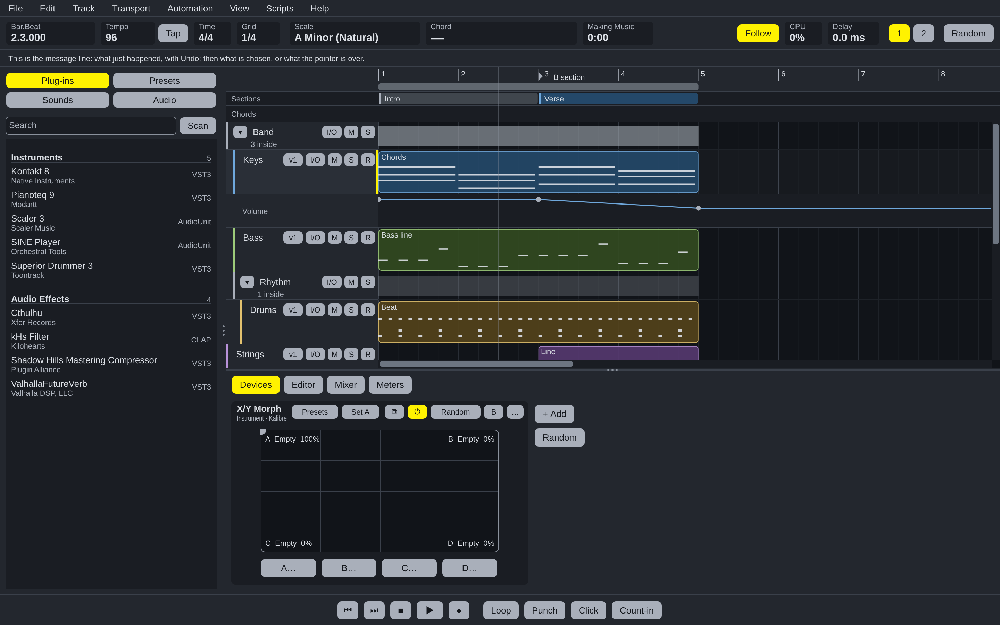

From top to bottom:

| Part | What it is |
| --- | --- |
| **Top bar** | The song's position, tempo, time signature, grid, scale, chord, a timer, Follow, CPU and delay. [Section 3](#3-the-top-bar-and-the-transport). |
| **The message line** | Under the top bar: what just happened (with **Undo** beside it), then what's chosen, or what the pointer is over: a note's pitch, velocity and length, a clip's length and notes. |
| **The ruler** | Bars and beats. Click the upper half to move the cursor; drag along the lower half to draw the loop range. Double-click it to add a marker. |
| **Lanes under the ruler** | The **Sections** lane, the **Chord** lane and the **Tempo** lane, each shown or hidden from the View menu. |
| **Track headers** | On the left: each track's name, version, I/O, M (mute), S (solo) and arm buttons. [Section 4](#4-tracks). |
| **The arrangement** | The clips, along the timeline. [Section 5](#5-clips-and-the-arrangement). |
| **The lower zone** | Under the tracks, with tabs: **Devices** (D), **Editor** (E), **Mixer** (X), **Meters** (Y), and **Video** when the song has a video. Drag the dots on its top edge to make it taller or shorter; drag it past its shortest and it shuts, leaving a thin bar along the bottom: drag the bar up (or click it) to open it again. Asking for one of its tabs (D, E, X, Y) opens it too, as does View > Lower Zone. |
| **The browser** | On the left: plug-ins, sounds (your samples and MIDI), audio settings, presets, keys and the studio. Drag its right edge to make it wider or narrower; drag it past its narrowest and it shuts, leaving a thin bar at the window's left edge: drag the bar (or click it) to open it again. ⌘B shows and hides it too. [Section 14](#15-the-browser). |
| **The transport** | Along the very bottom, in the middle: **⏮ Go to Start**, **▶ Play**, **● Record**, **Loop**, **Punch**, **Click** and **Count-in**. [Section 3](#the-transport-along-the-bottom). |

### Shutting the browser and the lower zone

Both shut the same way, to give the tracks the room:

- **Drag** the browser's right edge left, or the lower zone's top edge down,
  past its smallest size, and it shuts. A thin bar with three dots is left at
  the window's left edge, or along its bottom.
- **Drag the bar** right, or up, to open it again, following the pointer; or
  **click** the bar, and it opens as it was.
- **Double-click the three dots** (on the bar, or on the edge while it's
  open) to open it at its first size: 320 points wide, or tall. The way back
  after dragging it too far.
- ⌘B shows and hides the browser; **View > Lower Zone** the lower zone (give
  it a key in Help > Keys). Pressing D, E, X or Y, or anything that asks
  for one of the zone's tabs, opens the zone on that tab.

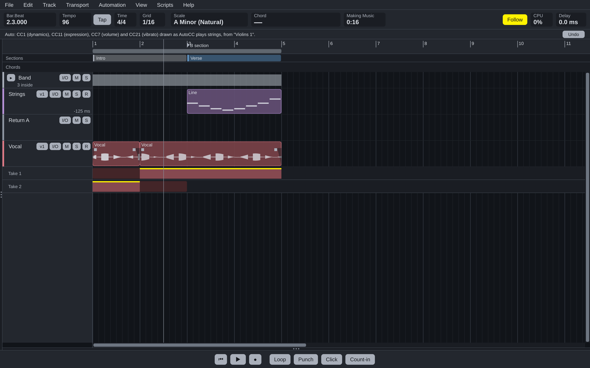

### Choosing things

Choosing works the same way for tracks (in the arrangement and the mixer),
their buttons, clips, notes and the Plug-in Manager's list:

| Click | Does |
| --- | --- |
| Click | Chooses just this one. |
| **Shift**-click | Chooses everything from the last one clicked to this one. |
| **⌥ Option**-click | Adds this one. |
| **⇧⌥ Shift-Option**-click | Takes this one out. |
| **⌘ Command**-click | Adds this one, or takes it out. |
| **Esc** | Lets go of everything chosen. |

### Text size

**View > Text Size** (100%, 125%, 150%, 200%), or ⌘= bigger, ⌘- smaller,
⌘0 back to 100%. Everything grows with it.

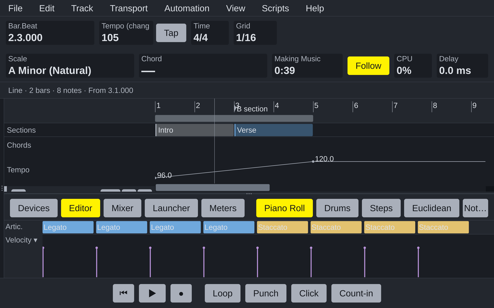

### Workspaces

**View > Workspaces > Save This Layout as a Workspace…** remembers the
browser, the lower zone's tab and height, the editor, the lanes, Follow, the
zoom and the text size, by name. Choose it from the same menu to bring the
layout back; **Delete a Workspace** removes one.

---

## 3. The Top Bar and the Transport

### The transport, along the bottom

The buttons that start and stop the song are in a bar along the very bottom
of the window, in the middle, under the lower zone:

| Button | What it does |
| --- | --- |
| **⏮ Go to Start** | The cursor to the start (Return). |
| **⏭ Go to End** | The cursor to where the last clip on the timeline ends (End). |
| **■ Stop** | Stops, and goes back to the start of the song (Home). |
| **▶ Play** | Space. Playing starts from the cursor; lit while it plays. Click it (or Space) again to stop and go back to where playing began. |
| **● Record** | R. Records on armed tracks ([Section 11](#11-recording)). A red ring while recording. |
| **Loop** | L. Plays the loop range round and round. Draw the range in the lower half of the ruler. |
| **Punch** | Records only inside the punch range (Transport > Set the Punch Range to the Loop). |
| **Click** | The metronome. Its subdivisions are in Transport > Metronome Clicks. |
| **Count-in** | A bar of clicks before recording starts. |

Right-click the transport for the same menu as the top bar's: Loop, Punch,
Click and Count-in can be hidden there. In a small window with large text,
those that don't fit are hidden from the right; they're in the Transport menu
still.

### The top bar

From left to right:

| Item | What it does |
| --- | --- |
| **Position** | Where the playhead is. Click to switch between bars and beats, minutes, samples and timecode. |
| **Tempo** | Drag up or down to change it, or double-click to type it. With tempo changes in the song it reads "Tempo (changes)": draw them in the Tempo lane (View > Tempo Lane). |
| **Tap** | Tap it in time to set the tempo. |
| **Time** | The time signature. Double-click to change it from the bar the cursor is in. |
| **Grid** | The arrangement's grid (1/1 to 1/64, with triplets): what clips, the cursor and the loop snap to. Click to choose, or turn **Snap to the Grid** off. The editors have their own grid, in the lower zone. |
| **Scale** | The song's key and scale. Its notes are shaded in the piano roll (View > Shade the Scale in the Piano Roll) and chords are spelt for it. Click for **Root** and **Scale**, **Find the Scale from the Notes**, or **Random Scale** (any root and any scale but the one it is; one undo step). |
| **Chord** | The chord you're playing on a MIDI keyboard, named as you play. |
| **Making Music** | How long you've worked on this song. It counts while you edit, play, record, play a MIDI keyboard, press a key or move the mouse in Kalibre, and pauses after 3 minutes with nothing happening (8 minutes while the song plays); it then says **Paused**, and starts again with the next thing you do. The mouse counts only while Kalibre is the app in front: moving it in Safari doesn't. Right-click > **Pause the Timer After** chooses 1, 2, 3, 5, 10 or 15 minutes. Saved with the song. |
| **Follow** | Click: the view scrolls to keep the playhead in sight. **Shift**-click: it turns the page instead, when the playhead reaches the right edge ("Follow: Page"). |
| **CPU** | How busy the audio is: the highest in the last 2 seconds. Right-click > **Change the CPU Reading** for every 1 or 5 seconds. The mixer shows each track's share. |
| **Delay** | How much the plug-ins delay the sound in all. Kalibre lines every track up by this much (plug-in delay compensation). |
| **1 2** | Song versions: the whole song twice. The lit one plays. [Below](#song-versions). |
| **Random** | At the very right: a whole new song by chance, ready to play. [Below](#the-random-button). |

**Right-click the top bar** (or the transport) to hide any of these: **Show
in the Bar** lists them with ticks; **Show Everything** brings them all back.

### Song versions

The **1** and **2** buttons left of Random hold two versions of the whole
song: try a different arrangement, mix or sound, and switch back and forth.

- **Click 2** the first time to make version 2: a copy of version 1, chosen,
  ready to change. Until then the 2 is in a quieter grey.
- **Click 1 or 2** to play that version. Each has its own tracks, clips,
  plug-ins and their settings, mix, automation, tempo, markers and key. The
  song's name, its details and the Making Music timer are shared.
- The version **not playing costs almost nothing**: its plug-ins are
  unloaded and its audio let go of, as with a frozen track. Choosing it loads
  them again exactly as they were, which takes a moment with big sample
  libraries. If the song was playing, it carries on from where it was.
- Choosing a version is **one undo step**. A knob turned in a plug-in since
  is kept in its version.
- **Right-click 1 or 2** for **Delete Song Version** (deleting the one
  playing plays the other, as version 1). Both versions are saved in the
  song.

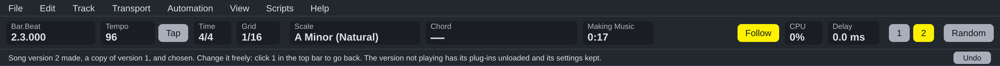

### The Random button

**Random** (also **File > New Random Song**) makes a new song by chance, to
start from. If the song you have has changes, it asks to save it first.
Then:

- **4 to 8 tracks**, eight bars long and looped, at a random tempo and key.
- **Music from the family's engines**: Good Idea writes the drums and a lead
  tune; Midi Suggester writes chords and a bass under the tune, and sometimes
  a counter-melody over the chords, or a pad an octave up.
- **A random instrument on each**: your scanned plug-ins (all of them but those
  turned off in the Plug-in Manager, and ones that measure rather than sound:
  analysers, meters, tuners), Kalibre Synth, Trombolese,
  Reese Basser, or Kalibre Sampler playing one of your sounds. Drums go to an
  instrument that plays drums when you have one (by its name).
- **Loops from your sounds** (the Sounds tab's folders), now and then: ones
  whose tempo is known, stretched to the song's.
- **Effects by chance**: none, one or two a track, 8 at most in all, and now
  and then a MIDI effect (2 at most), so it plays without overloading the
  Mac.
- A rough mix: drums and bass forward, the rest under and spread a little.

The message line says what it made ("6 tracks at 103 BPM in A Mixolydian, A
E A D E A"). Press Space to hear it; click Random again for another. Like
File > New, it's a new song: there's nothing to undo back to (that's why it
asks to save first).

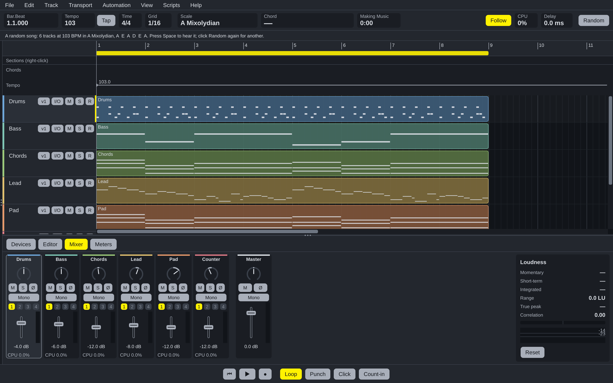

---

## 4. Tracks

### Kinds of track

| Kind | What it is | How to add |
| --- | --- | --- |
| **Track** | Holds audio and MIDI clips, on the same track. | ⌘T, Track > Add Track |
| **Folder** | Holds other tracks (and other folders) and sums them, with plug-ins of its own. | ⇧⌘T, Track > Add Folder |
| **Return** | Takes sends from other tracks (reverbs, delays). | Track > Add Return |
| **Summing Track** | Armed, it records the master as it plays, from where recording starts. | Track > Add Summing Track |
| **Cue Track** | After the master: its plug-ins, pan and mono are heard but never exported. One per song. | Track > Add Cue Track |
| **Master** | Where everything ends. Always there. | |

You can have up to 1000 tracks. Right-click in the empty space under the
tracks to add any kind.

### The track header

| Button | Click | Notes |
| --- | --- | --- |
| **Name** | Double-click to rename. | |
| **▾** (folders) | Fold the folder shut or open. | |
| **v1** (version) | The track's versions: choose one, or make a new one. | Up to four. |
| **I/O** | Where the track listens and where it plays to (below). | |
| **M** | Mute. | Also M on the keyboard, for the chosen tracks. |
| **S** | Solo. | Also S on the keyboard. |
| **R** (arm) | Click: arm for audio (red). Right-click: for MIDI (blue). Shift-click: both. Shift-right-click: MIDI as it comes in, before any plug-in ("In"). The same again disarms. | [Section 11](#11-recording). |

**⌥ Option-click** any header button to add the track to the choice instead
of pressing the button.

### The I/O button

One menu for everything going in and out, each choice ticked:

- **Audio In**: None, a stereo pair of inputs, or one input (Mono).
- **MIDI In**: Every Keyboard, None, or one port.
- **MIDI Channel**: Every, or one of 1 to 16; **MPE (a Channel for Each
  Note)** for MPE controllers, each note with its own bend, pressure and
  slide.
- **Monitor Input**: Auto (while armed), On or Off.
- **Out**: Its Folder, The Master, or a hardware output.
- **Send To**: a send to a return (add a return first).

### The track menu (right-click a header)

| Item | Does |
| --- | --- |
| **New Version** | A new version of the track: its own clips and its own plug-ins. |
| **Show Takes / Hide Takes** | The lanes of recorded takes, for comping ([Section 11](#comping-takes)). |
| **Add Track, Folder, Return, Summing Track, Cue Track** | A new track under this one. |
| **Put in a Folder / Take Out of Its Folder** | |
| **Rename…** | |
| **Colour** | The track's colour. |
| **Track Delay…** | In milliseconds; negative plays the track early, for sounds that are slow to start (-125 ms for a slow string library). |
| **Automation** | The track's mode: Off, Read, Touch, Latch, Write or Trim ([Section 12](#12-automation-and-modulation)). |
| **Articulation Map** | Which articulation map the track's notes use ([Section 15](#16-orchestral-tools)). |
| **Group** | Tracks in a group move together: volume, pan, mute, solo and arm. |
| **Freeze / Unfreeze** | Freeze renders the track quietly, without reloading anything else, and unloads its plug-ins, keeping their settings. Unfreeze deletes the render and loads them back as they were. |
| **Lock** | Its clips can't be moved or edited. |
| **Duplicate**, **Delete** | |

### Versions

A track can have up to four versions, each with its own clips and its own
plug-ins: try a part two ways and switch between them. The version button on
the header (and the 1 to 4 buttons on the mixer strip) chooses which plays.
Shift-click a version number in the mixer to switch every chosen track at
once. The versions not playing have their plug-ins unloaded, so they cost
nothing, and come back exactly as they were when chosen (a moment's wait
with big sample libraries). For two versions of the whole song, see [Song
versions](#song-versions).

### Folders

Drag a track onto a folder to put it in. A folder sums its tracks and can
have its own plug-ins; muting it silences everything inside. Folders can sit
inside folders. A folded folder shows where its tracks have clips.

---

## 5. Clips and the Arrangement

### Moving around

| Do | To |
| --- | --- |
| Scroll | Move up and down the tracks. |
| **Shift**-scroll, or scroll sideways | Move along the song. |
| **⌘**-scroll, or pinch | Zoom in and out, around the pointer. |
| **F** | Zoom to fit the whole song. |
| The Hand and Zoom tools | [Section 6](#6-the-toolbox). |

### Making clips

- **Double-click** an empty part of a track's lane: a new one-bar MIDI clip.
- **Drag files** in from the Finder or the browser's Sounds tab: audio and
  MIDI files go where you drop them. Several files go on new tracks.
- **File > Import Audio or MIDI…** (⌘I): onto the chosen track, at the
  cursor.
- Right-click an empty lane: **New MIDI Clip Here**, **Capture MIDI Here**,
  **Import Audio Here, Split at Transients…** (a sample as a clip for each of
  its hits, side by side, one undo step), **Paste Here**.

### Editing clips with the mouse

| Do | To |
| --- | --- |
| Click | Choose it (Shift, Option and Command as in [Choosing things](#choosing-things)). |
| Drag its middle | Move it, onto the grid; to another track too. With several chosen, they all move as far, one undo step. |
| **⌥ Option**-drag | Copy it (all the chosen ones). |
| **⌘ Command** while dragging | Move it freely, off the grid. |
| Drag its left or right edge | Trim it. |
| **⇧ Shift**-drag anywhere on it | Resize it from the nearer edge: grab its right half to move its end, its left half to move its start, without aiming for the edge. A Shift-click alone still chooses. |
| Drag a fade handle | The small handles at the top corners of an audio clip: fade in and fade out. Where two audio clips overlap they crossfade, equal power. |
| Drag a warp marker | Move that moment of the audio ([Warping](#warping)). |

### Editing clips with keys

| Key | Does |
| --- | --- |
| ⌘D | Duplicate the chosen clips, just after themselves. |
| ⌘E | Split at the cursor. |
| ⌫ or Delete | Delete them. With **Edit > Ripple Editing** on, the later clips on the track move back to close the gap. |

### The clip menu (right-click a clip)

For every clip:

| Item | Does |
| --- | --- |
| **Split at Cursor** | |
| **Duplicate** | |
| **Create Alias Clip** | Duplicates of an alias clip (⌘D or Option-drag) share their notes or audio: edit one, every copy changes. They wear a chain at the top right. **Make Independent** breaks the link; **Duplicate as Alias** makes a linked copy straight away. |
| **Set the Loop to the Clip(s)** | The loop range from the first clip's start to the last one's end. |
| **Delete** | |
| **Loop Its Content** | The clip's notes or audio repeat as you lengthen it. |
| **Reverse** | Plays it backwards. MIDI: the notes and controllers in reverse order, within what the clip plays. Audio: the sound backwards. Again to undo it. |
| **Invert (Upside Down)** | MIDI: the notes flipped, its highest note made its lowest and the rest mirrored between. Audio, **Invert (Polarity, Upside Down)**: the waveform flipped, which sounds the same alone but cancels against a copy. Ticked while on. |
| **Mute**, **Lock** | |
| **Consolidate the Chosen Clips** | Several clips on a track into one. Audio becomes a new file, normalised, the clip's gain making up for it. |

Reverse and Invert work on every chosen clip at once.

For MIDI clips, also:

| Item | Does |
| --- | --- |
| **Explode Chords to Tracks** | A track for each voice of the chords, each with the track's plug-ins. |
| **Fix Note Timings and Volume…** | [Section 15](#fix-note-timings-and-volume). |
| **Bounce in Place** | Renders the clip through the track's plug-ins onto a new audio track under it; the clip is muted, not deleted. 32-bit float. |
| **Detect Chords** | Their chords appear in the Chord lane (several clips at once). |
| **Transpose** | Up or down a semitone, a fifth or an octave. |

For audio clips, also:

| Item | Does |
| --- | --- |
| **Warp** | Granular, spectral or repitch; **The File's Tempo…**; **Add a Warp Marker at the Cursor**. |
| **Transpose** | Pitch-shift. |
| **Normalise** | The clip's gain so its loudest peak is at -0.3 dB. The file isn't changed. |
| **Strip Silence** | One clip for each stretch with sound in it. |
| **Quantise Audio to the Grid** | Every hit moved onto the grid with warp markers. |
| **Edit Samples** | Opens the sample editor ([Section 13](#13-audio-editing)). |
| **Split at Transients** | A clip for each hit: the clip cut just before every drum hit or note it holds, the pieces side by side, so it plays the same. Then move, mute or delete hits one by one. Not on a looped or reversed clip. |
| **Fade In and Out (10 ms)** | |
| **Offline Effects** | Plug-ins rendered into the clip: **Add** one, **Edit Their Settings**, **Render**, or go **Back to the Original**. |

### Warping

Audio follows the song's tempo when it's warped. Choose the way in **Warp**:
**granular**, **spectral** or **repitch** (faster is higher, like tape). Kalibre
works from the file's own tempo (**The File's Tempo…**) or from warp markers:
right-click > Warp > **Add a Warp Marker at the Cursor**, then drag a marker
along the clip to move that moment.

### The loop, markers and the cursor

- **The cursor** is where playing starts: click the upper half of the ruler,
  or an empty lane.
- **The loop range**: drag along the lower half of the ruler (or Shift-drag
  anywhere on it). L turns looping on and off.
- **Markers**: double-click the ruler.

### Sections and the song's shape

The **Sections** lane (View > Section Lane) names stretches of the song:
Intro, Verse, Chorus.

| Do | To |
| --- | --- |
| Right-click the lane | **Add a Section from the Loop Range** or **Add a Four-Bar Section Here**. |
| Right-click a section | **Rename…**, **Loop It**, **Duplicate**, **Move Earlier**, **Move Later**, **Delete the Section and Its Bars**, **Delete the Section Only**. |
| **Shift**-drag a section | Move it, and everything in it, to any bar. An outline shows where it lands. What was there moves out of its way. |

The Edit menu changes the song's length:

- **Insert Bars at the Cursor…**: empty bars; everything after moves later.
- **Delete the Loop Range's Bars**: and closes the gap.
- **Duplicate the Loop Range**.

Clips crossing an edge are split; automation, markers, sections and tempo
changes move with them.

### The Chord lane

View > Chord Lane. Right-click clips > **Detect Chords** and their chords are
written along the lane, spelt for the song's scale.

### The Tempo lane

View > Tempo Lane. Drag a tempo point up or down; **⌥ Option**-drag to ramp
to it from the point before. **Transport > Ramp the Tempo to Here** adds a
point at the cursor that the one before ramps to. The Time Warp tool moves a
beat to where it falls in the audio ([Section 6](#6-the-toolbox)).

---

## 6. The Toolbox

Hold **⌃ Control** and **right-click** over the arrangement or the piano roll:
the toolbox opens under the pointer. Click a tool to use it; the pointer
becomes that tool. Each area keeps its own tool. Esc closes the toolbox.
Right-click a tool in the box for its modes.

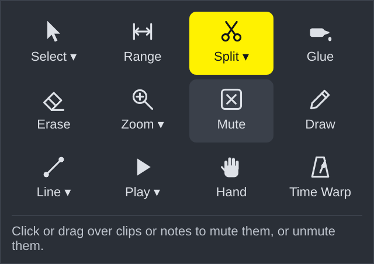
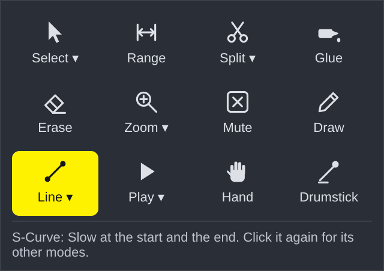

| Key | Tool | In | What a click does | Modes |
| --- | --- | --- | --- | --- |
| **1** | **Select** | Both | Choose, move and trim, as always. In the piano roll: the rules in [Section 7](#the-piano-roll). | Normal; Click Adds or Takes Away; Everything at the Click (every clip or note playing at that moment). |
| **2** | **Range** | Both | Drag across tracks to choose a stretch of time; Delete clears what's in it. In the piano roll, drag to choose an area of notes. | |
| **3** | **Split** | Both | Click a clip or note to cut it there. **⌥ Option**-click cuts it into pieces as long as from its start to the click. | Split the Clicked One; Split Every Chosen One. |
| **4** | **Glue** | Both | Click a clip to join it to the next on its track, or a note to the next of its pitch. | |
| **5** | **Erase** | Both | Click or drag over clips, notes and automation points to delete them. | |
| **6** | **Zoom** | Both | Click to zoom in, ⌥ Option-click to zoom out. | Zoom to the Dragged Area; Zoom Horizontally (drag right in, left out); Zoom Vertically (rows taller, Option shorter). |
| **7** | **Mute** | Both | Click or drag over clips or notes to mute or unmute them. Muted notes are drawn hollow. | |
| **8** | **Draw** | Both | Drag in an empty lane for a new MIDI clip; drag over automation to draw it. In the piano roll, click or drag to draw notes, even over others. | |
| **9** | **Line** | Both | Drag a straight line of automation, or a run of notes in the piano roll. | Linear; Curve; S-Curve; Fast Start; Fast End; Steps. |
| | **Play** | Both | Play from where you click. | Play While Held (notes in the piano roll play as the pointer passes); Play from the Click (click again to stop). |
| | **Hand** | Both | Drag to move around without zooming. | |
| | **Drumstick** | Piano roll | Click or drag to paint hits a grid step long; click a hit to take it away. | |
| | **Time Warp** | Arrangement | Click to put a tempo change on the nearest grid line. Drag a beat to where it falls in the audio: the tempo before it changes to fit. | |

The number keys choose tools in both areas at once (an area that hasn't the
tool keeps its own). Play, Hand, Drumstick and Time Warp have no key until
you give them one in **Help > Keys**. Right-click still removes notes in the
piano roll, whatever the tool.

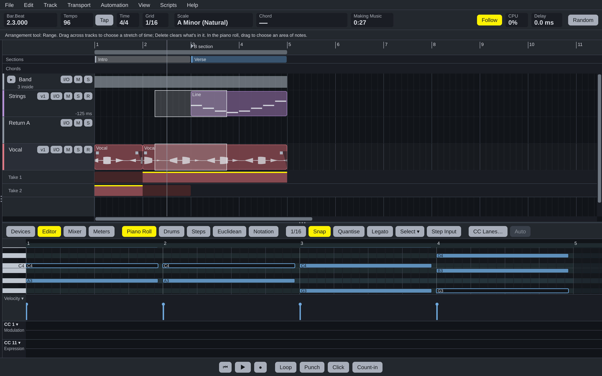

---

## 7. Writing Notes: the Editors

Press **E** (or click **Editor** in the lower zone) with a MIDI clip chosen.
Five editors, chosen along the top of the zone, all write into the **same
clip**: the piano roll shows every note; the others show their own.

### The editor bar

| Control | Does |
| --- | --- |
| **Piano Roll, Drums, Steps, Euclidean, Notation** | The editor. |
| **1/16** | The editor's grid: what notes snap to, and how long a new note is (with triplets). |
| **Snap** | Snap to the grid. Hold ⌘ while dragging to move freely. |
| **Quantise** (Q) | Move the chosen notes (or all of them) onto the grid. |
| **Legato** | Lengthen the chosen notes up to the next one. |
| **Step Input** | Write notes from a MIDI keyboard (below). |
| **Select ▾** | Choose notes by what they are (below). |
| **CC Lanes…** | Which controller lanes are shown under the notes. |
| **Auto** | Draw the CC lanes as AutoCC would play these notes ([Section 15](#16-orchestral-tools)). |

Under the notes, **Velocity ▾** (at the left of the lane) chooses what the
lane shows and sets; in Drums and Steps it's a button on the bar.

### The piano roll

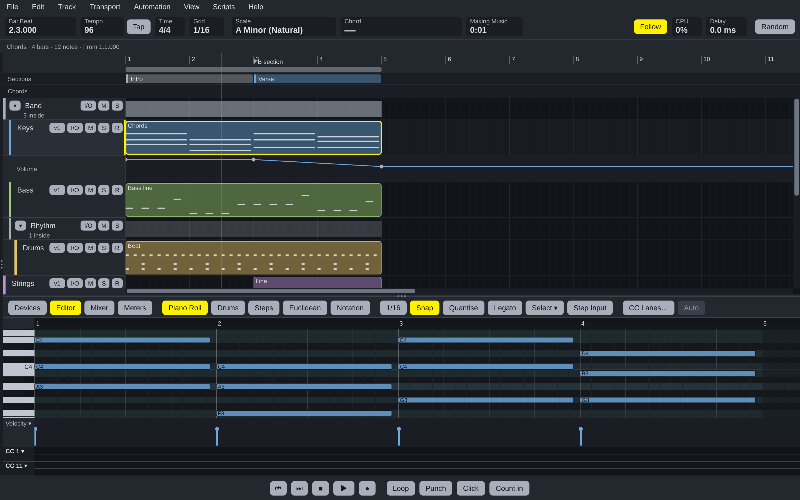

**The mouse rules** (with the Select tool):

| Do | To |
| --- | --- |
| Click empty space | Add a note. Drag to make it longer. A new note is as long as the last one added, clicked or stretched. |
| **Right-click** a note | Remove it. |
| **Right-drag** over an area | Remove everything in it. |
| Drag a note's body | Move it, with every chosen note. |
| Drag a note's edge | Stretch or shorten it. |
| **Shift**-drag | Choose an area. |
| **Shift**-click | Choose every note from the last one clicked to this one. |
| **⌥ Option**-click | Add a note to the choice. |
| **⇧⌥ Shift-Option**-click | Take a note out. **Shift-Option**-drag takes an area out. |
| **⌥ Option**-drag | Copy the notes. |
| **⌘ Command** while dragging | Off the grid. |
| Click a key on the keyboard | Hear the note. |

**Keys in the piano roll:**

| Key | Does |
| --- | --- |
| ↑ / ↓ | The chosen notes up or down a semitone. |
| ⇧↑ / ⇧↓ | Up or down an octave. |
| ← / → | Earlier or later by a grid step. |
| ⇧← / ⇧→ | Earlier or later by a bar. |
| ⌫ or Delete | Delete the chosen notes. |
| ⌘A | Choose every note. |
| Esc | Let go of the notes (again: leave the piano roll). |

**Edit menu, for notes:** Quantise, Legato, Humanise, **Join the Chosen
Notes**, **Split the Chosen Notes at the Cursor**, **Transpose** (up or down
1, 7 or 12).

**Velocity ▾** chooses what the lane under the notes shows and sets:

| Option | Is |
| --- | --- |
| **Velocity** | How hard the note is played. |
| **Note Chance** | How often the note plays, out of 100: at 50% about every other time. |
| **Random Velocity Range** | How much softer or harder it may play, chosen afresh each time. |
| **Random Timing** | How many milliseconds early or late it may play, chosen afresh each time. |
| **Note Delay** | How many milliseconds later (or earlier, below the middle) the note plays, on top of its track's and articulation's delays. |
| **Articulation Map** | The track's map ([Section 15](#16-orchestral-tools)). |

Chance, random velocity and random timing are chosen afresh every time a note
plays, in exports too.

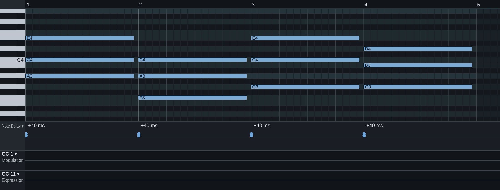

### Select ▾

| Item | Chooses |
| --- | --- |
| **Select Roots, 3rds, 5ths, 7ths, 9ths, 11ths, 13ths** | That note of each chord. |
| **Select Every Beat / Every Off Beat** | Notes on (or off) the beat. |
| **Select the Bottom Notes / the Top Notes** | The bass line or the top line. |
| **Select All**, **Select None** | |
| **Explode Chords to Tracks** | A track a voice. |

### Step input

Click **Step Input**, then on a MIDI keyboard **hold the notes** of a chord,
**press a number** for its length, and **let go**: the notes are written at
the cursor, and the cursor moves on.

| Key | Length |
| --- | --- |
| 1 | 1/128 |
| 2 | 1/64 |
| 3 | 1/32 |
| 4 | 1/16 |
| 5 | 1/8 |
| 6 | 1/4 |
| 7 | 1/2 |
| 8 | 1/1 (a whole note) |
| 9 | Dotted (half as long again) |
| 0 | Triplet (two-thirds as long) |
| - | A rest that long |

It works in the piano roll, notation and the drum grid.

### CC lanes

Under the piano roll and notation: any of the 128 controllers by their
standard names (Modulation, Breath, Volume, Expression, Sustain), pitch bend,
pressure, and each note's MPE bend, pressure and slide. **CC Lanes…** chooses
them. Draw in a lane with the mouse. Right-click a lane: **Clear Lane**,
**Remove Lane**, **Show Lanes**.

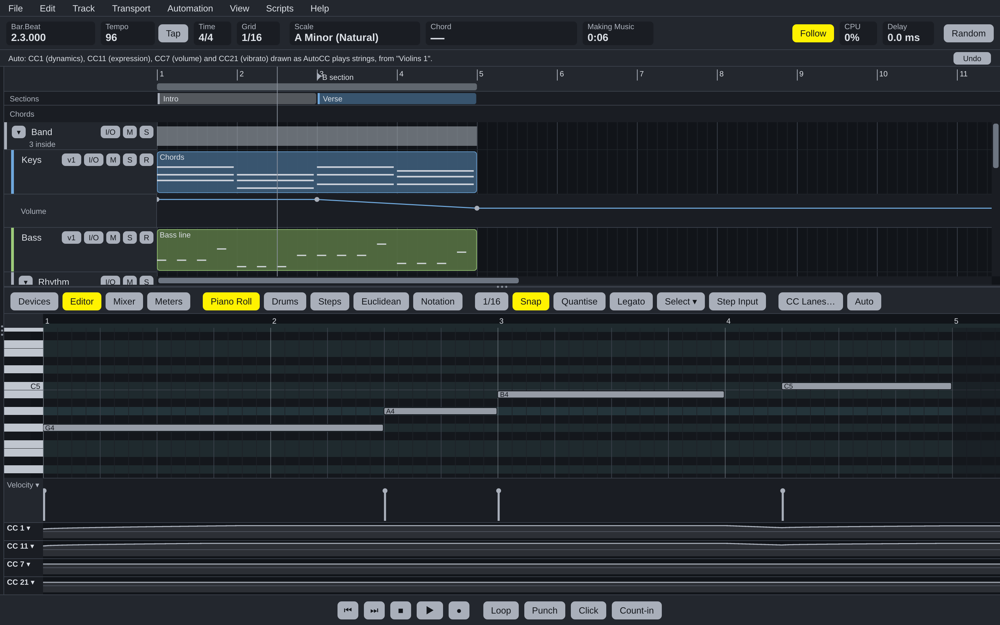

### Drums

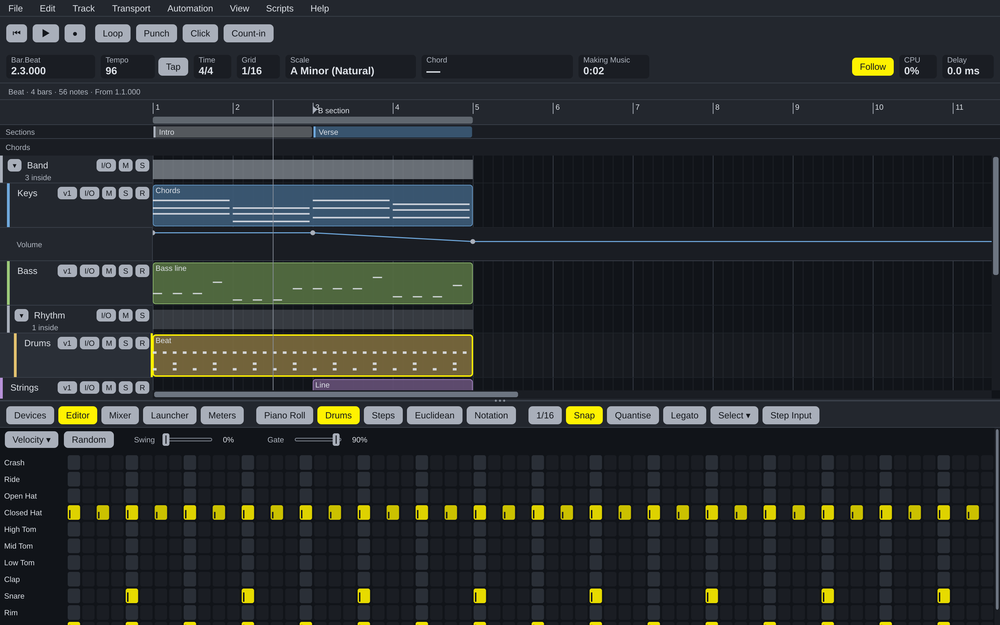

A grid of drum hits, a row a drum.

| Do | To |
| --- | --- |
| Click an empty cell | A hit (velocity 100). **Shift**-click: velocity 127. |
| Drag a hit up or down | Its velocity (or what **Velocity ▾** chooses). |
| Click a hit | Take it away. |
| Right-click | Take it away. |
| **Swing**, **Gate** | Every second step played late; how long each hit sounds. |
| **Random** | A new groove from Good Idea, every click (Undo puts the old one back). |

**Velocity ▾** here also has **Repeat**: 2 is two quick notes in the step, 4
a roll.

### Steps

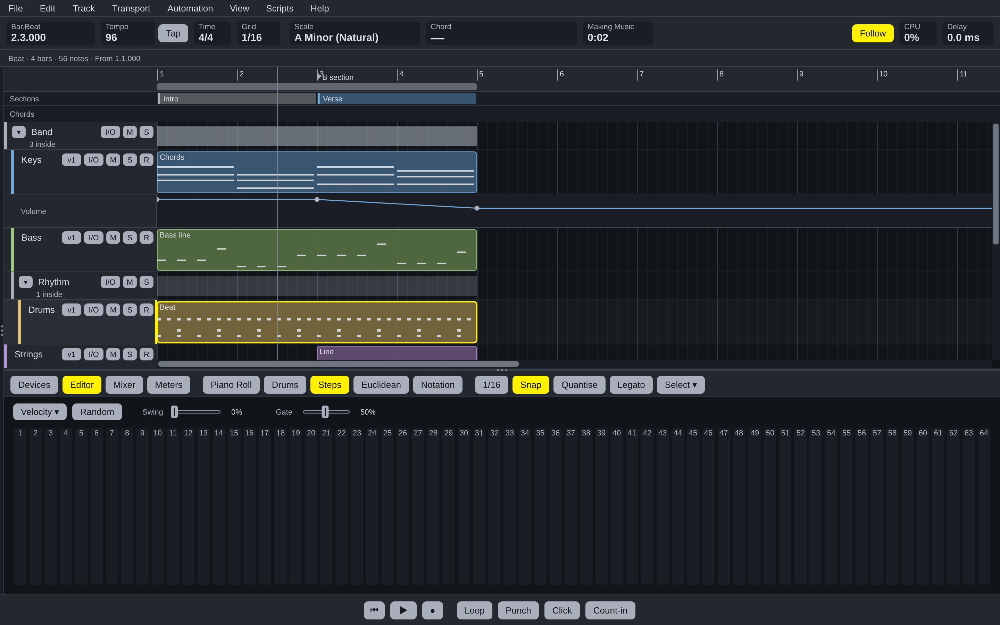

One note a step. Height is pitch; the bar inside is velocity.

| Do | To |
| --- | --- |
| Click a step | Turn it on (starting on the step before's pitch, so lines draw quickly). Click again to turn it off. |
| Drag up or down | Its pitch (in the scale, when it's shaded). |
| **⌥ Option**-drag | Its velocity (or what **Velocity ▾** chooses). |
| Double-click | Tie it to the next step. |
| Right-click | Turn it off. |
| **Swing**, **Gate** | Every second step played late; how long each note sounds. |
| **Random** | A new tune from Good Idea in the song's key. |

### Euclidean

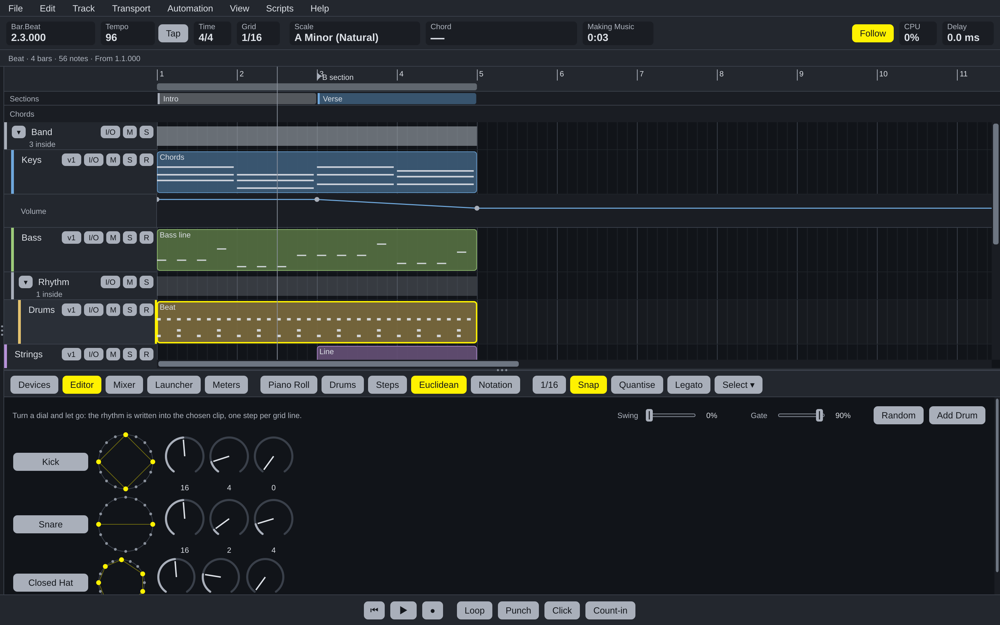

Rhythms spread as evenly as possible over a number of steps: each row is a
drum, with **Steps**, **Hits** and **Rotate** dials. Turn a dial and let go:
the rhythm is written into the clip. **Add Drum** adds a row; click a row's
name to choose its drum. **Random** rolls new rhythms for every drum.

### Notation

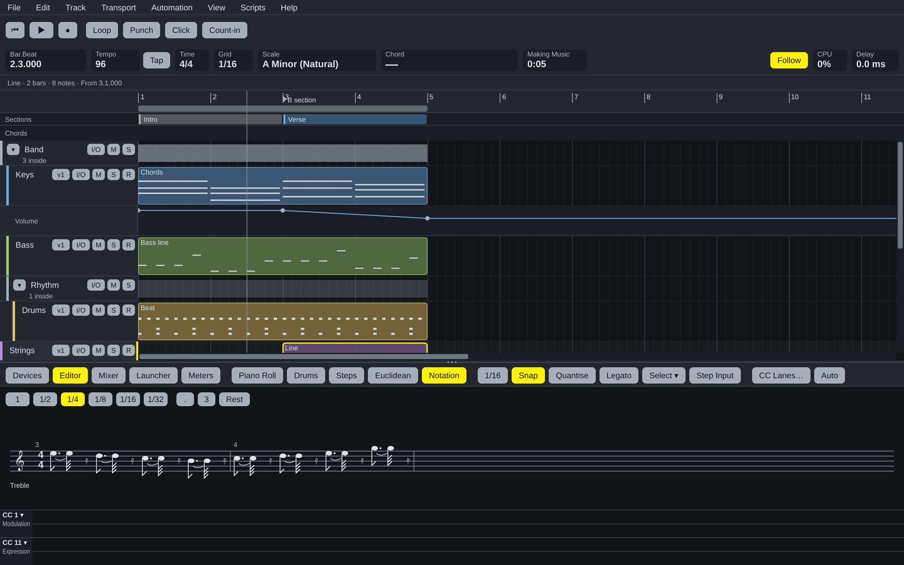

The notes on a staff, spelt for the song's key.

| Do | To |
| --- | --- |
| The note buttons | The value of the next note: whole to thirty-second. |
| **.** | Dotted. |
| **3** | Triplet. |
| **Rest** | Move the cursor on by the value, leaving a rest. |
| Click on the staff | A note at the cursor, at that line or space. **⌥ Option**-click: sharpened; **Shift**-click: flattened. |
| Click a note | Choose it. |

---

## 8. Plug-ins and Devices

Press **D** for the Devices tab: the chosen track's plug-ins, side by side,
in the order the sound passes through them. MIDI effects always come before
the instrument, then the audio effects.

### Adding plug-ins

Click **+ Add** (or Track > Add a Plug-in…): **MIDI Effects**,
**Instruments**, **Audio Effects** and **Kalibre** (Kalibre's own devices,
[Section 9](#9-kalibres-own-devices)). Or drag one from the browser's
Plug-ins tab onto a track, or straight into the **Devices** tab of the lower
zone: the rack is outlined while you drag, and the plug-in goes between the
ones either side of where you let go (MIDI effects still come first, then
instruments, then audio effects). With no track chosen, a new track is made
for it.

**Random**, under **+ Add**, adds devices by chance to the chosen track, as
the top bar's Random chooses them: an instrument if the track plays notes and
has none (one that plays drums for a track named Drums, Beat or Perc, when
you have one), one or two effects, and now and then a MIDI effect. They come
from your scanned plug-ins and Kalibre's own. A return, a folder or a track
of audio clips gets effects only. The master gets nothing by chance: Random
isn't shown when the master is chosen. It's one undo step; click it
again for more. A scanned plug-in that can't be loaded any more (moved or
deleted since its scan) is left out, and the message line says so.

### Each plug-in's buttons

| Button | Does |
| --- | --- |
| **⏻** | Switch it off: unloaded from memory, its settings kept. Switch it on to load it again. Its delay is kept in its place, so the tracks stay lined up. |
| **B** | Bypass: the sound passes untouched, the plug-in still loaded. |
| **Random** | Its controls set by chance, for a new sound. [Below](#a-plug-ins-random). |
| **Set A / Set B** | Two settings to compare: click to switch. Copy one to the other in Presets. |
| **Presets** | **Save Preset…**, your saved presets, and **The Plug-in's Own** programs (Kalibre's own: **Factory Presets**, eleven for Kalibre Synth). |
| **Match** | Match Loudness: keeps what comes out as loud as what goes in (short-term loudness, LUFS-S). The amount is shown beside it. |
| **⧉** | Move its window out of the rack into a window of its own, and back. |
| **…** | **Move Left**, **Move Right**, **Sidechain From** (another track), **Its Other Outputs as Tracks**, **Automate the Last Touched Control**, **Modulate the Last Touched Control**, **Remove**. |

Each plug-in's window is drawn inside the rack, fitted to the lower zone:
resizable ones take the size, others are shown smaller, never stretched or
bigger than they are. **Swipe sideways with two fingers** to move along the
rack. Every action on a plug-in is one undo step.

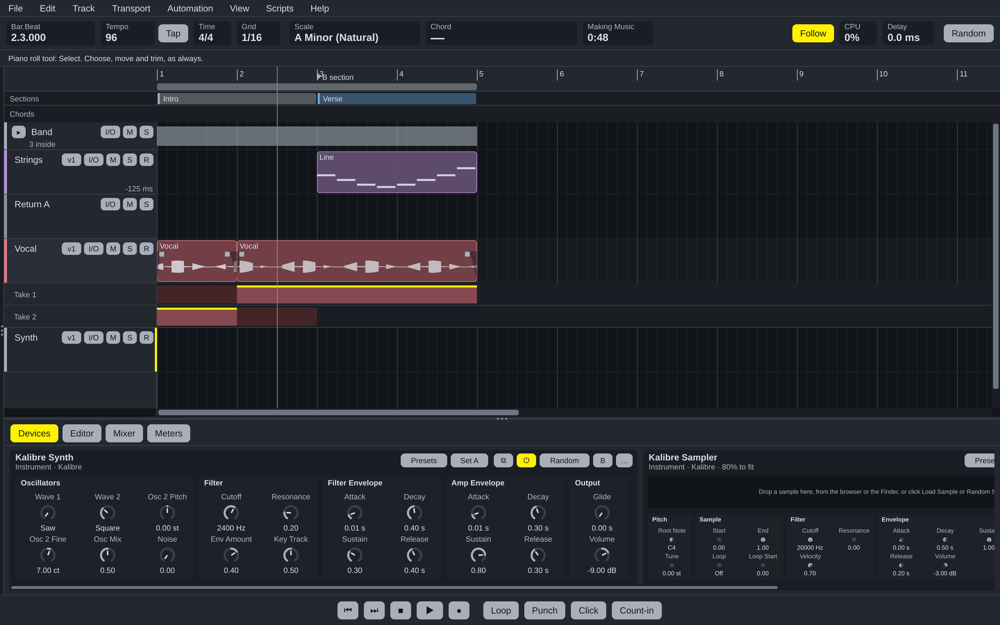

### A plug-in's Random

**Random**, beside **B** on each plug-in, sets its controls by chance: a new
sound from the same plug-in. Click again for another; it's one undo step, so
**Undo** goes back to how it was. It never writes automation, even while the
song plays.

It leaves alone every control for **volume** (Volume, Gain, Level, Output,
Input, Trim, Makeup, a limiter's Ceiling and Threshold, an envelope sent to the
amp), **tuning and pitch** (Tune, Pitch, Fine, Coarse, Transpose, Detune,
Octave, Semitones, Note, Cents, Root, Pitch Bend, Vibrato, Drift, a sample's
Speed, an oscillator's frequency), switches that could **silence** a sound
source (Osc 1 On), and settings that **aren't the sound**: presets, bypass,
mute and solo, monitoring (Delta, Listen), quality and oversampling, MIDI,
polyphony and the wheels. Controls with no real name (#001, Param 12) and
macros are left too: they could be wired to volume or pitch. The names come
from what the plug-ins themselves call their controls.

Pitch tools (Auto-Tune, Little AlterBoy, pitch shifters, tuners) and utilities
(gain, trim, meters, analysers) have no Random: their controls are all volume
or pitch. The button is dimmed, and says why.

To see exactly what it does to your plug-ins, use the **Random Settings
Report** in the Plug-in Manager.

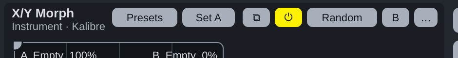

### Sidechains

**…** > **Sidechain From** chooses the track a compressor (or any plug-in with
a sidechain input) listens to. It's heard in freezes and bounces too.

### Instruments with several outputs

**…** > **Its Other Outputs as Tracks**: each further output of a
multi-output instrument (a drum sampler) plays on its own track.

### Plug-in delay compensation

Every track is lined up for the plug-ins' delays, to the sample; the top
bar's **Delay** says how much in all. Automation is lined up too: a lane on
the fader, a send, or a plug-in after one that delays the sound is read as
late as the sound reaches it, so a mute, a volume step or a filter sweep
lands exactly under the sound it was drawn under, round a loop as well.

### Using every core

Tracks' plug-ins play side by side on all the Mac's performance cores. It's
on by default: **Use Every Core** in the browser's Audio tab switches it. The
sound is exactly the same either way.

---

## 9. Kalibre's Own Devices

All under **+ Add > Kalibre**. Every control of every one, and how to get
what it makes into your song, is in **[the devices manual](DEVICES.md)**.

| Device | Kind | What it is |
| --- | --- | --- |
| **Kalibre Synth** | Instrument | A simple synthesiser. |
| **Kalibre Drums** | Instrument | A drum kit: pads of samples or plug-ins, with its own steps that play with the song or drag out to the timeline. [Below](#kalibre-drums). |
| **Kalibre Sampler** | Instrument | Plays a sample three ways (**Mode**): **Keys**, across the keyboard; **Slices**, cut at its hits, a key each from the root note up; **Granular**, as many short grains, so **Speed** changes how fast it plays without changing its pitch (0 holds it still). [Below](#kalibre-sampler). |
| **Trombolese** | Instrument | A physical model of a trombone crossed with an oboe: one note at a time, sliding between held notes; Bore and Reed morph, the mod wheel on the bore. In tune from note 34 to 84. |
| **Hardware Insert** | Effect | Outboard gear in the chain: out to the interface and back, its round trip measured. |
| **X/Y Morph** | Instrument or effect | Four corners, each a plug-in or a sample, mixed by where the dot is on a pad. Sample corners play the track's notes. X and Y can be automated and modulated. |
| **Container** | Effect | Up to eight plug-ins in a row, each on a band, the mid or the sides. |
| **Note Splitter** | MIDI effect | A chord's notes, top to bottom, each to another track. |
| **Instant Virtual Instrument** | Instrument | Builds an instrument from a sample, in its own window. |
| **ScaleView** | MIDI effect | Shows the scale and names the chord played through it; the sound is unchanged. Put it before the instrument. |
| **Midi Evolver**, **Transient Shuffler**, **Reese Basser**, **Reverberator**, **Instrument Creator** | Various | The family's JSFX, exactly as REAPER runs them, each with its own window. Their sliders are parameters you can automate. |
| **Midular**, **MIDI Production Center** | MIDI effects | MIDI samplers: right-click > **Load the Chosen MIDI Clip** (MIDI Production Center's own **Load Item** button works too). The phrase is saved with the song. |
| **Starting Blocks**, **Starting Blocks Notation**, **Midi Catalogue** | MIDI effects | Ideas to start from, in their own windows. **Audition** and **Play with the Song** play through the instrument after them; **Insert at Cursor** puts the block on the track at the playhead (Midi Catalogue's sections a track per instrument). |
| **Good Idea** | MIDI effect | Ideas for starting a track. **Insert** puts the idea in the song at the playhead; drums on channel 10. |
| **Orchestration Helper** | Tool | Its database beside the track: search, pages, Text Size. |

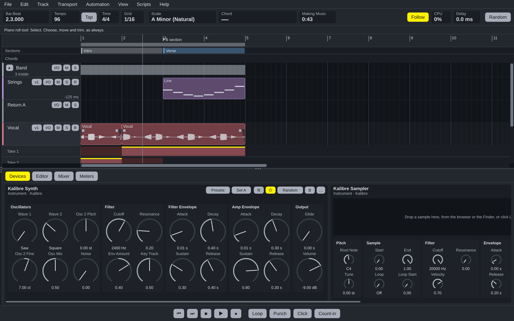
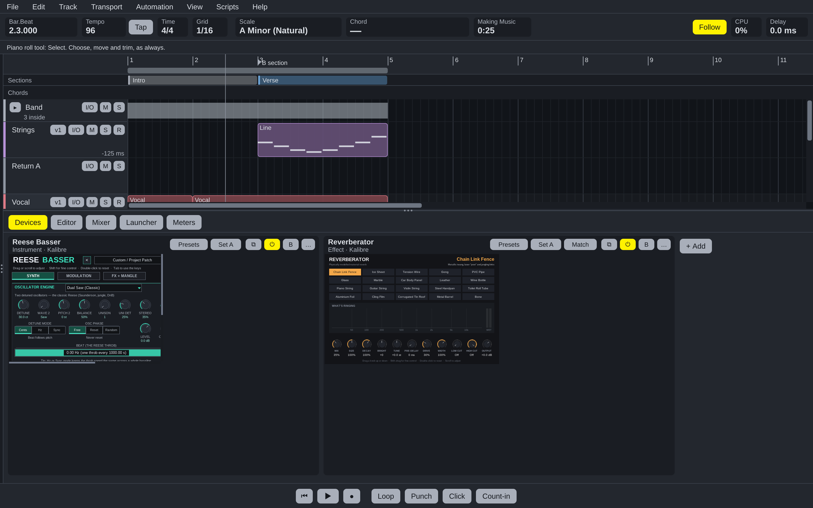

### Kalibre Sampler

Drop a sample on it (from the Sounds tab or the Finder) or click **Load
Sample…**. Or click **Random Sample** for any sound from your Sounds folders:
a loop, a one-shot, a note, a texture. Click again for another; ⌘Z goes back
to the one before. When the sound is one note (a pad, a bass note, a voice),
its **Root Note** is set to that note, however it was loaded, so it plays in
tune from the keys; Random Sample's message says which. Each new sample, however it's loaded, is one undo
step. Its knobs, group by group:

| Group | Knobs |
| --- | --- |
| **Pitch** | **Root Note** (the key that plays the sample as it is; in Slices, the key of the first slice), **Tune**. |
| **Sample** | **Start**, **End** (the part played), **Loop** and **Loop Start** (Keys and Granular). |
| **Filter** | **Cutoff**, **Resonance**, **Velocity** (how much playing harder makes it louder). |
| **Envelope** | **Attack**, **Decay**, **Sustain**, **Release**, **Volume**. |
| **Play** | **Mode**: Keys, Slices or Granular. **Speed**: how fast the sample is played, 0 to 4 times. In Keys and Slices it's like tape, faster is higher (Tune can bring it back down); in Granular the pitch stays where the key puts it. **Slice Sensitivity**: higher finds quieter hits, so more slices. |
| **Grains** | Granular only. **Grain Size** (10 ms to half a second), **Density** (grains a second), **Spray** (how far each grain wanders from the reading point), **Position** (where in the sample it starts reading). |

In **Slices**, the waveform shows a line where each slice starts, named with
its key. A slice plays to the next hit and stops, with a 3 ms fade so it
never clicks; keys past the last slice play nothing. Split a drum loop
into a kit: Slices, then play the hits from the keys.

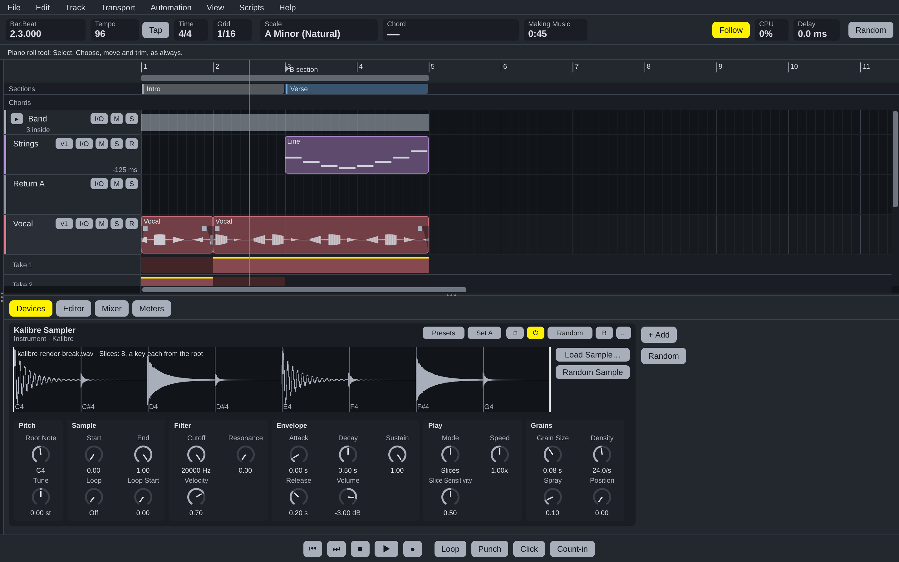

### Kalibre Drums

A drum kit with its own steps. **Add > Kalibre > Kalibre Drums**.

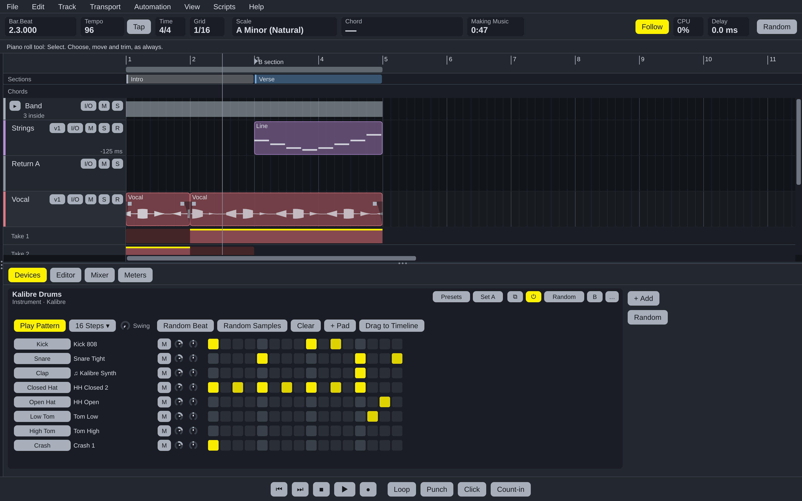

**Pads.** Eight to start (Kick, Snare, Clap, Closed Hat, Open Hat, Low Tom,
High Tom, Crash), up to 16 with **+ Pad**. Each plays a **sample** or a
**plug-in**:

- **Drag a sound** from the Sounds tab (or the Finder) onto a pad's row.
- **Drag a plug-in** from the browser onto a pad's row, or right-click the
  pad > **Play It with a Plug-in**: a drum synth plays that pad. Click the
  pad's name to see its plug-in beside the steps.
- **Random Samples** gives every pad a drum sound from your Sounds folders, a
  kick for the kick, a snare for the snare, told as the Sounds tab's **Drums**
  tells them ([how](#how-a-drum-is-told)): by name, folder, length and the
  shape of the hit. Never a loop or another instrument; never the same one
  twice. Pads with plug-ins keep them. Click again for others; **Undo** for
  the last.

Click a pad's name to hear it. **M** mutes it; the two knobs are its volume
and pan. Right-click a pad for **Rename…**, **Played by** (its note),
**Choose a Sample…**, **Note Sent to the Plug-in**, **Clear Its Sound**,
**Choke Group** (pads in a group stop each other: the closed hat stops the
open one, as on a real kit) and **Take Out This Pad**.

**Steps.** Click a step on or off; drag along a row to paint; **Option**-click
for a loud, then a soft hit. **16 Steps ▾** chooses 8 to 64 steps, each an
eighth, a sixteenth, a sixteenth triplet or a thirty-second. **Swing** plays
every second step later. **Random Beat** is a new groove from Good Idea on
your pads, every click. **Clear** takes every hit out.

**Play Pattern** (lit) plays the steps while the song plays, from the song's
start and round the loop. **Drag to Timeline**: drag it onto a track in the
arrangement and the beat is a clip there, which the drum grid opens to change
or vary it. Let go near a bar line (within a beat) and it starts on the bar. On the drums' own track, Play Pattern switches off, so the beat
isn't heard twice. Clips' notes play the pads, so beats can live in clips,
section by section.

On a track playing Kalibre Drums, the **drum grid** (Editor > Drums) has the
kit's pads for rows, with their names, and its Random puts every hit on one.

Every change in it is one undo step.

### The Container

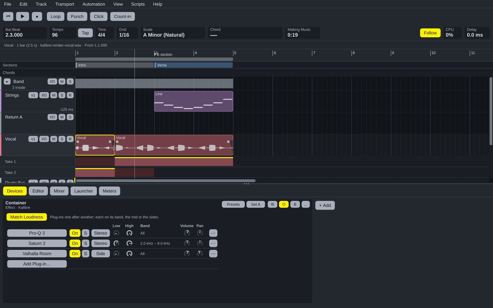

Each plug-in in it has:

- **On**, and **S** (solo: with any soloed, only those play);
- **Stereo / Mid / Side**: what it hears and changes;
- **a band** (low and high edges; double-click for none): it changes only
  those frequencies;
- its own **Volume** and **Pan**.

Its **⋯** menu: Show Its Window, Replace…, Move Up, Move Down, Remove.
**Match Loudness** brings what goes out to the loudness of what came in.

### The Note Splitter

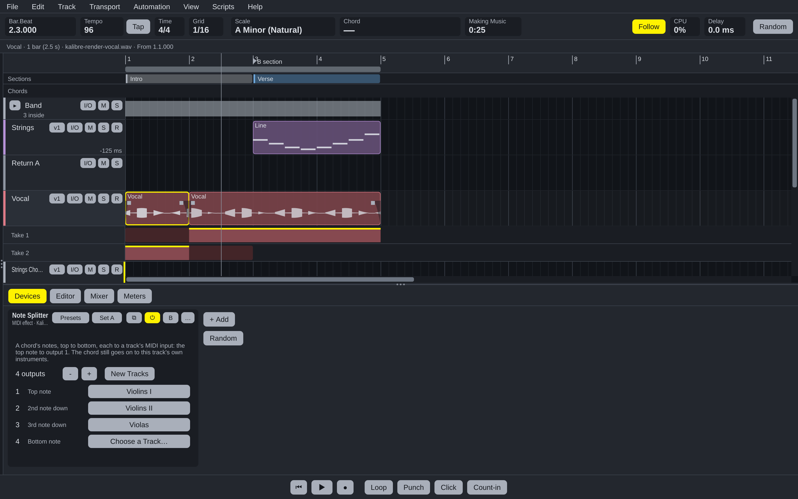

Play a four-note chord on one track and the top note goes to the violins,
the next to the violas, and so on. **+** and **-** set how many outputs (1 to
16); choose a track for each, or **New Tracks** makes them under this one.
The chord still plays on its own track too.

---

## 10. The Mixer

Press **X** for the mixer.

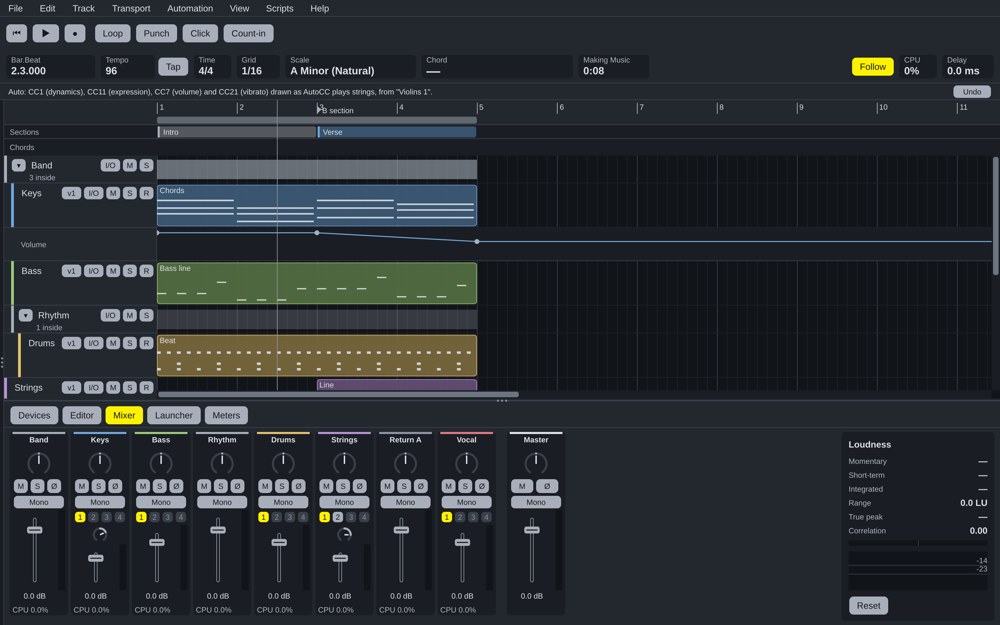

Each strip, top to bottom:

| Control | Does |
| --- | --- |
| **Pan** | The knob at the top. Double-click for the centre. The pan law is constant power, 0 dB in the middle. |
| **Front to Back** | In a surround mix (Track > Mix Format). |
| **M**, **S** | Mute, solo. |
| **Ø** | Invert the polarity. |
| **Mono** | Both sides play the two mixed together (on the Cue track: heard only, exports stay stereo). |
| **1 2 3 4** | The track's versions: click to play one (the lit one plays). Shift-click to switch every chosen track. |
| Sends | A small knob for each send. |
| The fader | Volume, in dB underneath. |
| Meters | Peak and RMS, beside the fader. |
| **CPU** | The track's share of the load. |

The **Loudness** panel beside the master: Momentary, Short-term and
Integrated loudness (LUFS), Range, True Peak and Correlation. **Reset**
starts measuring again.

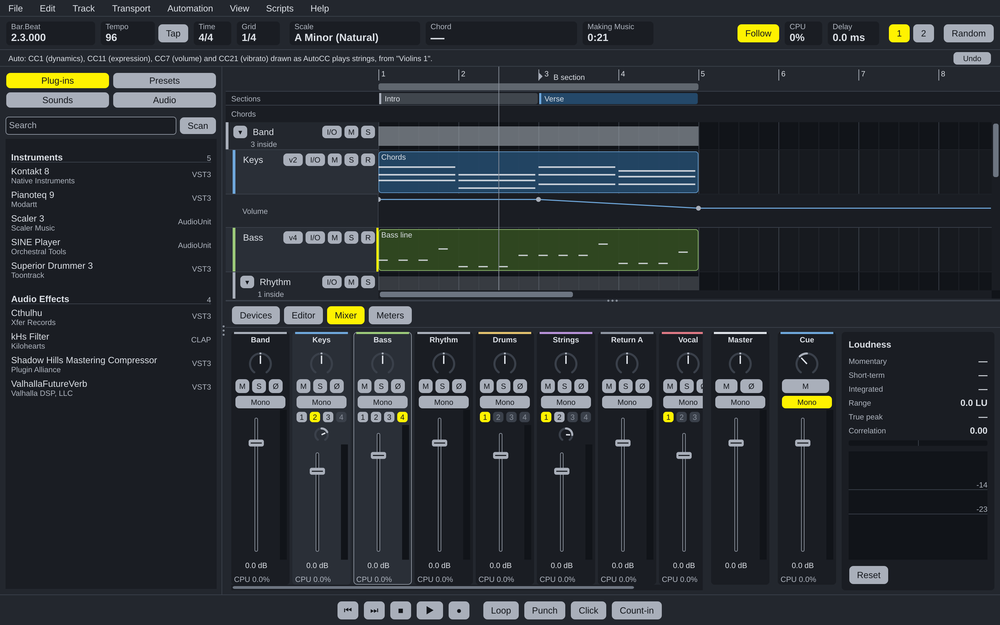

### Surround

**Track > Mix Format**: Stereo, Quad, 5.1 or 7.1. Pan places a track left to
right; **Front to Back** from front to back. Exports have every channel.

---

## 11. Recording

### Arming

| On the arm button | Records |
| --- | --- |
| Click (red) | Audio, from the track's audio input. |
| Right-click (blue) | MIDI: what the instrument is played, arpeggiators and MIDI effects included. |
| Shift-click (half and half) | Both. |
| Shift-right-click ("In") | MIDI as it comes in, before any plug-in. |

The same in **Track > Arm for Recording Audio / MIDI / Audio and MIDI /
MIDI Input**.

### Recording

Press **R** (or ● Record). Recording adds clips; it never removes what's
there. **Loop** on: one take each time round. **Punch** on: only inside the
punch range (**Transport > Set the Punch Range to the Loop**). **Count-in**
plays a bar first. The **Metronome** (**Click**) has an accent and
subdivisions (Transport > Metronome Clicks: beats, or beats in 2, 3 or 4).

Everything Kalibre records is 32-bit float WAV.

### Capturing what you just played

Kalibre is always listening.

- **Capture MIDI** (⇧⌘R): what you last played on a MIDI keyboard becomes a
  clip, back to a pause of three seconds. Where it was played if the song was
  playing; otherwise at the cursor.
- **Capture Audio (the Last 30 Seconds)**: from an armed or monitored track,
  at the cursor.

### Comping takes

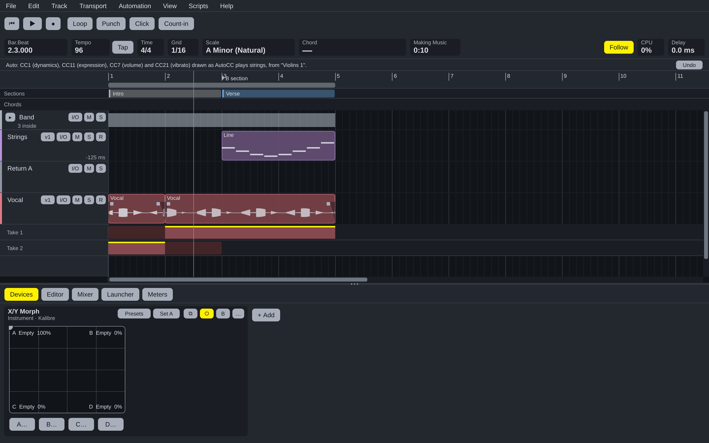

Each pass round the loop is a take. Track menu > **Show Takes** opens a lane
for each under the track.

- **Drag across a take's lane** to use that take there.
- **Click** a take's clip to use all of it.
- Right-click a take lane: **Use This Take Everywhere**, **Delete This
  Take**, **Flatten the Comp** (into ordinary clips), **Hide Takes**.

Joins between takes get a short fade.

### The Summing track

Track > Add Summing Track, then arm it: it records the master as you play,
from where recording starts, sample for sample.

---

## 12. Automation and Modulation

### The last touched control

Kalibre remembers the last control you moved by hand: a plug-in's parameter,
a fader or a pan knob. The Automation menu works on it:

- **Automate (its name)**: a lane for it under the track.
- **Modulate (its name)**: LFO, ADSR Envelope, ADR Envelope, Envelope
  Follower, or Wavetable (draw it, or load a sample as the shape).
- **MIDI Learn (its name)…** (⌘L): move a knob on a MIDI controller and it's
  mapped. **MIDI Mappings** lists them; choose one to forget it.

### Lanes

Right-click a track's lane: **Show Volume Automation**, **Show Pan
Automation**, any other parameter, or **Automate the Last Touched Control**.
Click in a lane to add a point; drag points; the Draw and Line tools draw
shapes. Right-click a lane: **Paste Here**, **Hide This Lane**, **Delete This
Lane**. Every lane is followed sample by sample.

### Modes

Automation > **Mode** (or the track menu > Automation):

| Mode | Does |
| --- | --- |
| **Off** | The lanes are ignored. |
| **Read** | The lanes play. |
| **Touch** | While playing, moving a control writes; letting go returns to the lane. |
| **Latch** | Like Touch, but keeps writing the last value after you let go. |
| **Write** | Writes everything while playing. |
| **Trim** | Moves the lane's shape up and down by your hand, keeping the shape. |

### Modulators

Shown in the device rack. Each pushes a parameter up and down by an
**Amount** from where it sits:

- **LFO**: six shapes (Sine, Triangle, Saw Up, Saw Down, Square, Random),
  free or **Sync to the Tempo**.
- **ADSR / ADR envelopes**, started by the track's notes.
- **Envelope Follower**: the level of this track or another.
- **Wavetable**: a cycle drawn, or a sample's shape.

---

## 13. Audio Editing

### The sample editor

Right-click an audio clip > **Edit Samples**, or choose it and press **E**.

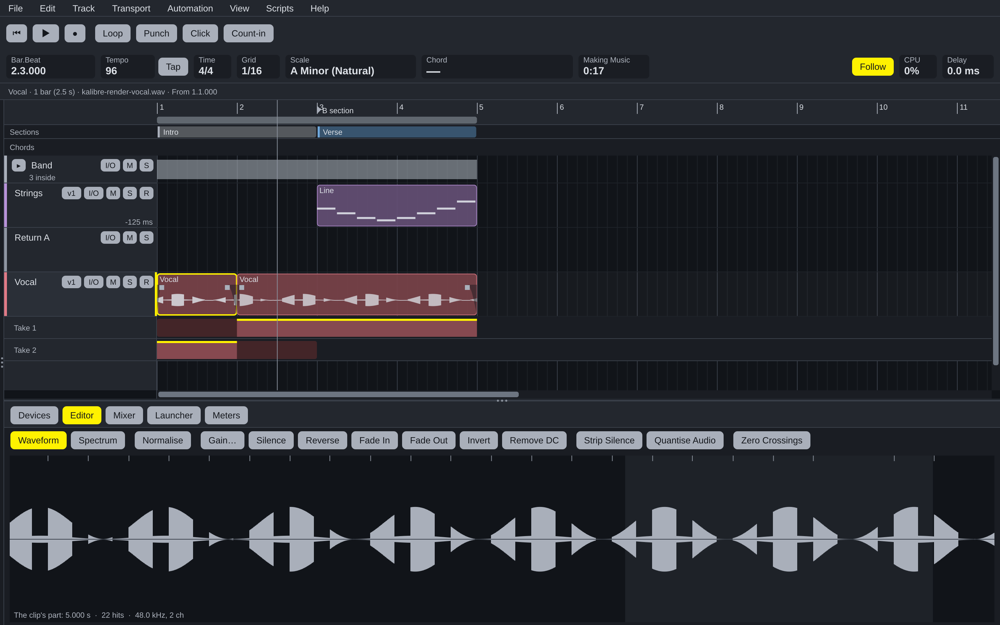

Drag across the waveform to choose a range, then:

| Button | Does |
| --- | --- |
| **Waveform / Spectrum** | The file as a waveform, or a spectrogram (pitch up, loudness as brightness). |
| **Normalise** | The clip's gain so its loudest peak is at -0.3 dB (the file isn't changed). |
| **Gain…** | The range louder or quieter. |
| **Silence** | The range silent. |
| **Reverse** | The range backwards. |
| **Fade In / Fade Out** | |
| **Invert** | The range's polarity. |
| **Remove DC** | Centres the waveform on zero. |
| **Strip Silence** | One clip for each stretch with sound in it. |
| **Quantise Audio** | Every hit onto the grid with warp markers. |
| **Zero Crossings** | Range ends, clip edges and cuts land where the waveform crosses zero, so there's no click (also Edit > Snap to Zero Crossings). |

Right-click the range: **Normalise the Range to -0.3 dB**.

Edits make a new 32-bit float file; the original is kept.

### Offline effects

Right-click an audio clip > **Offline Effects** > **Add** a plug-in. **Edit
Their Settings** shows their windows in the Devices tab; **Render** renders
the clip through them; **Back to the Original** undoes it.

---

## 14. Meters and Video

**Y** opens the Meters: a spectrum, an oscilloscope, a phase scope and a
tuner, on the master or the chosen track.

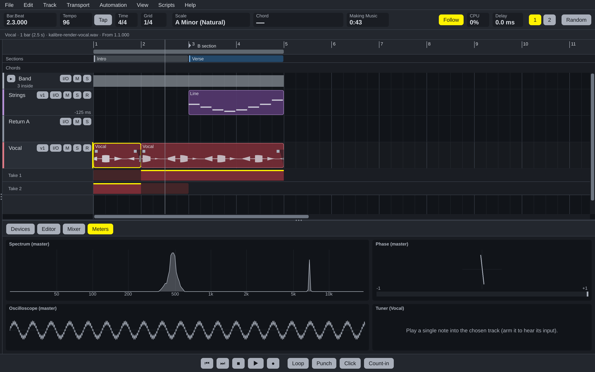

**File > Import Video…** puts a video on the timeline at the cursor, its
sound on a track of its own. The **Video** tab shows the picture, following
the playhead. **File > Remove the Video** takes it away.

---

## 15. The Browser

On the left of the window.

- **Wider or narrower**: drag its right edge (the three dots).
- **Shut**: keep dragging the edge left past its narrowest, and it shuts. A
  thin bar with three dots stays at the window's left edge.
- **Open**: drag that bar to the right, and the browser follows; or click
  the bar, and it opens as wide as it was.
- ⌘B (or View > Browser) shows and hides it too.

Six tabs:

| Tab | What's in it |
| --- | --- |
| **Plug-ins** | Every plug-in found, by kind. Search; drag one onto a track or into the rack. **Scan** looks for new ones. |
| **Sounds** | Your samples and MIDI files, to hear and bring into the song ([below](#the-sounds-tab)). |
| **Audio** | The audio interface, sample rate (as high as the interface goes: 44.1 to 192 kHz) and buffer size, inputs and outputs; **Use Every Core** (on unless you switch it off). |
| **Presets** | Saved presets for the chosen track's plug-ins. |
| **Keys** | Every command and its key ([Section 19](#20-every-key-command)). |
| **Studio** | Sync and control surfaces ([Section 17](#18-sync-control-surfaces-and-scripts)). |

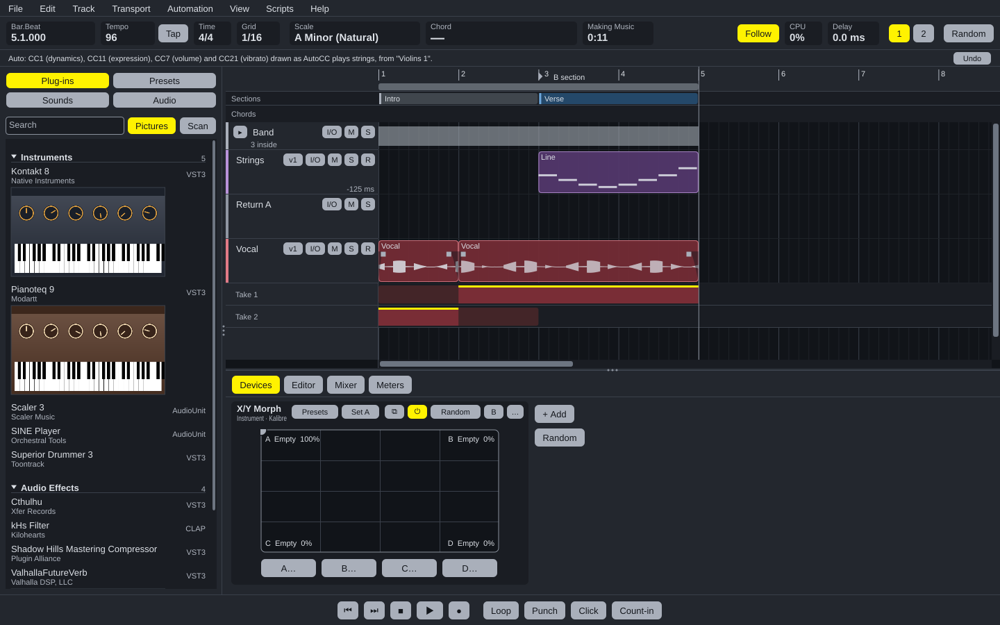
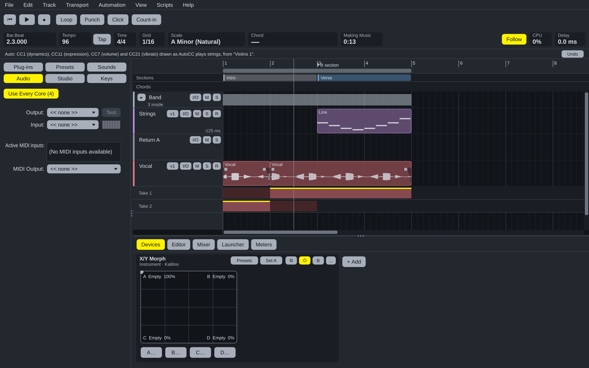

### The Sounds tab

Every sample and MIDI file in the folders you chose, to hear, mark as
favourites and bring into the song.

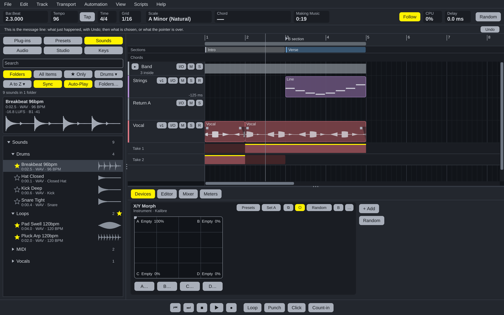

**The folders.** The first time Kalibre opens it asks which folders to look
in; **Kalibre > Library Folders…** (or **Folders…** in the tab) adds one
(**Add Folder…**), takes one out (**Remove**: its files aren't touched), or
looks through them all again (**Look Again**). Coming back to Kalibre (from
the Finder, say) looks again by itself, at most once a minute, so a sample
you've just saved is listed. Only files Kalibre can play
are listed: WAV, AIFF, FLAC, Ogg, MP3, AAC and ALAC (M4A, CAF), and MIDI.
Each file is read once; after that only new and changed files are, so
opening Kalibre doesn't wait. The line under the buttons says how far a scan
has got ("Reading new sounds: 1,200 of 50,000…"; "Checking 500,000 sounds for
changes…" while it only looks at the ones it knows), or how many sounds there
are. A big first scan is saved every 50,000 sounds, so quitting part-way
loses at most those: the next time, it carries on from there. With tens of
thousands of sounds the list is opened in the background as Kalibre starts
("Opening the list of your sounds…").

| Control | Does |
| --- | --- |
| **Folders** | The sounds in their folders. Click a folder to open or shut it. |
| **All Items** | Every sound in one list, without folders. |
| **★ Only** | Only favourites: sounds and folders with a star, and everything inside a favourite folder. |
| **Drums ▾** | Only drum sounds (**All Drums**), or one kind: **Kicks**, **Snares**, **Claps**, **Hats**, **Toms**, **Cymbals**, **Rims**, **Shakers**, **Percussion**. **All Sounds** shows everything again. [How a drum is told](#how-a-drum-is-told). |
| **A to Z ▾** | The order: **A to Z**, or **Shuffle** (within each folder, or the whole list in All Items). It stays shuffled the same way until you choose **Shuffle Again**. |
| **Sync** | Previews play at the song's tempo. MIDI always; a sample when its tempo is known: written in its name ("Drums 96bpm", "BPM120"), in the file (an ACID WAV), or heard in a loop (below). While the song plays, a preview starts on the next beat. Off: everything as it was made. |
| **Auto-Play** | On: choosing a sound plays it. Off: choosing (a click, ↑ or ↓) is silent; click the chosen sound's picture at the top to hear it, and again to stop it. Right-click > **Play** works too. Remembered. |
| **Folders…** | The Library Folders window. |
| **Search** | At the top of the browser: only sounds whose names hold what you type. |

#### How a drum is told

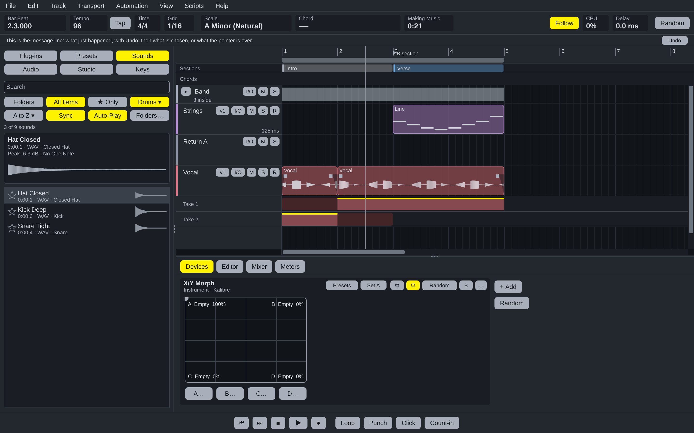

A drum sound is **short** (three seconds at most; a cymbal eight), and
**shaped like a hit**: it starts at once, rises in a few milliseconds and
dies away. Its **kind** is read from its **name** ("Kick 05", "BD_808",
"Snare_Tight", "HH Closed", "OHH", "Crash 1"), or failing that its
**folder's** ("Kicks/Punchy 01"). Words that say it isn't a drum rule it out:
Loop, a tempo ("120bpm"), Fill, Pad, Vocal, Chord, Bass (but not Bass Drum),
Riser, and a folder named for loops or pads.

When neither its name nor its folder says, Kalibre **hears** its kind: low
and dull, a kick; pitched in the middle, a tom; very bright and short, a
closed hat (longer, an open hat; longer still, a cymbal); bright, a snare.
Those show "(Heard)" after the kind, as "Snare (Heard)". Each sound's kind is
in its line under its name.

The first time Kalibre opens after this change, it reads the first seconds of
every sound once more to hear its shape (not all of it again).

At the top, **the chosen sound**: its name, length, format and tempo, and
its waveform, or its notes for MIDI, with the playhead as it plays. For a
sample, a second line says what the scan heard in it:

- **How loud**: its loudness in LUFS, measured as streaming services do; a
  sound too short to measure that way (under about half a second) shows its
  **Peak** in dB instead.
- **Its note**: the pitch it plays, as the piano roll names it (middle C is
  C4), with how many cents off, "A3 -12". **No One Note** for drums, chords
  and noise.
- **Its tempo**: when its name and file don't say, it's heard from how its
  hits repeat. A loop cut to whole bars at that tempo is known exactly (**Tempo
  Heard (a Loop)**), and Sync stretches it; otherwise the tempo is shown as
  "about 128 BPM" and the sample isn't stretched, since a guess could be twice
  or half.

All of it is kept in Kalibre's own folder (Library Index.json), so the next
time Kalibre opens it's there at once; a file is only listened to again when
it changes.

**Hearing sounds**

| Do | To |
| --- | --- |
| Click a sound | Hear it (with Auto-Play on). MIDI plays through Kalibre Synth. |
| ↑ / ↓ | Choose the sound above or below, and hear it. |
| ← / → | Shut or open a folder (← on a sound goes to its folder). |
| Return, or double-click | Put it on the chosen track at the cursor. |
| Click ☆ | Make it a favourite (★); click again to take the star away. |

**Bringing a sound into the song**

| Do | To |
| --- | --- |
| Drag it onto a track | It goes where you drop it; onto empty space, a new track. |
| Right-click > **New Track with Kalibre Sampler** | A sample: a new track with Kalibre Sampler, the sample loaded in it, to play from the keys. A MIDI file: the notes, with an empty sampler. |
| Right-click > **New Track with Kalibre Synth** | A MIDI file: a new track with Kalibre Synth and the notes at the cursor. |
| Right-click > **New Track with the Sample** | The sample as a clip on a new track, at the cursor. |
| Right-click > **Put on the Chosen Track at the Cursor** | |
| Right-click > **Put on the Chosen Track, Split at Transients** | A sample as a clip for each of its hits, side by side at the cursor. |
| Right-click > **Play** | Hear it, whether Auto-Play is on or not. |
| Right-click > **Add to Favourites**, **Show in Finder** | |

Each of these is one undo step. Right-click a folder to make it a favourite
or show it in the Finder.

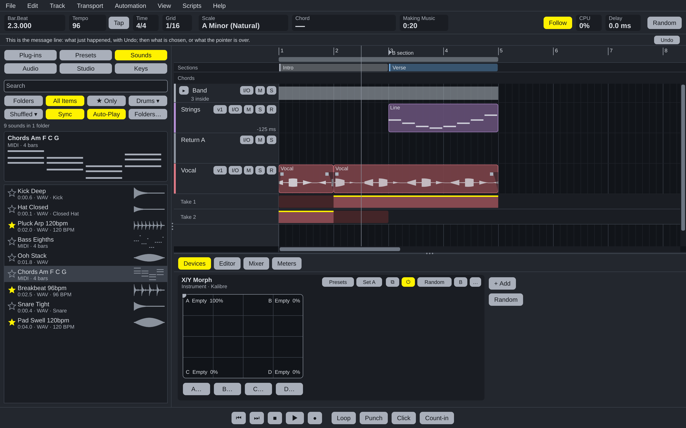

### The Plug-in Manager

**Kalibre > Plug-in Manager…**, in a window of its own.

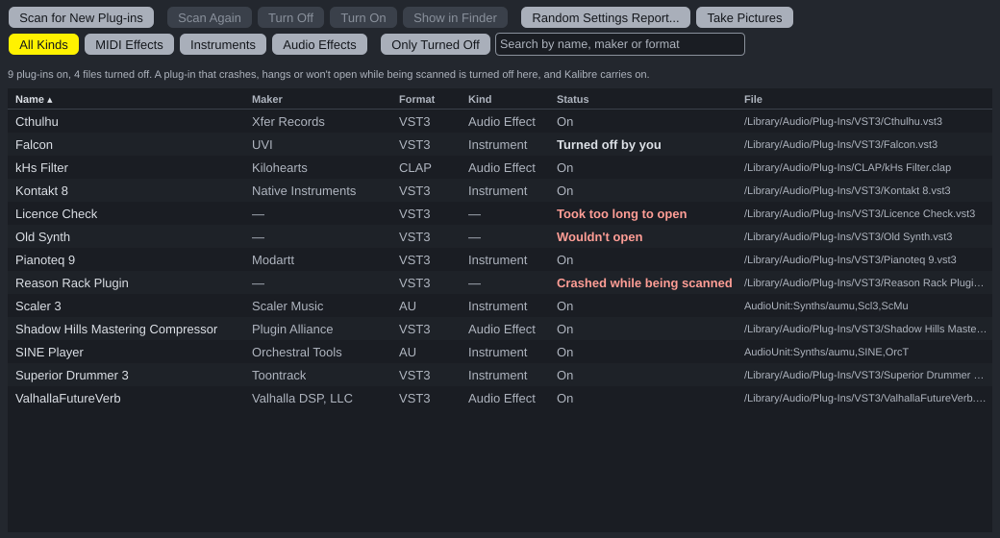

| Control | Does |
| --- | --- |
| Search, sort | By name, maker, kind or format. |
| **Scan for New Plug-ins** | Plug-ins installed since the last scan, each opened in a helper. |
| **Scan Again** | The chosen ones again, as if new: for one that crashed and has been updated since. |
| **Turn Off** | Leave them out of the browser and the menus, and never load them. |
| **Turn On** | Back on. One that crashed or hung is scanned again first. |
| **Show in Finder** | The plug-in's file. |
| **Only Turned Off** | Just those, each with why: crashed, hung, couldn't open, or turned off by hand. |
| **Random Settings Report…** | Every control of every plug-in, each marked **random** (a plug-in's Random may change it) or **kept**, and why, in a file on your Desktop (Kalibre Random Settings Report.txt). Each plug-in is opened in a helper, so it takes a few minutes; the message line shows how far it's got. |
| Right-click > **File As** | MIDI Effect, Instrument or Audio Effect, by hand. |

An instrument that also sends MIDI (Riffer, Scaler) is listed under MIDI
Effects too.

---

## 16. Orchestral Tools

### Articulation maps

An articulation map says which keyswitch plays which articulation (legato,
staccato, pizzicato), and how many milliseconds late each one speaks, so
Kalibre can play it early by that much.

- **Track > Articulation Maps > New Articulation Map…** makes a map with six
  string articulations to start from. Its submenu edits each one's name,
  keyswitch and delay, or **Add an Articulation**.
- **The articulation lane** in the piano roll gives each note its
  articulation.
- **Velocity ▾ > Articulation Map** in the piano roll chooses the track's map,
  from the song or from the library.

### The Articulation Manager

**File > Articulation Manager…**, in a window of its own.

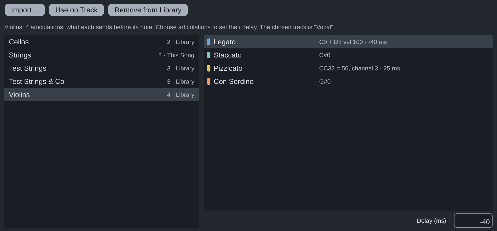

| Control | Does |
| --- | --- |
| **Import…** | Cubase expression maps (`.expressionmap`), Logic articulation sets (`.plist`) and Reaticulate banks (`.reabank`) into the library. |
| **Use on Track** | The chosen map on the chosen track. |
| **Remove from Library** | Songs that use it keep their own copy. |
| **Delay** | Each articulation's delay, kept in the library. |

### Fix Note Timings and Volume

Right-click a MIDI clip > **Fix Note Timings and Volume…**: Note Position &
Volume Fixer, built in. For sample libraries whose notes speak late or
unevenly.

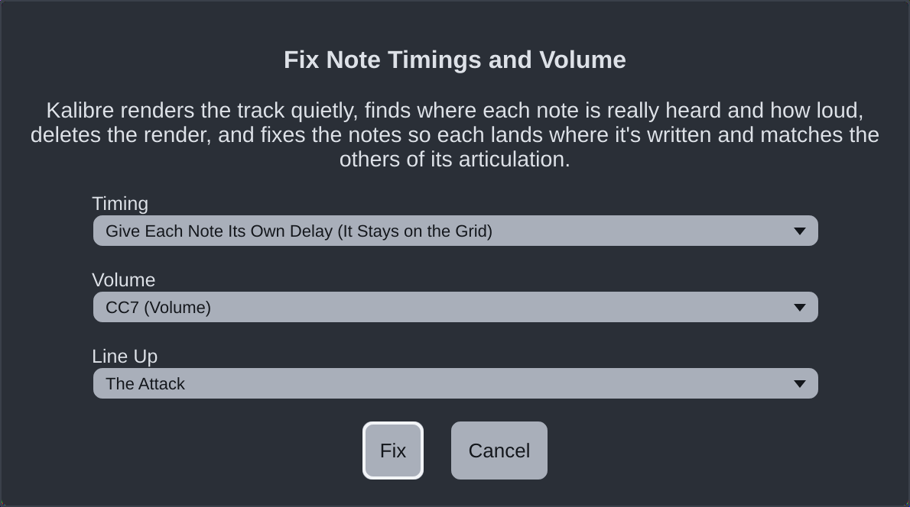

Kalibre renders the track quietly, finds where each note is really heard and
how loud, and then:

- gives each note the **delay** that puts its sound on the grid (or **moves**
  the notes instead);
- evens out the **volume** within each articulation, with CC7, CC11 or
  velocity.

It's one undo step, and safe to run again.

### AutoCC

On a track named for an instrument AutoCC knows (Violin, Horn, Flute…),
click **Auto** on the editor bar: CC1, CC11, CC7 and CC21 are drawn as
AutoCC would play these notes.

---

## 17. Songs, Files, Import and Export

### Saving, autosave and backups

- **Save** (⌘S), **Save As…** (⇧⌘S).
- An **autosave** every three minutes while there are changes: **File > Open
  the Last Autosave**.
- A **backup** every 15 minutes while it has changed, the newest 48 kept:
  **File > Open a Backup** (and **Show Backups in Finder**).
- **Templates**: **File > Save as Template…** (**Tracks and Plug-ins**, or
  **With the Music Too**); **File > New from Template** starts from one.

### Files and folders

- **Collect All Files and Save**: copies every file the song uses into its
  folder.
- **Relink Missing Files…**: choose the folder they're in now (folders inside
  it are searched too).
- **Archive the Project…**: the song and all its files in one `.zip`.
- **Song Details…**: title, artist and the rest, written into WAV and MP3
  exports.

### Import

| Menu item | Takes |
| --- | --- |
| **Import Audio or MIDI…** (⌘I) | WAV, AIFF, FLAC, MP3, OGG, MIDI. Audio is copied into the song's Audio folder as 32-bit float WAV. |
| **Import MusicXML…** | `.musicxml`, `.xml`, `.mxl`: each part becomes a track, with the tempo and key. |
| **Open a DAWproject…** | A song from Bitwig, Studio One, Cubase or another program, as a new song: tracks, folders, returns, the mix, sends, tempo, time signatures, markers, clips, plug-ins by name, automation and warping. |
| **Import Video…** | `.mov`, `.mp4`, `.m4v`. |
| **Import Final Cut XML…** | Clips placed as they were. |

### Export

Exports cover the loop range when the loop is on, otherwise the whole song.

| Menu item | Makes |
| --- | --- |
| **Export the Mix…** (⇧⌘E) | WAV, AIFF, FLAC or MP3 (320 kb/s), by the name you give it. 16, 24 or 32-bit, with dither where it's fewer bits. The whole song is from the start to the bar line after the last clip (the loop, when it's on). |
| **Export the Mix at a Loudness** | **For Streaming (-14 LUFS)**, **For Apple Music (-16 LUFS)**, **For Broadcast (-23 LUFS)**. |
| **Export Every Track…** | A file per track (stems). |
| **Export MIDI…** | A MIDI file. |
| **Export MusicXML…** | For Dorico, MuseScore, Sibelius or Finale. |
| **Export a DAWproject…** | For Bitwig, Studio One, Cubase and others. |
| **Export Several at Once…** | Tick what you want (The Mix as WAV, The Mix as MP3, Every Track as WAV, The MIDI, The Mix at -14 LUFS, and the two below) and choose a folder. |
| **Export Final Cut XML…** | The audio clips, for Final Cut, Resolve, Premiere or Logic. |

Exporting the mix or every track first asks two things, ticked as you left
them last time:

| Tick | Does |
| --- | --- |
| **Record the Tail** | After the end, nothing new starts playing, and whatever is still sounding (a synth's release, a reverb, a delay's echoes) is recorded until it falls silent, then the file ends (at most 30 seconds on). A note held past the end is let go at the end. Off: the file stops exactly on the end. On unless you turn it off. |
| **Export the Second Pass** | The range (the loop, or the whole song) is played through once without being recorded, then recorded the second time through. What rings past the end, the reverb and echoes of the last bar, is then heard at the start, as it is when the loop goes round: a loop that loops without a gap or a jump. The file is still exactly as long as the range. |

Both together: the second pass, then its tail.

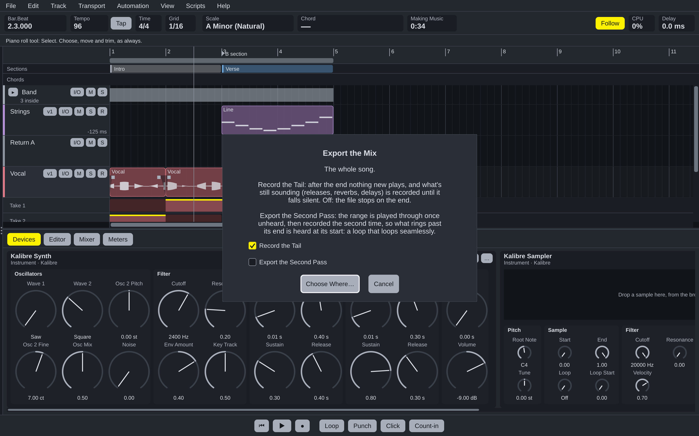

---

## 18. Sync, Control Surfaces and Scripts

**Kalibre > Sync and Control Surfaces…** opens the browser's **Studio** tab.

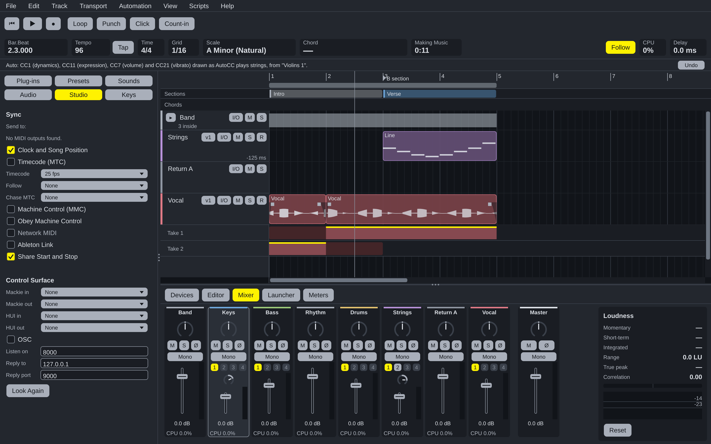

- **Sync**: MIDI clock and Song Position out, MIDI timecode out, follow
  another machine's clock, chase MTC, MIDI Machine Control in and out,
  **Ableton Link**, and the Mac's **network MIDI** session.
- **Control surfaces**: **Mackie Control** and **HUI** (choose their ports),
  and **OSC**.

Everything each one does is in [CONTROL.md](CONTROL.md).

**Scripts**: Lua scripts in the **Scripts** menu. **Show the Scripts Folder**
is where they go; **Add the Example Scripts** copies Kalibre's examples
there. How to write them: [SCRIPTING.md](SCRIPTING.md).

### AI agents (MCP)

An AI agent, such as Claude, can work in Kalibre with you: look at the song,
make tracks, add plug-ins and turn their knobs, write clips and notes, play
and stop, export. It talks to Kalibre through MCP (the Model Context
Protocol), which Claude Desktop, Claude Code and many other agents speak.

1. **Kalibre > AI Agents…** opens the browser's Studio tab at **AI Agents
   (MCP)**. Tick **Let AI Agents Control Kalibre**. Under it, it says
   **Listening on this Mac, port 47100**.
2. Tell the agent where Kalibre is, once:
   - **Claude Desktop**: click **Copy Setup for Claude Desktop**. In Claude
     Desktop, choose **Settings > Developer > Edit Config**, paste it into
     the file (if it already has an `"mcpServers"` section, put the
     `"kalibre"` part inside that one), save, and open Claude again.
   - **Claude Code**: click **Copy Command for Claude Code**, paste it into
     Terminal and press Return.
   - **Anything else**: point it at `http://127.0.0.1:47100/mcp`, or have it
     start Kalibre with `--mcp` (what the setups above do).
3. Ask it for things: "make a bass track with Kalibre Synth and write a
   two-bar line in A minor", "put Pro-Q on the vocal and cut a bit at
   300 Hz", "loop bars 5 to 8".

Kalibre must be open for the agent to reach it. What you'll see:

- **Every change is one undo step**, named "Agent: …", and the message
  line says what the agent did ("An AI agent: Add 2 Notes."), with **Undo**
  beside it. ⌘Z takes it back like anything you did. Turning a plug-in's
  knob isn't an undo step, as when you turn it.
- **Only this Mac**: Kalibre listens on 127.0.0.1, so nothing on the network
  can reach it, and a web page in your browser is turned away. Untick the box
  and no agent can reach it at all. It's off until you tick it.
- If **Port** is taken by something else, the message line says so: type
  another and press Return (then copy the setup again).

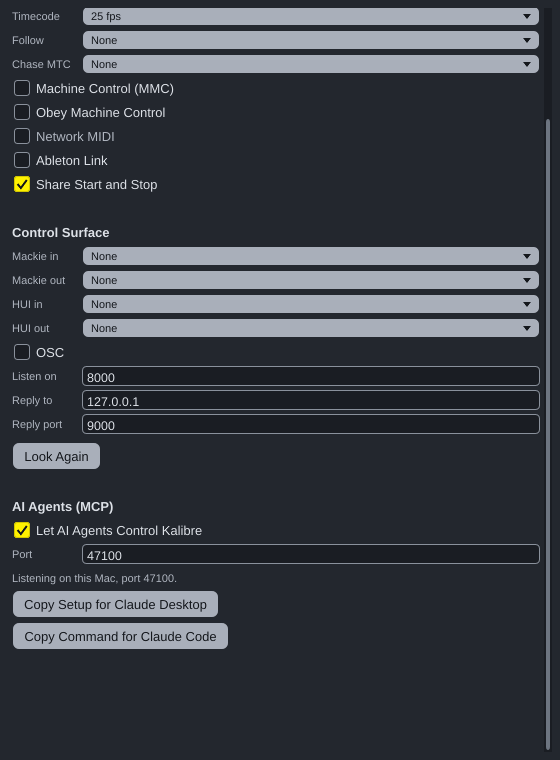

Every tool an agent is given, and what it does: [AGENTS.md](AGENTS.md).

---

## 19. Every Menu, Item by Item

### Kalibre

| Item | Key | Does |
| --- | --- | --- |
| Audio and MIDI Settings… | ⌘, | The browser's Audio tab. |
| Sync and Control Surfaces… | | The browser's Studio tab. |
| AI Agents… | | The Studio tab at AI Agents (MCP): let an AI agent work in Kalibre. |
| Plug-in Manager… | | [Section 14](#the-plug-in-manager). |
| Library Folders… | | The folders the Sounds tab looks in ([Section 14](#the-sounds-tab)). |
| Quit Kalibre | ⌘Q | Asks to save first. Kalibre always ends within five seconds, even if a plug-in won't let go. |

### File

| Item | Key |
| --- | --- |
| New | ⌘N |
| New Random Song | |
| Open… | ⌘O |
| Open the Last Autosave | |
| Open a Backup ▸ | |
| New from Template ▸ | |
| Save | ⌘S |
| Save As… | ⇧⌘S |
| Save as Template… | |
| Articulation Manager… | |
| Collect All Files and Save | |
| Relink Missing Files… | |
| Archive the Project… | |
| Song Details… | |
| Import Audio or MIDI… | ⌘I |
| Import MusicXML… | |
| Open a DAWproject… | |
| Import Video… | |
| Remove the Video | |
| Export the Mix… | ⇧⌘E |
| Export the Mix at a Loudness ▸ | |
| Export Every Track… | |
| Export MIDI… | |
| Export MusicXML… | |
| Export a DAWproject… | |
| Export Several at Once… | |
| Export Final Cut XML… | |
| Import Final Cut XML… | |

### Edit

| Item | Key | Does |
| --- | --- | --- |
| Undo (what) | ⌘Z | Every gesture is one step. |
| Redo (what) | ⇧⌘Z | |
| Delete | ⌫ | The chosen notes, clips or range. |
| Duplicate | ⌘D | |
| Split at the Cursor | ⌘E | |
| Snap to Zero Crossings | | Edges and cuts land where the waveform crosses zero. |
| Choose Every Note | ⌘A | |
| Quantise | Q | |
| Legato | | |
| Humanise | | Small random changes in timing and velocity. |
| Join the Chosen Notes | | |
| Split the Chosen Notes at the Cursor | | |
| Transpose ▸ | | Up 12, 7, 1; Down 1, 7, 12. |
| Consolidate the Chosen Clips | | |
| Ripple Editing | | Deleting a clip pulls the later clips on its track back. |
| Insert Bars at the Cursor… | | |
| Delete the Loop Range's Bars | | |
| Duplicate the Loop Range | | |
| Add a Section from the Loop Range | | |

### Track

| Item | Key |
| --- | --- |
| Add Track | ⌘T |
| Add Folder | ⇧⌘T |
| Mix Format ▸ (Stereo, Quad, 5.1, 7.1) | |
| Add Return | |
| Add Summing Track | |
| Add Cue Track | |
| Put the Chosen Tracks in a Folder | |
| New Version | |
| Add a Plug-in… | |
| Duplicate | |
| Delete | |
| Arm for Recording Audio / MIDI / Audio and MIDI / MIDI Input | |
| Articulation Maps ▸ | |

### Transport

| Item | Key |
| --- | --- |
| Play / Stop | Space |
| Record | R |
| Stop and Go to the Start | Home |
| Go to the Start | Return |
| Go to the End | End |
| Loop | L |
| Punch In and Out | |
| Set the Punch Range to the Loop | |
| Metronome | |
| Count-in | |
| Metronome Clicks ▸ (Beats, Beats in 2, 3, 4) | |
| Capture MIDI | ⇧⌘R |
| Capture Audio (the Last 30 Seconds) | |
| Tap Tempo | |
| Ramp the Tempo to Here | |

### Automation

| Item | Key |
| --- | --- |
| Automate (the last touched control) | |
| Modulate (the last touched control) ▸ | |
| MIDI Learn (the last touched control)… | ⌘L |
| MIDI Mappings ▸ | |
| Mode: Off, Read, Touch, Latch, Write, Trim | |

### View

| Item | Key |
| --- | --- |
| Devices | D |
| Editor | E |
| Mixer | X |
| Meters | Y |
| Browser | ⌘B |
| Lower Zone | |
| Section Lane | |
| Chord Lane | |
| Tempo Lane | |
| Shade the Scale in the Piano Roll | |
| Follow Playback | |
| Zoom to Fit | F |
| Workspaces ▸ | |
| Text Size ▸ | ⌘0 for 100% |

### Scripts

Your scripts, then **Show the Scripts Folder** and **Add the Example
Scripts**.

### Help

| Item | Does |
| --- | --- |
| Keys | The browser's Keys tab. |
| Show Crash Reports | The folder of crash reports. |
| Kalibre on GitHub | |

---

## 20. Every Key Command

These are the keys Kalibre starts with. Change any of them in **Help > Keys**:
click a command, then press its new key. Esc leaves it as it was; Delete takes
its key away; **Default Key** puts one back, **All Defaults** puts them all
back. A key does one thing: giving it to a command takes it from any other.
The menus always show the key a command has now.

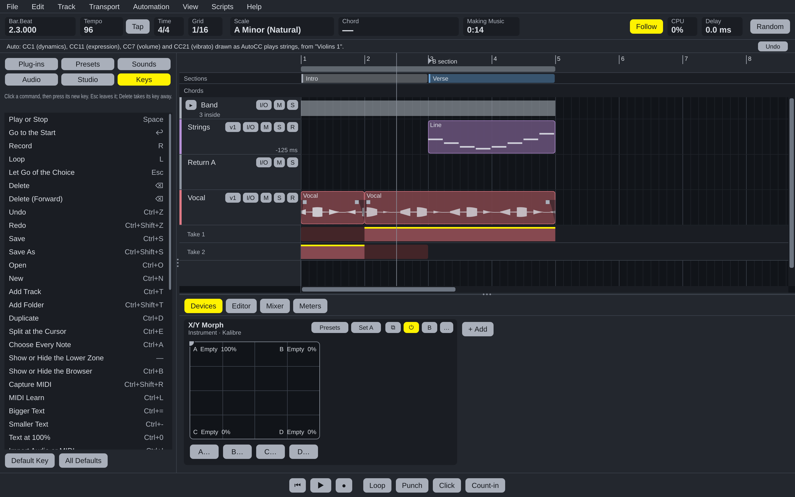

*The pictures in this guide are drawn on Linux, so this list says Ctrl+ where
the Mac says ⌘.*

### Playing

| Key | Command |
| --- | --- |
| Space | Play or Stop |
| Return | Go to the Start |
| Home | Stop and Go to the Start |
| End | Go to the End (where the last clip ends) |
| R | Record |
| L | Loop |
| ⇧⌘R | Capture MIDI |

### Editing

| Key | Command |
| --- | --- |
| ⌘Z | Undo |
| ⇧⌘Z | Redo |
| ⌫ | Delete |
| Delete (forward) | Delete |
| ⌘D | Duplicate |
| ⌘E | Split at the Cursor |
| ⌘A | Choose Every Note |
| Q | Quantise |
| Esc | Let Go of the Choice |

### Tracks

| Key | Command |
| --- | --- |
| ⌘T | Add Track |
| ⇧⌘T | Add Folder |
| M | Mute the Chosen Tracks |
| S | Solo the Chosen Tracks |
| ⌘L | MIDI Learn (the last touched control) |

### Views

| Key | Command |
| --- | --- |
| D | Devices |
| E | Editor |
| X | Mixer |
| Y | Meters |
| ⌘B | Show or Hide the Browser |
| (none) | Show or Hide the Lower Zone |
| F | Zoom to Fit |
| ⌘= | Bigger Text |
| ⌘- | Smaller Text |
| ⌘0 | Text at 100% |

### Files

| Key | Command |
| --- | --- |
| ⌘N | New |
| ⌘O | Open |
| ⌘S | Save |
| ⇧⌘S | Save As |
| ⌘I | Import Audio or MIDI |
| ⇧⌘E | Export the Mix |
| ⌘, | Audio and MIDI Settings |
| ⌘Q | Quit |

### Tools

| Key | Tool |
| --- | --- |
| 1 | Select |
| 2 | Range |
| 3 | Split |
| 4 | Glue |
| 5 | Erase |
| 6 | Zoom |
| 7 | Mute |
| 8 | Draw |
| 9 | Line |
| (none) | Play, Hand, Drumstick, Time Warp: give them keys in Help > Keys. |

### Keys that work in one place

These aren't in the Keys list: they belong to where you are.

| Where | Key | Does |
| --- | --- | --- |
| Piano roll | ↑ / ↓ | Chosen notes up or down a semitone |
| Piano roll | ⇧↑ / ⇧↓ | Up or down an octave |
| Piano roll | ← / → | Earlier or later by a grid step |
| Piano roll | ⇧← / ⇧→ | Earlier or later by a bar |
| Piano roll | Esc | Let go of the notes; again, leave the piano roll |
| Step input on | 1 to 8 | Write the held notes: 1/128, 1/64, 1/32, 1/16, 1/8, 1/4, 1/2, 1/1 |
| Step input on | 9 / 0 | Dotted / triplet |
| Step input on | - | A rest |
| The toolbox | Esc | Close it |
| The Sounds tab | ↑ / ↓ | The sound above or below, heard |
| The Sounds tab | ← / → | Shut or open a folder |
| The Sounds tab | Return | Put the sound on the chosen track at the cursor |
| Questions Kalibre asks | Return / Esc | The default button / Cancel |
| Keys tab | Esc / Delete | Leave the key / take it away |

---

## 21. Every Mouse Gesture

### Anywhere

| Gesture | Does |
| --- | --- |
| ⌃ Control-right-click (arrangement, piano roll) | The toolbox. |
| Control-click alone | The Mac's right-click, as always. |
| Hover | The message line says what's under the pointer; tooltips say what a control does. |

### The ruler and the lanes under it

| Gesture | Does |
| --- | --- |
| Click the upper half of the ruler | Move the cursor. |
| Drag along the lower half (or Shift-drag) | Draw the loop range. |
| Double-click the ruler | Add a marker. |
| Right-click the Sections lane | Add a section. |
| Right-click a section | Its menu. |
| Shift-drag a section | Move it, and everything in it, to another bar. |
| Drag a tempo point | Change it. **⌥ Option**-drag: ramp to it. |

### Track headers

| Gesture | Does |
| --- | --- |
| Click | Choose the track. Shift, Option, Command as everywhere. |
| Double-click the name | Rename. |
| Right-click | The track menu. |
| Drag onto a folder | Put it in the folder. |
| ⌥ Option-click a button | Add the track to the choice instead. |
| Arm: click / right-click / Shift-click / Shift-right-click | Audio / MIDI / both / MIDI input. |
| Right-click under the tracks | Add a track. |

### Clips

| Gesture | Does |
| --- | --- |
| Double-click an empty lane | A new one-bar MIDI clip. |
| Click | Choose. |
| Drag | Move. **⌥** copies; **⌘** off the grid. |
| Drag an edge | Trim. |
| Drag a top corner handle (audio) | Fade in or out. |
| Drag a warp marker | Move that moment of the audio. |
| Right-click | The clip menu. |
| Drag across a take's lane | Use that take there. |
| Drop files (from the Finder or the Sounds tab) | Import them there. |

### Scrolling and zooming

| Gesture | Does |
| --- | --- |
| Scroll | Up and down the tracks. |
| Shift-scroll, or sideways | Along the song. |
| ⌘-scroll, or pinch | Zoom around the pointer. |
| Two-finger swipe over the device rack | Along the rack. |
| Drag the browser's right edge | Make it wider or narrower; past its narrowest, it shuts. |
| Drag (or click) the bar at the window's left edge | Open the browser again. |
| Drag the lower zone's top edge down | Make it shorter; past its shortest, it shuts. |
| Drag (or click) the bar along the bottom | Open the lower zone again. |

### Editors

The piano roll, drums, steps, Euclidean and notation have their own tables in
[Section 7](#7-writing-notes-the-editors).

### Knobs and faders

| Gesture | Does |
| --- | --- |
| Drag | Change it. |
| Double-click pan | Back to the centre. |
| Moving one by hand | It becomes the last touched control ([Section 12](#12-automation-and-modulation)). |

---

## 22. When Something Goes Wrong

- **A plug-in crashed while scanning.** It's turned off, with the reason, in
  the Plug-in Manager (**Only Turned Off**). After updating it, choose it and
  click **Scan Again**.
- **Kalibre crashed.** A crash report is written, naming the plug-in that was
  playing; you're told on the next start. **Help > Show Crash Reports**.
  **File > Open a Backup** or **Open the Last Autosave** brings your work
  back.
- **Files are missing.** File > **Relink Missing Files…** and choose the
  folder they're in.
- **Something's too quiet or loud on export.** File > Export the Mix at a
  Loudness.
- **It sounds different with Use Every Core.** It shouldn't: switch it off in
  the Audio tab, and say which plug-in.
- **Undo.** Every gesture is one step: ⌘Z, or **Undo** beside the message.

---

*This guide describes Kalibre as it is. What's built and what isn't is in
[FEATURES.md](FEATURES.md); why it works as it does is in
[decisions](decisions/README.md).*
