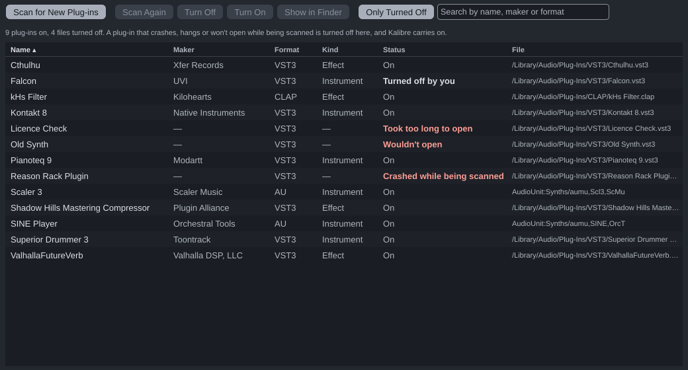

# 0047. Plug-ins are scanned in a helper, and turned off when they crash

## Context

Scanning loaded every plug-in into Kalibre itself, one after another. On the
user's Mac a plug-in (most likely Reason Rack Plugin) aborts the moment it's
loaded, inside its own start-up code, so the scan took Kalibre down every time
(Crash_1125_161126, 16 November). JUCE's "dead man's pedal" noted the crasher
for next time, but the list of what had been found was only saved at the end
of a scan, so each attempt started from nothing and met the next crasher.

## Decision

- Each plug-in file is looked at by a helper: Kalibre runs its own program
  again as `Kalibre --kalibre-scan <format> <file> <result>`. That copy starts
  no window and no audio, loads the one plug-in straight away (not from the
  event loop: on the Mac, a helper that waited for its event loop never
  answered), writes what it found and quits at once (`std::_Exit`, so a plug-in that crashes as it's unloaded
  can't spoil the answer). It's started with `posix_spawn`, from a thread, so
  the window keeps working.
- A helper that crashes, takes longer than two minutes, or finds nothing
  turns that file off (JUCE's blacklist), with the reason kept beside the
  list: crashed (and the signal), took too long, wouldn't open, or turned off
  by you. The scan carries on with the next one.
- The list is saved after every plug-in, written beside and moved over.
- The helper writes each step to `Plug-in Scan.log` beside the list
  (Application Support/Kalibre), for when a plug-in misbehaves.
- What the old scanner left in `Scanning.txt` is turned off as a crash.
- A turned-off plug-in isn't loaded, even by a project that uses it: the
  project opens without it and the message line says why.
- Kalibre > Plug-in Manager... (also View > Plug-in Manager...) opens a window
  of its own (0002, amended): every plug-in and every one turned off, with
  search, sorting by any column, Only Turned Off, Scan for New Plug-ins (Stop
  Scanning while one runs), Scan Again, Turn Off, Turn On and Show in Finder.
  Turning on one that crashed or hung scans it again; it stays off if it
  still fails. Turning off by hand keeps what the file held, so turning it on
  needs no scan.

## Consequences

- A plug-in that crashes Kalibre while *playing* still crashes it: only the
  scan is in a helper. Hosting plug-ins out of process is a far larger job.
- Each plug-in costs a program start (a fraction of a second) on its first
  scan; later scans only look at what's new or changed.
- AUv3 plug-ins that must be made asynchronously are still left out, as before.
- On the Mac, the test also scans Apple's own Audio Units through the helper.
- Tested with a fake format whose plug-ins abort, hang, hold nothing or open
  (Tests/App/TestPlugins.cpp), and in the real app with a VST3 that aborts as
  it loads, like the user's crash.

