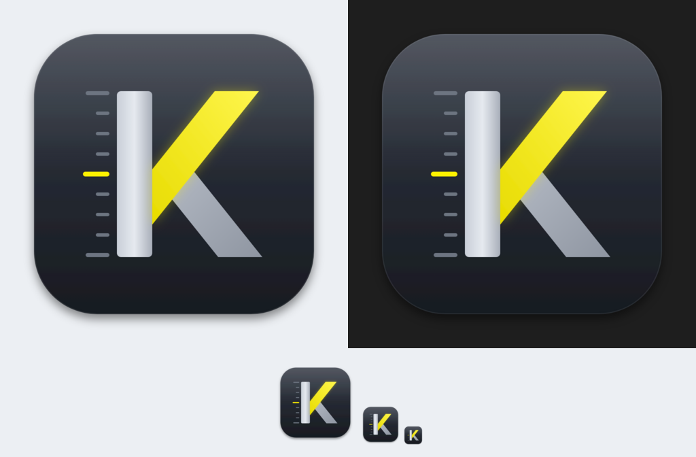

# 0048. The app icon

## Decision

A bold K on the house's dark ground (docs/COLOUR.md), on Apple's icon grid
(an 824-point rounded square in a 1024 canvas, with its shadow). The stem is
light grey and carries calibration ticks down its left side, a ruler for
Kalibre (calibre: a measure); the middle tick and the K's upper arm are the
house yellow, the colour that means "on". The lower leg grows from under the
yellow arm. Each piece is as thick as the stem.

`Resources/Icon.svg` is the source; `Resources/Icon.png` is it drawn at 1024
by a browser, and `ICON_BIG` in cmake/App.cmake makes the Mac's icon from it.

## Consequences

At 32 points the ticks blur into a texture; the K stays readable.
