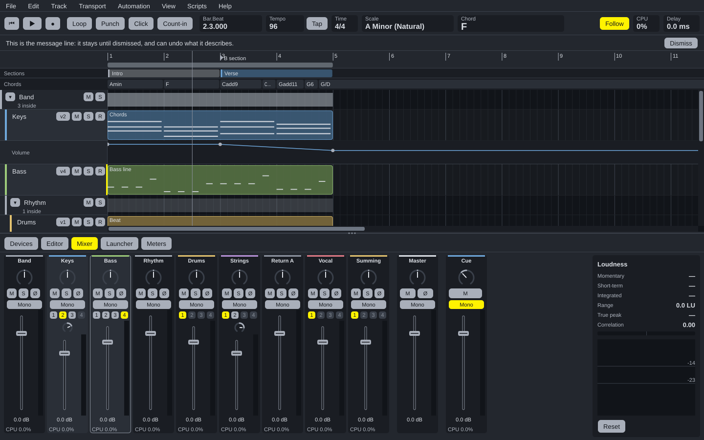

# 0050. Versions have their own plug-ins, four at most, chosen from the mixer

## Context

Track versions (0006) shared one set of plug-ins, so trying another sound
for a part meant changing it for every version. The user wants to compare up
to four versions of a track quickly, A/B/C/D, from the mixer, each able to
have different instruments and plug-ins, and to switch several tracks at
once (16 November).

## Decision

- A track has four versions at most. A new track is on version 1; a new
  version is the one chosen.
- Each version has its own devices. The active version's are the track's
  `devices`, as before, so the rest of Kalibre is unchanged; the others wait
  in their `TrackVersion::devices`. New Version copies the active version's
  devices under the same ids, so the track's automation lanes and
  modulators follow whichever version plays; from then on each version's
  plug-ins and settings are its own.
- The engine keeps every version's plug-ins loaded, by (version, device):
  the playing version's are wired in, the others are "parked" in their
  wrapper (TimedPlugin): silent and costing no processor time. Choosing a
  version is instant, and nothing is reloaded.
- Each strip in the mixer has four small squares, 1 to 4: the chosen version
  is lit, versions that don't exist are dimmed. Clicking one chooses it.
  Shift-click strips' names to choose a range (Command-click adds or takes
  away one); a number then switches every chosen track that has that
  version, and the message line says which didn't. It's one undo step.
- Versions made before this took the track's plug-ins when first chosen.
- Removing a device in one version keeps the automation lanes another
  version still uses.

## Consequences

- Memory: every version's plug-ins stay loaded. Four versions of a big
  sampler is four samplers in memory.
- 0006 said devices were shared by every version: no longer.

