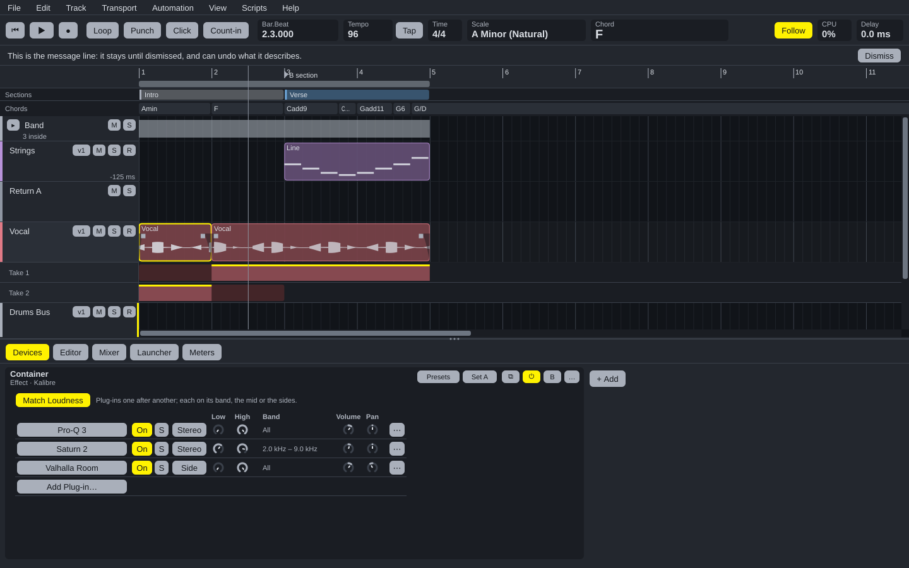

# 0055. The Container

## Context

The user asked for a device that holds several plug-ins, where each can play
only on the mid or the sides, only on part of the spectrum (multiband), be
switched off or soloed, and have its own volume and pan; with loudness
compensation by short-term LUFS (16 November).

## Decision

- Add > Kalibre > Container, an audio effect. Up to eight plug-ins, one
  after another, like a track's own effects (Add Plug-in…, then each row's
  ⋯ menu: Show Its Window, Replace…, Move Up, Move Down, Remove). The chosen
  plug-in's own window is shown beside the list, in the lower zone.
- Each plug-in has On, S (solo: with any soloed, only those play),
  Stereo/Mid/Side, a band (Low and High edges; double-click for none), and
  its own Volume and Pan. Volume and pan act on what that plug-in changed.
- Mid/Side: the plug-in hears the mid (or side) signal on both its inputs;
  what it sends back takes the mid's (or side's) place, and the other passes
  by unchanged.
- The band is split off with a three-way Linkwitz-Riley crossover (below, in,
  above), as multiband processors do. The three add up to the input's level
  at every frequency, so a plug-in that does nothing leaves every frequency
  as loud as it was (tested to 0.1 dB at and around the edges).
- What passes a plug-in by is held back by the plug-in's own delay, so it
  lines up with what comes back. The container's delay is the sum of its
  plug-ins', and stays the same when one is switched off or soloed (it's
  then held back as long), so the track's delay compensation never jumps.
- Match Loudness: short-term loudness (LUFS-S: K-weighted, 3 s, BS.1770) of
  what comes in and what goes out; what goes out is turned up or down by the
  difference, gliding over about a second, at most 24 dB, and only while
  both are above -70 LUFS. The amount is shown beside the button.
- Every setting is a parameter: it can be automated, modulated, MIDI-learned
  and picked up by last touched. The plug-ins inside and their settings are
  the Container's own saved state. A missing plug-in keeps its place and the
  sound passes it by.

## Consequences

- One after another only. Plug-ins in parallel (layers) could be a later
  choice; asked.
- The plug-ins inside can't be automated from the track's lanes yet, only
  the Container's own settings.

