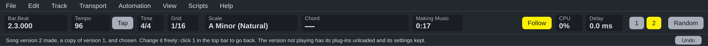

# 0103. Song versions 1 and 2; versions not playing are unloaded

## Context

Asked (20 November): beside the four versions each track has, two versions
of the whole song, chosen with 1 and 2 buttons in the top bar: 1 to start
with, 2 made when wanted, working like a track version. Worth it only if a
whole song of plug-ins and audio waiting under the other number costs very
little processor and memory: could it act like a frozen track, unloaded
while the other plays and put back as it was when chosen?

Asked back, and answered: each version has its own tempo, markers and key;
choosing one is an undo step; and track versions should unload the same way
(until now every version's plug-ins stayed loaded, parked: no processor, but
their memory, 0050).

## Decision

- **Song versions** (`Project::songVersion`, `otherVersion`). The playing
  version is the project as before; the other waits as it would be saved
  (`StoredSong`: the JSON of its tracks, clips, mix, automation, tempo,
  markers, key, sections, video and every plug-in's settings), shared
  between Undo's snapshots rather than copied. The song's name, its details
  (metadata), the music-making timer (0091) and the sample rate are the
  song's, shared by both. Saved inside the `.kalibre` file as
  `otherVersion`; a file without it opens as version 1, as before.
- **The top bar's 1 and 2**, left of Random. The playing one lit; 2 in the
  quieter grey until it's made. Clicking 2 the first time makes it, a copy of
  1, and chooses it; after that each click chooses. Right-click either for
  Play, New and **Delete Song Version** (deleting the one playing plays the
  other, as 1). Hidden like the rest from the bar's menu ("Song Versions").
  Making, choosing and deleting are each one undo step.
- **Choosing a version** stores the one playing (every plug-in's settings
  taken first), loads the other, and the engine lets go of every plug-in
  (`Engine::newSong`, as opening a song does, since the versions' devices
  have the same numbers) and makes the new version's from their settings.
  The playing version's `songId` says when that's needed: making version 2
  doesn't change it (the copy plays on, nothing reloads), nor does deleting
  the one not playing. If the song was playing it plays on from where it
  was; while recording, choosing is refused.
- **Audio** is read into memory whole (0022) and was never let go of until
  the song closed. Now the cache forgets, after each sync, every file and
  warped render no clip asked for since the last (`AudioCache::forgetUnused`):
  the other version's audio, and old renders of a warp since changed.
- **Track versions** not playing are no longer loaded: only the playing
  version's plug-ins are made; the others' settings wait in their
  `TrackVersion::devices`, as a switched-off plug-in's do (0010). Choosing a
  version takes its plug-ins' settings first, unloads them and makes the
  chosen one's. Parking (`TimedPlugin::parked`) is gone.
- **Undo across a switch** keeps what was changed since in the version left
  (a knob turned inside a plug-in isn't an undo step): Undo and Redo carry
  the settings of the plug-ins being unloaded into the version they go back
  to rest in (`Controller::carryPlayingStates`), for track and song versions.
- **Frozen tracks** in both versions: unfreezing one doesn't delete a render
  the other version still plays (`edit::otherVersionUses`).
- **Agents** (0099): `song_version` plays 1 or 2 (making 2); `get_song` says
  which plays and how many there are.

## Consequences

- The version not playing costs no processor and almost no memory: its
  settings as text (a few kilobytes, a few megabytes for a plug-in that keeps
  samples in its settings) and nothing else.
- Choosing is no longer instant, for track versions too: it takes as long as
  loading those plug-ins, seconds for big sample libraries. Playback carries
  on after.
- Tested: the core model (copies, what's each version's and what's shared,
  ids never handed out twice, saved and opened, deleting either); the app
  (version 2 made without reloading; two synths and an audio file let go of
  when version 2 doesn't have them, and back as they were on choosing 1;
  plays on; one undo step, carrying a change made since; saved and opened);
  track versions (the one not playing not loaded; settings back; Undo
  carrying a change); the top bar's buttons; the agents' tool.
- 0050's "every version's plug-ins stay loaded; choosing is instant" no
  longer holds.

