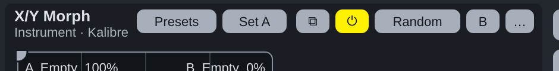

# 0104. A plug-in's Random: its controls by chance, volume, tuning and pitch left alone

## Context

Asked (20 November): a Random button in each plug-in's header, beside the
bypass button, that sets its parameters by chance, leaving every control for
volume, tuning or pitch untouched. Then: look into what the most used
plug-ins call their controls, and plan around those names. The plan was
shown and taken as it stood.

There is no published list of the names plug-ins give their controls. What
they're really called was read from the source of the open-source ones:
Vital, Surge XT, Dexed, OB-Xf, Odin 2, Helm, Monique, Tunefish, OctaSine,
Geonkick, ADLplug, Wolf Shaper, sfizz, Chow Tape Model, Airwindows (530
plug-ins), Calf, LSP, x42, Dragonfly Reverb, Valentine and DISTRHO-Ports:
over 2,000 names. The usual commercial ones (Serum, Sylenth1, Diva, Spire,
Pigments, Omnisphere, Kontakt, FabFilter, Valhalla, Soundtoys, Waves,
iZotope, OTT, Soothe2, Auto-Tune) from their manuals, not checked.

## Decision

- **Random**, beside B on every plug-in (`Controller::randomSettings`): each
  control chance may change is set to a value by chance, notifying the
  plug-in as a host does, but not as a touch (`settingByChance`): no
  automation written, nothing "last touched". One undo step, Kalibre's own
  state change (`pluginChanged`), so Undo puts the old settings back.
- **What's left alone** (`randomVerdict`, then `randomsong::whyKept`, in Core):
  - what the plug-in says: its bypass, meters, its own input and output gain,
    controls a host can't automate, and meta controls;
  - by unit: semitones (`st`) and cents;
  - by name, in words ("MasterVol", "Osc1Pitch", "GTune" are two each):
    **pitch** (tune, retune, pitch, transpose, detune, fine, coarse, crs,
    semi, sem, octave, oct, note, cent, root, bend, vibrato, vib, drift, wow,
    flutter; an oscillator's, operator's or FM carrier's frequency or ratio,
    its keytrack; tape or sample speed; frequency shift; Valhalla's Shift,
    Auto-Tune's Key and Scale; Dexed's PM depth); **volume** (volume, vol,
    gain, level, lvl, loud, output, out, input, In, trim, makeup, ceiling,
    amplitude, fader, atten, master, main, return, expression; envelopes and
    velocity sent to the amp; a limiter's threshold); **silence** (a sound
    source's on switch); **not the sound** (presets, patches, banks, init,
    save, load, undo, learn, browser, panic, reset, delta, listen, audition,
    monitor, oversampling, lookahead, latency, quality, sidechain, MIDI,
    channel, polyphony, Voices, the wheels, aftertouch, pedal, solo, mute,
    bypass, polarity, dither, meters, analysers, views, BPM); **unknown**
    (#001, Param 12, macros, modulation slots: wired to anything).
  - Words alone mean one thing and in a longer name another: "Speed" and
    "Shift" alone are pitch, but Speed Mode (a rotary speaker) and BitShift
    aren't; "In" alone is volume, Fade In isn't; "Key" alone is Auto-Tune's,
    Key Follow is a filter's. Odin's "SEM" filter isn't semitones.
- **No Random at all** for pitch tools (Auto-Tune, Little AlterBoy,
  Melodyne, pitch shifters, harmonisers, tuners) and utilities (gain, trim,
  meters, analysers), by the plug-in's name: the button is dimmed and says
  why.
- **The Random Settings Report** (Plug-in Manager): every control of every
  scanned plug-in, each "random" or "kept" and why, to a file on the Desktop.
  Each plug-in is opened in the scan's helper again (`--kalibre-scan ...
  controls`), so one that crashes can't close Kalibre; Kalibre's own devices
  are read in Kalibre. It's for checking the rule against the musician's own
  plug-ins, whose names weren't all known.
- **Agents** (0099): `randomise_plugin`.

## Consequences

- Amended 21 November: the report froze Kalibre at its end on the
  musician's Mac (macOS: not responding; nothing written). Its text was
  built by appending to a juce::String, which grows only as far as each
  append needs, so every line copied the whole report so far; with hundreds
  of thousands of controls it never finished. Now built in a std::string, on
  a thread of its own; a test of 300 plug-ins with 1,500 controls each hung
  before and takes 5 seconds (unoptimised) now.
- Amended 21 November: fitted to the musician's own report (508 plug-ins,
  about 600,000 controls). Every name was judged again by the old and the new
  rule and each change read. Now kept: MIDI controller slots and host slots
  (Steinberg's HALion and Groove Agent: "Foot Ctrl", "Data Entry MSB",
  "Ch1 Ins1 P3", "MM Slot 4 Destination"), Serum's and XILS's tuning
  ("A Ratio", "A Hz Offset", "Osc 1 Range", "Tuning Mode"), pitch-bend range,
  anything measured in semitones, cents or octaves. Now random: a delay's
  note, which is a time (EchoBoy's Echo Note, "StDly Base Note", "LFO Sync
  Note"); an input's or output's mode or diffusion ("Input Mode", "InOutMode");
  an LFO's rate in octaves (Tremolator's RateMod); a tape machine's speed
  (Satin's 7.5/15/30 ips is its tone). Chromaphone's and Padshop's A and B
  layers stay random: only "A Enable"-style names (a letter and one word) are
  Serum's oscillators.

- Kept on purpose, costing some randomness, never safety: EQ band gains
  (dB boosts), macros, an envelope's sustain level, Knee Level, note-off
  settings, a sampler's envelope and loop switches. Glide and portamento,
  compressor thresholds, velocity sensitivity and filter keytrack stay random.
- A plug-in that names a volume or pitch control in no word the rule knows
  is randomised: the report finds those. Kontakt's #001 slots and Phase
  Plant's host controls are left alone, so Random does little there.
- In FM synths (Dexed) operator levels and ratios are kept, so Random changes
  envelopes and modulation, not the operators' mix or tuning.
- Tested: over 200 real names in Core, each with its reason, and 50 that
  must stay random; Kalibre Synth and Sampler (their volume, tune, root, speed
  and pitch untouched, the rest changed, Undo exact, nothing touched); a
  utility refused; the button beside B; the report read through the helper
  from fake plug-ins with Serum's and Sylenth1's names, and written to a file;
  the agents' tool.

