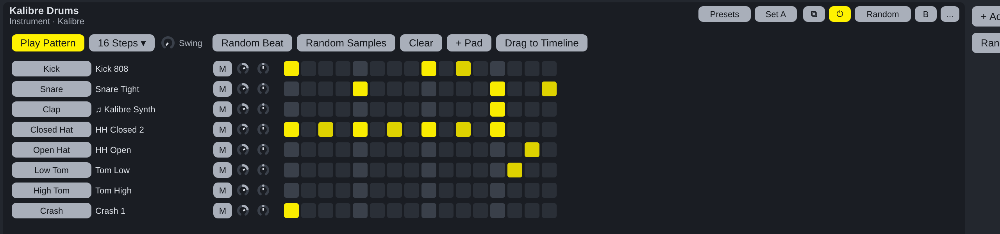

# 0105. Kalibre Drums: a kit of samples and plug-ins, with its own steps

## Context

Asked (21 November): a native device adapted from the drum sequencer, where
samples are dragged from the browser onto its lanes, or plug-ins added to
act as drum synths on them, with a Random Samples button that fills each
sample with one from the scanned folders. Asked back where its pattern
lives (today the drum grid edits a clip's notes): **both**, a kit with its
own grid that plays with the song, which can be dragged out to the timeline
as a clip.

## Decision

- **Kalibre Drums**, an instrument (Add > Kalibre). Pads (eight to start:
  Kick, Snare, Clap, Closed Hat, Open Hat, Low Tom, High Tom, Crash, on
  General MIDI's notes; up to 16), each: a **sample** or a **plug-in**
  (a plug-in wins), the note that plays it, volume, pan, mute, and a
  **choke group** (the hats share one: the closed hat stops the open one, on
  its very sample). `Core/DrumKit.*` (the kit, its state as JSON, choosing
  sounds), `Engine/DrumMachine.*` (the device and its window).
- **Samples** are read whole into memory at the device's rate when chosen
  (30 seconds at most) and played as one-shots, as loud as the hit.
  **Plug-ins** are hosted inside, as the Container's are (0055), each sent
  the pad's plug-in note (C3 unless chosen) on each hit and its note-off
  after the step, or when the note played in ends; their settings are kept
  in the device's state. A pad whose sound is missing keeps it, silent, and
  says so.
- **Onto a pad**: drag a sound from the Sounds tab or the Finder, or a
  plug-in from the browser, onto its row; or right-click the pad: Choose a
  Sample…, Play It with a Plug-in (the scanned instruments), Played by (its
  note), Note Sent to the Plug-in, Clear Its Sound, Choke Group, Rename…,
  Take Out This Pad. Click a pad's name to hear it (and see its plug-in).
- **Its own steps**: the drum grid's pattern (`patterns::Grid`), a lane a
  pad. Click a step on or off, drag along to paint, Option-click for a loud
  then a soft hit; 8 to 64 steps of an eighth, sixteenth, sixteenth triplet
  or thirty-second; Swing. **Play Pattern**: it plays while the song plays,
  from the song's start, round the loop on the very sample it wraps (the
  playhead's loop points), and stops with the song.
- **Random Beat**: a Good Idea groove (0062) put on the pads, each hit on
  its own note's pad or the nearest kind's (a ride on the hats when there's
  no ride). **Random Samples**: for each pad, a one-shot from the Sounds
  tab's folders (readable audio, 4 seconds at most, not a loop or "bpm" in
  its name) whose name or folder says it's that drum ("Kick 05", "BD_808",
  "Snares/Tight", "HH Closed", "OHH"), never the same one twice; pads with
  plug-ins keep them. **Clear**, **+ Pad**.
- **Drag to Timeline**: the pattern as a clip where it's let go, made of
  the drum grid's notes (so the drum grid opens it); let go on the device's
  own track, Play Pattern is switched off so it isn't heard twice. One undo
  step. Notes in clips play the pads, as from a keyboard.
- **The drum grid** on a track playing Kalibre Drums has the kit's pads for
  rows, named as they're named; its Random puts each hit on a pad.
- **Undo**: every edit in the window (a step, a drag of steps, a pad's
  sound, volume and pan dragged) is one undo step, through `DrumMachine::edit`,
  which the Controller makes a plug-in state change (as presets and A/B are).
- **Agents** (0099): add_plugin knows "Kalibre Drums"; clips' notes play it.

## Consequences

- One stereo output: pads can't go to tracks of their own yet; a pad's
  plug-in delay isn't compensated (drum synths have none).
- Volume and pan aren't parameters, so they aren't automated or learned; a
  plug-in's Random (0104) finds nothing to change on it.
- Tested: a sample on its note, its level and constant-power pan, muted;
  the pattern's hits on the very sample at 120 BPM, swung, round a loop,
  silent when stopped or switched off; choke; a plug-in pad sounding, its
  setting kept through the state; one undo step an edit; the beat dragged to
  its track (a clip of drum-grid notes, the pattern switched off, one undo
  step) and through the arrangement's drop; the drum grid's rows and Random
  on the kit; Random Samples by kind, never a long sound, one undo step; a
  sound dropped on a pad. In Core: the standard kit, its state, adding and
  taking out pads, sounds' kinds from names libraries use, Random Samples,
  the pattern as notes, a groove on the pads.

