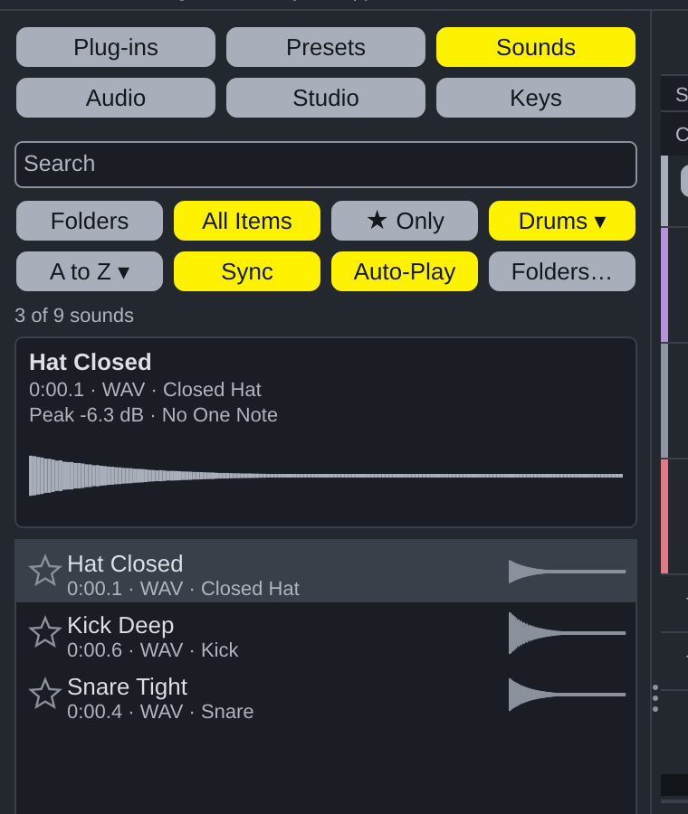

# 0106. Telling drum sounds: name, length and the shape of the hit; the scan at half a million sounds

## Context

Asked (21 November): an algorithm in the sample browser that detects whether
a sound is a drum from its length, its transient and its name (0105's
naming), a Drums button to filter by it, and the same logic in Kalibre
Drums. And: the musician has half a million samples; the scan's time is
fine, but it should save as it goes, say every 50,000.

## Decision

- **The hit's shape** (`audiotools::hitShape`): from the loudest of each
  millisecond of the first ten seconds, when it starts (a tenth of its
  loudest), how long it rises to nine tenths, how loud its last tenth is
  against its loudest (dB), and its brightness (zero crossings a second in
  the 50 ms after it starts). The scan hears it (analysis version 3); a sound
  read by version 2 has only that added, from its first 8.5 seconds, its
  loudness, note and tempo kept.
- **The verdict** (`Core/DrumSounds.*`, `drumsound::of`):
  - named as a drum in its file's name (Kick, BD, Snare, SD, Clap, HH, CH,
    OHH, Tom, Crash, Ride, Cymbal, Rim, Shaker, Perc...), not with a word that
    says it isn't one, and short (3 s; a cymbal 8 s), and not rising slowly:
    a drum of that kind;
  - named only by a folder (within three): also shaped like a hit (starts in
    60 ms, rises in 20 ms, its last tenth 12 dB down);
  - named by nothing: shaped like a hit and 2 s at most, its kind heard
    (a kick: dull, low or no pitch; a tom: pitched C2 to E4; very bright: a
    closed hat under 0.35 s, an open hat under 1.2 s, else a cymbal; bright:
    a snare); shown "(Heard)";
  - never: MIDI, loops (heard, or a tempo in the name), and names or nearby
    folders saying Loop, Fill, Groove, Break, Beat, Pad, Vocal, Chord, Keys,
    Lead, Synth, FX, Riser, Sweep, Bass (not Bass Drum)...;
  - a sound scanned before shapes were heard is judged from its waveform's
    160 columns.
- **Drums ▾** in the Sounds tab (`Settings::drumsOnly`, `drumKind`): All
  Sounds, All Drums, or a kind (Hats takes closed and open, Cymbals crash and
  ride). Each sound's kind in its details. Verdicts are kept
  (`drumsound::Cache`) and worked out again only when a sound changes.
- **Kalibre Drums' Random Samples** chooses only drums by the same verdict.
- **The scan at scale**: the index is written and read a sound a line
  (`library::writeIndex`, `readIndex`; the older single document still read),
  through a file beside it put in its place, so a save cut short leaves the
  last one whole; saved every 50,000 sounds read and at the end; handed to
  the list every 15 seconds while scanning a library over 20,000 (each
  hand-over copies it), every 0.4 s under; an index over 20 MB is opened on
  the scan's thread ("Opening the list of your sounds…"), not while Kalibre
  starts; quitting gives the scan 15 seconds to save.

## Consequences

- Half a million sounds, Release build on this Linux container: saving 2.7 s,
  opening 2.5 s, the first Drums list 3.7 s (most of it building the list,
  as All Items does), a search in it 0.7 s; the index 330 MB.
- The first scan after this reads the first seconds of every sound once.
- Hearing a kind is rough: claps sound like snares, and a bright tom like a
  snare; names, when there, always win.
- Tested: shapes of a kick, a hat, a pad and silence; the verdict on 30
  names as libraries write them, on folder-named and unnamed sounds by their
  shapes, on waveform columns; the filter and its kinds; a real scan with an
  unnamed noise hit heard as a closed hat; version 2 entries topped up, their
  loudness kept; the index a line a sound, and the old one read; a scan cut
  short carrying on; a big index opened on the scan's thread.

