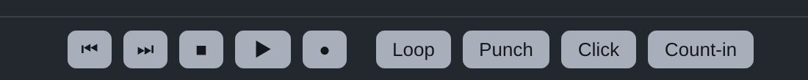

# 0107. Stop, and Go to End, in the transport

## Context

Asked (21 November): a Stop button in the transport bar that stops playback
and returns the song to the start; and a fast-forward button beside the
rewind one that skips to the end of all the clips on the timeline.

## Decision

- The transport, left to right: **⏮ Go to Start**, **⏭ Go to End**, **■ Stop**,
  **▶ Play**, **● Record**; then Loop, Punch, Click, Count-in (0095).
- **Go to End** (`Controller::goToEnd`, End): the cursor to where the last
  clip on any track ends (`Project::lastClipEnd`, the playing versions'
  clips, muted ones too); while playing, the playhead jumps there.
- **Stop** (`Controller::stopAndGoToStart`, Home): stops (finishing a
  recording, as Space does) and puts the cursor at the start; stopped
  already, the cursor goes to the start.
- **Play** always shows ▶, lit while playing; clicking it while playing stops
  and goes back to where playing began, as before. (It showed ■ while playing:
  two ■ side by side would have read the same.)
- In the Transport menu: Stop and Go to the Start, Go to the End; in the Keys
  tab, to give them other keys.
- Too narrow for the row (a small window at 200% text): Loop, Punch, Click and
  Count-in are hidden from the right, as the top bar hides what doesn't fit.

## Consequences

Tested: the order; Go to End at the last clip's end across two tracks, not a
version not playing; Stop while playing and stopped; Play lit while playing;
the keys; nothing off the edge at the smallest window and 200% text.

