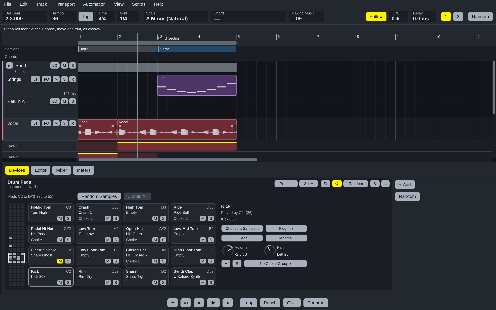

# 0128. Drum Pads: 128 pads of samples and plug-ins, sixteen shown

## Context

Asked (22 November): a device like Kalibre Drums (0105), called Drum Pads,
of 128 pads, 16 shown at a time, each pad playing a sample or a plug-in;
samples dragged over from the browser; choke groups, and volume, pan, mute
and solo for each pad.

## Decision

- **Drum Pads**, an instrument (Add > Kalibre > Drum Pads). **128 pads, one
  for each MIDI note**: pad 36 is played by note 36. So every note a clip or
  a keyboard can send has a pad, and General MIDI drum parts land where they
  should. A pad is named after its note's General MIDI drum ("Kick",
  "Closed Hat") between 35 and 81, else after the note ("C6"), until it's
  renamed. Kalibre writes middle C as C4.
- **Sixteen shown**, four rows of four, the lowest note at the bottom left,
  as on hardware pads. Beside them, **a map of all 128** (a row of four a
  line, the highest at the top): pads with a sound lit, the soloed in the
  accent, the muted dimmer, the sixteen shown framed. Click or drag in the
  map, or scroll over the pads, to show others, a row at a time. It opens on
  36 to 51 (the kick to the ride bell). Which sixteen are shown is kept with
  the song but isn't an undo step.
- **Each pad**: a **sample** (read whole into memory at the device's rate,
  30 s at most, played as a one-shot as loud as the hit: Kalibre Drums'
  reader, `readDrumSound`) or a **plug-in** (hosted inside as Kalibre Drums
  hosts them; a plug-in wins), the note its plug-in is sent (C4 unless
  chosen, or the pad's own), **volume** (-36 to +12 dB), **pan** (constant
  power, Kalibre's pan law), **mute**, **solo** (with any soloed, only the
  soloed are heard; Unsolo All), and a **choke group** (1 to 8; the hats,
  42, 44 and 46, are group 1 to start).
- **Choke**: a hit stops the other pads of its group. Their samples fade out
  in 2 ms, so the cut never clicks (Kalibre Drums cuts on the very sample);
  their plug-ins are sent their note-offs.
- **Onto a pad**: drag a sound from the Sounds tab or the Finder (several
  from the Finder: this pad and those above it), or a plug-in from the
  browser; or the pad's menu (right-click) or the chosen pad's controls:
  Choose a Sample…, Plug-in ▾, Clear. Click a pad to hear it and choose it:
  its controls show beside the pads (name, note, sound, Volume and Pan
  knobs, M, S, Choke Group ▾, the plug-in's note), its plug-in's window
  beside those.
- **Random Samples**: a drum of its kind (0106) for each of the sixteen
  shown, as Kalibre Drums' does; pads with plug-ins keep them.
- **No steps inside**: it is played by notes. The drum grid on its track
  has a row for each pad with a sound, named as it's named; its Random puts
  hits on those pads. Its track's clips open in the drum grid.
- **Engine** (`Engine/DrumPadsDevice.*`, `DrumPadsEditor.cpp`; `Core/DrumPads.*`):
  the audio thread is handed the kit whole through `Swap` (pads' gains, who
  is heard, the samples and plug-ins as shared pointers), so it never locks
  or allocates; a plug-in it played is let go on the message thread when
  Swap's bin is emptied. Each pad's voice is the audio thread's own. The
  pads are added at 64 bits and rounded once (0081). The state is JSON with
  only the pads that differ from an empty one.
- **Undo**: every edit in its window (a sound, a knob's drag, M, S, a
  choke group, a name, Random Samples) is one undo step, through
  `DrumPadsProcessor::edit`, which the Controller makes a plug-in state change.
- **Agents** (0099): add_plugin knows "Drum Pads"; clips' notes play it.

## Consequences

- One stereo output: pads can't go to tracks of their own yet; a pad's
  plug-in delay isn't compensated (drum synths have none).
- Volume, pan, mute and solo aren't parameters, so they aren't automated or
  learned.
- A pad plays one sound at a time: hit again, it starts again.
- Every plug-in on a pad runs each block, heard or not, as in Kalibre Drums;
  dozens of heavy synths on pads will cost what dozens of tracks would.
- Tested: each of 128 pads on its note, its level and constant-power pan,
  velocity; mute and solo; choke's 2 ms fade, and a pad outside the group
  playing on; a plug-in pad sounding, silent muted, its instance kept, its
  setting kept through the state; one undo step an edit; the drum grid's
  rows and the drum grid opening its clips; the window's sixteen with the
  lowest at the bottom left, a sound dropped on a pad, four from the Finder
  filling up to pad 127, the view kept with the song; M on a pad one undo
  step; Random Samples by kind. Neutral (`TestNeutral.cpp`): a pad at 0 dB
  in the centre at full velocity cancels against its sample, two pads are
  their sum rounded once. In Core: names, views, mute and solo, the state,
  Random Samples.

