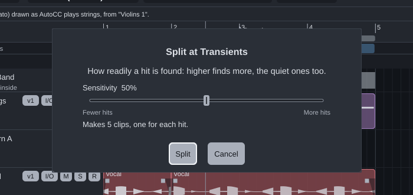

# 0130. Split at Transients asks how sensitive

## Context

Asked (23 November): wherever audio is split by transients, a threshold
control for how sensitive it is: higher finds more transients, lower fewer.

## Decision

- Every **Split at Transients** asks first (a question in the main window,
  0002): the clip's **Split at Transients…** (all the clips chosen), the
  lane's **Import Audio Here, Split at Transients…** (after the file), and
  the Sounds tab's **Put on the Chosen Track, Split at Transients…**.
- One slider, **Sensitivity**, 0 to 100% (as Kalibre Sampler's Slice
  Sensitivity, 0095): higher finds more hits, the quiet ones too (its floor
  falls from -50 to -70 dB and the rise it needs from 12 to 4 dB). Called
  Sensitivity rather than Threshold because a higher threshold usually means
  fewer; it works as asked, higher finding more. "Fewer hits" and "More
  hits" at its ends.
- **How many clips**, said as it moves ("Makes 5 clips, one for each
  hit."): every possible hit is found once (`audiotools::hitCandidates`),
  then the hits at a sensitivity are quick to pick (`hitsAt`), and the cuts
  are the very ones the split makes (`edit::cutsAtSource`, split out of
  `splitAtSource`).
- **Kept** (`Controller::transientSensitivity`, in Editing.json beside
  Studio.json): the next question starts there, and what doesn't ask follows
  it: the Sample Editor's hit marks, Quantise Audio to the Grid, agents'
  split_at_transients (which may also give `sensitivity`).

## Consequences

- A split is one more click than before (Split, or Return).
- Tested: the same signal at 0 and 1 (the loud hits, then the quiet too),
  never fewer as it's raised, the same as `transients` at each; a clip split
  at 0 and 1; an import split at 0; the question's count at 0 and 100% and
  its Split, the choice kept.

