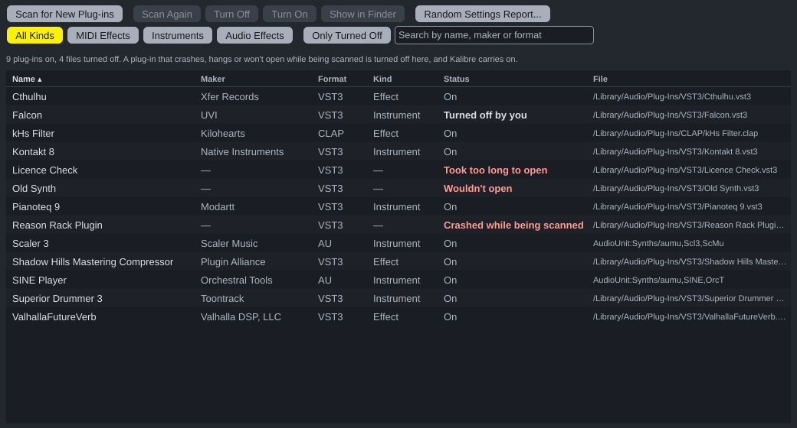

# 0131. Every list of plug-ins in three parts

## Context

Asked (23 November): any time a list of plug-ins is given, the plug-ins
separated out as MIDI Effects, Instruments and Effects. + Add and the
browser's Plug-ins tab were already (0069, 0125); the rest weren't.

## Decision

- One way to list plug-ins to choose from (`Engine/PluginMenu.*`,
  `pluginmenu::make`): a heading for each kind, **MIDI Effects**,
  **Instruments**, **Audio Effects**, in that order (the order they play in),
  and under each the makers, each with its plug-ins. Only the kinds a place
  takes; an instrument that sends MIDI is under MIDI Effects too (0069), and
  is chosen as one there.
- Used by: a clip's offline effects (audio effects; before, MIDI effects
  slipped in), the Container, Multiband and Stereo Split (audio effects),
  X/Y Morph's corners (instruments and audio effects; before, one long
  list), Kalibre Drums' and Drum Pads' **Play It with a Plug-in**
  (instruments).
- **+ Add > Kalibre**: Kalibre's own devices under the same three headings
  (X/Y Morph under Instruments and Audio Effects), the kind no longer
  written after each name.
- **The Plug-in Manager**: All Kinds, MIDI Effects, Instruments, Audio
  Effects, a second row of buttons with Only Turned Off and the search; its
  Kind column says Audio Effect, as the headings do.

## Consequences

- A place that takes one kind still shows its heading, so it's plain what's
  listed.
- Tested: the three parts in order with the right plug-ins (a MIDI-sending
  instrument in two), one part for the Container, a MIDI-sending instrument
  chosen as a MIDI effect; the Plug-in Manager's four buttons.

