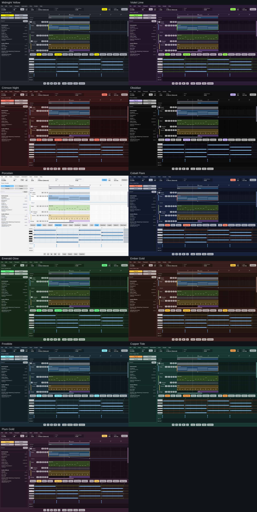

# 0132. Themes

## Context

Asked (23 November): a set of about ten themes in the View menu, each named
for its colours, among them a black one and a white one. Until now Kalibre
had one look, the house scheme (docs/COLOUR.md), with every colour a
constant in `Theme.h`.

## Decision

- **View > Themes**: eleven, the house scheme first, ticked when chosen,
  kept for next time (in the settings, `theme`). Choosing one says so in the
  message line and redraws everything at once, plug-in panels and open
  windows too.

  | Theme | Ground | On (the accent) |
  | --- | --- | --- |
  | Midnight Yellow | cool blue-grey | yellow: the house scheme, unchanged |
  | Violet Lime | deep purple | lime green |
  | Crimson Night | dark red | coral |
  | Obsidian | near black | lavender |
  | Porcelain | white (dark words) | sky blue |
  | Cobalt Flare | navy | flame orange |
  | Emerald Glow | dark green | bright green |
  | Ember Gold | burnt red-brown | gold |
  | Frostbite | icy teal | ice blue |
  | Copper Tide | deep teal | copper orange |
  | Plum Gold | plum | honey gold |

- The colours in `Theme.h` are still named by role, and still the only place
  a colour comes from; they're now variables, set together by
  `theme::usePalette`. A theme other than the first is made from a hue, how
  strongly the greys lean to it, its accent and its warning words
  (`Theme.cpp`, `build`), on the house scheme's ramp of lightness (inverted
  for Porcelain), then each word colour is moved lighter or darker until it
  reads at 7:1 on everything it sits on, buttons' ink at 7:1 on them, edges
  at 3:1.
- The greys lean blue (R < G < B) in the house scheme; in the others they
  lean to the theme's own hue.
- A track, clip, section or note colour with words on it goes through
  `theme::underWords`: darkened in dark themes, paled in Porcelain, then
  moved until the words read at 7:1. `theme::fade` dims a colour the same
  way (a step's velocity); `theme::veil` greys out what's outside a clip.
- Nothing keeps a colour copied from the theme: a JUCE colour set on a
  component (`setColour`) is set again when the look changes
  (`lookAndFeelChanged`), or not set at all and taken from the look.

## Consequences

- Track colours stay the same in every theme: they're the music's, not the
  window's.
- Tested: about ten, every word 7:1 on what it sits on in each, the first
  the house scheme unchanged, one light among them; names on sections,
  clips and notes 7:1 in each; View > Themes sets every colour, redraws and
  is kept.

