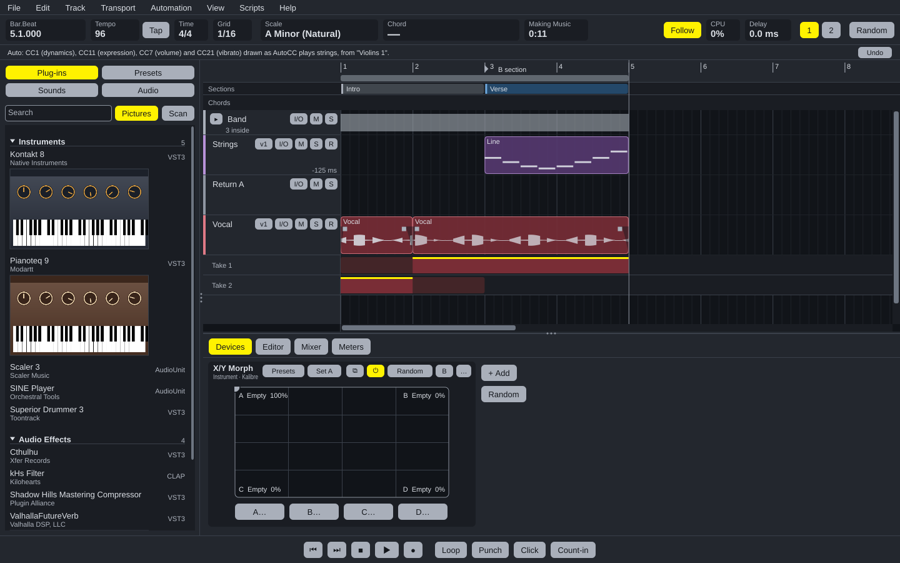
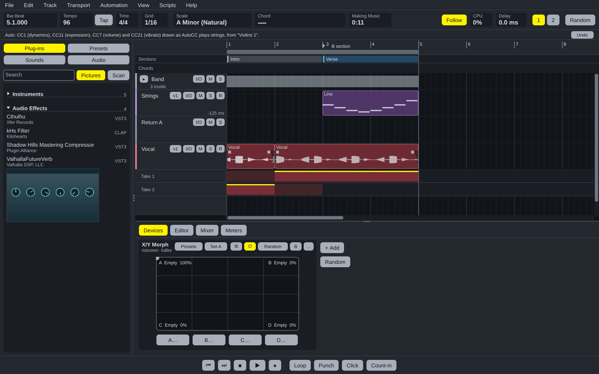

# 0138. Plug-in pictures, and the browser's headings fold

## Context

Asked (26 November): in the browser, the plug-ins' headings (MIDI Effects,
Instruments, Audio Effects) collapsible. Plug-ins shown with a screenshot of
their window in the browser: a button in the Plug-in Manager that opens each
plug-in, takes the screenshot, saves it to Kalibre's library, shows it in the
browser under the plug-in's name and closes the plug-in before the next; and a
photo button on each plug-in's panel that takes a new one. Then: an option to
hide the pictures.

## Decision

- **Headings fold.** Click a heading in the Plug-ins tab: its plug-ins fold
  away, a ▸ before it, the count still beside it; click again, ▾, open.
  Remembered between starts (`pluginHeadingsShut` in Kalibre's settings).
  While searching, everything found shows, folded or not: a search that
  finds nothing because a heading was folded would look broken.
- **Pictures in the browser** (`App/PluginPictures.*`): a plug-in with a
  picture shows it under its name, four rows tall, as wide as fits, its
  shape kept, never made bigger. The list is a ListBox with rows of one
  height, so the picture is drawn across the rows after the plug-in, each
  drawing its own part; choosing or dragging one of those rows chooses or
  drags the plug-in. **Pictures**, beside Scan, hides them (names only) and
  shows them again; remembered (`pluginPictures`).
- **Kept in Kalibre's library**: Application Support/Kalibre/Plug-in
  Pictures (Windows: AppData\Roaming\Kalibre; Linux: ~/.config/Kalibre), a
  PNG for each plug-in named for its maker and name ("Xfer Records -
  Serum.png"): its VST3, AU and CLAP look the same, so they share it, and
  the folder is readable by hand. No wider than 1600 pixels; read back for
  the browser at most 720 by 360, the 120 last drawn held in memory.
- **Take Pictures** (the Plug-in Manager): every plug-in without a picture,
  one of each name, in turn (`pictures::Taker`): made, prepared, its window
  opened in a window of its own in front of everything, photographed after
  1.5 s (time to draw), the window closed (the plug-in told first, 0056; the
  window retired, 0115), the plug-in let go of, then the next. Its progress
  in the Plug-in Manager's line; **Stop Taking Pictures** stops it; the
  message line says how many, and which couldn't be and why. A plug-in with
  no window of its own gets none. Right-click chosen ones > **Take Their
  Pictures Again**.
- **The camera button** on a plug-in's panel (plug-ins only: Kalibre's own
  devices aren't in the browser's list): the window moved out at its own size
  for a moment (as ⧉ does), photographed, and put back
  (`DeviceRack::photograph`). The browser shows the new one at once.
- **The picture is what's on the screen**: a plug-in's window is a native
  view Kalibre never draws, so it's read back through each system's own
  call. Mac: the window server's copy of Kalibre's own window
  (`CGWindowListCreateImage`, looked up at run time as Apple has marked it
  for replacement), else AppKit asked to draw the view. Windows:
  `PrintWindow` with `PW_RENDERFULLCONTENT` (DirectX too), else the screen.
  Linux: X11's `XGetImage` of the window, else of the screen. Where all of
  that gives one colour all over, Kalibre draws the component itself.
- **Crashes**: plug-ins are opened in Kalibre itself, as they are when added
  to a track (they passed the scan's helper first, 0047). The one being
  photographed is noted (`Taking.txt`) before it opens; if Kalibre closes
  meanwhile, it's put in `Skipped.txt` and Take Pictures passes over it from
  then on, saying so.

## Consequences

- On the Mac, macOS may ask once whether Kalibre may record the screen.
  Kalibre only reads its own windows; without the permission most plug-ins'
  pictures still come through AppKit, but one drawn with Metal may not.
- Each plug-in shows for about 1.5 s: 200 plug-ins take about six minutes,
  windows coming and going meanwhile.
- A plug-in that needs longer to draw (a big sample library loading) may be
  photographed half drawn: its camera button takes it again.
- Tested: the file names and sizes, one picture for every format; Take
  Pictures with a fake plug-in that draws blue with a light square (the
  picture read back from the screen through X11 has both colours where they
  are), one with no window, one that won't open, one noted as having closed
  Kalibre; the camera button moves the window out and back and keeps the
  picture; a heading folded and opened, a search showing what's folded, the
  picture's rows under its plug-in, choosing them choosing the plug-in, and
  the Pictures button hiding them. Untried with real plug-ins on a Mac or a
  PC.

